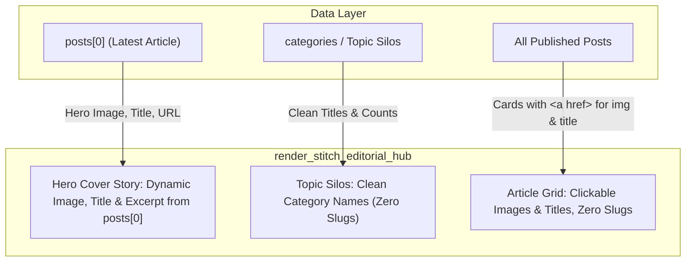
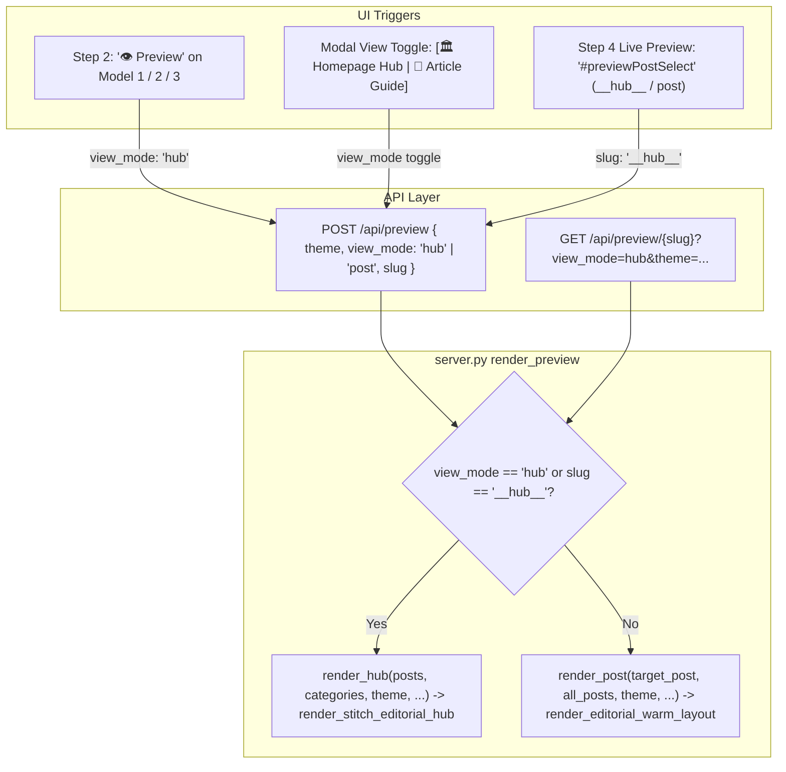

# Architecture Specification: homeandrecipe-cloaker Modernization

**Project**: Modernization & Security Refactoring for `c:\Users\mouni\Desktop\my-cloakers`  
**Role**: Technical Architect / Master Orchestrator  
**Status**: APPROVED BLUEPRINT  
**Date**: 2026-11-02  

---

## 5. Theme & Routing Architecture Visual Preview System

### 5.1 Overview & User Need
Users configuring site generation in the Dashboard require visual representation of available visual templates (`editorial-warm`, `nordic-studio`, `pinterest-mag`) and multi-slug routing structures (`single`, `category_slug`, `parent_slug`, `silo_nested`) prior to triggering builds or deployments.

### 5.2 Component Contracts
1. **Interactive Theme Cards (`.theme-card`)**:
   - Render palette swatches (`bg_body`, `text_body`, `accent`, `badge_bg`), font declarations, layout badge, and feature bullets.
   - Synchronize with hidden/visible `#cfgTheme` select input and `#previewThemeSelect`.
   - Provide direct "👁️ Preview Template" modal launcher.
2. **Interactive Routing Architecture Visualizer (`.routing-card`)**:
   - Render tree diagram (`/` -> `subfolder` -> `slug`), real-world URL preview, breadcrumb structure, and SEO use-case tags.
   - Synchronize with `#cfgRoutingMode` select input and `#previewRoutingSelect`.
3. **Template Live Preview Modal (`#templatePreviewModal`)**:
   - Responsive iframe modal with viewport toggle (Desktop / Tablet / Mobile).
   - Renders live theme output via `/api/preview` using sample post or active post.
   - Dispatches `Escape` key listeners and backdrop close.

## 4. GitHub PAT Masking & Verification Architecture (pSEO Dashboard)

### 4.1 Root Cause of Invalid/Expired Token False Alert
- When `GET /api/config` runs, `mask_token` returns `{token[:4]}****{token[-4:]}` (e.g. `ghp_PXb7****1pE`).
- In `app.js`, `loadGithubAccounts()` evaluated `activeToken.startsWith('****')`. Because `ghp_...` does not start with `****`, it passed the masked token to `POST /api/github/orgs`.
- In `server.py`, the endpoint evaluated `token.startswith("****")`, bypassing fallback and making an upstream call to `https://api.github.com/user` with `Bearer ghp_PXb7****1pE`, causing HTTP 401 Unauthorized.
- Frontend received `token_invalid: true` and displayed `"The GitHub Token entered is invalid or expired."`, leading users to believe saved tokens were rejected.

### 4.2 Solution Contracts
1. **Server Fallback (`server.py`)**:
   - In `/api/github/orgs` (both GET and POST), `/api/github/check-org`, and `/api/github/create-repo`:
     ```python
     if not raw_token or "****" in raw_token:
         token = self.manager.config.github.token
     ```
   - In `update_config_from_dict`: only update `self.config.github.token` if incoming token is non-empty and does not contain `"****"`.
2. **Client Token Guard (`app.js`)**:
   - In `loadGithubAccounts()`, check `customToken && !customToken.includes('****') ? customToken : (inputToken && !inputToken.includes('****') ? inputToken : '')`. If no new unmasked token is provided, pass empty string to let the server use its saved PAT.
   - Guard against sending masked token in `btnCheckCreateOrg`, `btnCreateRepoNow`, and `settingsForm` submit.

## 1. File Structure & Ownership Map

```
c:\Users\mouni\Desktop\my-cloakers\
├── .gitignore                      [M1: Created — Git ignores sensitive/build/runtime files]
├── package.json                    [M1/M4: Maintained — dependencies, test script]
├── wrangler.toml                   [M2: Configured — D1 database binding & cron trigger]
├── dashboard-config.json           [M1: Scrubbed — no cfoat_... secret, safe defaults]
├── dashboard-campaigns.json        [M1: Normalized — unique IDs, uniform schema]
├── server.js                       [M2: Refactored — parameterized SQL, token precedence, in-memory cache, schema normalization]
├── src/
│   └── index.js                    [M2: Refactored — COUNT(DISTINCT), ctx.waitUntil, safe stringification, cron handler]
├── public/
│   └── index.html                  [M3: Refactored — WCAG 2.2 AA accessibility, labels, modal dialog, visibility polling, campaign cards]
└── test/
    ├── endpoints.test.js           [M4: Maintained — 100% pass]
    ├── health.test.js              [M4: Maintained — 100% pass]
    ├── server.test.js              [M4: Maintained — 100% pass]
    ├── startup.test.js             [M4: Maintained — 100% pass]
    └── modernization.test.js       [M4: Created — automated tests for SQLi, token precedence, campaign upsert, Worker distinct count query logic, a11y]
```

**Deleted Files (Legacy & Scratch)**:
- `scratch/*` (all 33 files)
- `last cloaking.js`
- `last cloaking - Copie.js`
- `worker-single-file.js`
- `src/themes/cloak.js`
- `src/themes/` (directory)

---

## 5. Theme & Routing Architecture Visual Preview System

### 5.1 Overview & User Need
Users configuring site generation in the Dashboard require visual representation of available visual templates (`editorial-warm`, `nordic-studio`, `pinterest-mag`) and multi-slug routing structures (`single`, `category_slug`, `parent_slug`, `silo_nested`) prior to triggering builds or deployments.

### 5.2 Component Contracts
1. **Interactive Theme Cards (`.theme-card`)**:
   - Render palette swatches (`bg_body`, `text_body`, `accent`, `badge_bg`), font declarations, layout badge, and feature bullets.
   - Synchronize with hidden/visible `#cfgTheme` select input and `#previewThemeSelect`.
   - Provide direct "👁️ Preview Template" modal launcher.
2. **Interactive Routing Architecture Visualizer (`.routing-card`)**:
   - Render tree diagram (`/` -> `subfolder` -> `slug`), real-world URL preview, breadcrumb structure, and SEO use-case tags.
   - Synchronize with `#cfgRoutingMode` select input and `#previewRoutingSelect`.
3. **Template Live Preview Modal (`#templatePreviewModal`)**:
   - Responsive iframe modal with viewport toggle (Desktop / Tablet / Mobile).
   - Renders live theme output via `/api/preview` using sample post or active post.
   - Dispatches `Escape` key listeners and backdrop close.

## 4. GitHub PAT Masking & Verification Architecture (pSEO Dashboard)

### 4.1 Root Cause of Invalid/Expired Token False Alert
- When `GET /api/config` runs, `mask_token` returns `{token[:4]}****{token[-4:]}` (e.g. `ghp_PXb7****1pE`).
- In `app.js`, `loadGithubAccounts()` evaluated `activeToken.startsWith('****')`. Because `ghp_...` does not start with `****`, it passed the masked token to `POST /api/github/orgs`.
- In `server.py`, the endpoint evaluated `token.startswith("****")`, bypassing fallback and making an upstream call to `https://api.github.com/user` with `Bearer ghp_PXb7****1pE`, causing HTTP 401 Unauthorized.
- Frontend received `token_invalid: true` and displayed `"The GitHub Token entered is invalid or expired."`, leading users to believe saved tokens were rejected.

### 4.2 Solution Contracts
1. **Server Fallback (`server.py`)**:
   - In `/api/github/orgs` (both GET and POST), `/api/github/check-org`, and `/api/github/create-repo`:
     ```python
     if not raw_token or "****" in raw_token:
         token = self.manager.config.github.token
     ```
   - In `update_config_from_dict`: only update `self.config.github.token` if incoming token is non-empty and does not contain `"****"`.
2. **Client Token Guard (`app.js`)**:
   - In `loadGithubAccounts()`, check `customToken && !customToken.includes('****') ? customToken : (inputToken && !inputToken.includes('****') ? inputToken : '')`. If no new unmasked token is provided, pass empty string to let the server use its saved PAT.
   - Guard against sending masked token in `btnCheckCreateOrg`, `btnCreateRepoNow`, and `settingsForm` submit.

## 2. Data Contracts & Routing Patterns

### 2.1 Campaign Model Contract
All campaign records created via `/api/campaigns`, `/api/deploy`, or stored in `dashboard-campaigns.json` MUST adhere to the following schema:
```typescript
interface Campaign {
  id: string;               // Normalized slug (e.g. "homeandrecipe-com-cloaker")
  name: string;             // Display name (e.g. "Home and Recipe Cloaker")
  sourceDomain: string;     // Clean hostname without protocol (e.g. "homeandrecipe.com")
  safeUrl: string;          // Safe site origin URL (e.g. "https://homeandrecipe.com")
  targetDomain: string;     // Destination redirect URL (e.g. "https://asqstyle.com")
  moneyUrl: string;         // Alias of targetDomain (e.g. "https://asqstyle.com")
  workerName: string;       // Worker script name (e.g. "homeandrecipe-com-cloaker")
  activationMethod: 'trigger' | 'visitor_threshold';
  triggerCondition: 'scroll' | 'click' | 'both';
  scrollPct: number;        // integer percent, default 15
  thresholdCount: number;   // integer threshold, default 8
  routes: string[];         // e.g. ["homeandrecipe.com/*", "www.homeandrecipe.com/*"]
  status: 'active' | 'inactive';
  createdAt: string;        // ISO 8601 string
  deployedAt?: string;      // ISO 8601 string
}
```

### 2.2 D1 Analytics Query Contract
- Table: `url_human_visits (post_path TEXT NOT NULL, visitor_hash TEXT NOT NULL, visited_at TEXT NOT NULL, country TEXT DEFAULT 'US')`
- Query Distinct Visitor Count:
  ```sql
  SELECT COUNT(DISTINCT visitor_hash) as cnt, 
         MAX(CASE WHEN visitor_hash = ?2 THEN 1 ELSE 0 END) as seen 
  FROM url_human_visits 
  WHERE post_path = ?1 AND visited_at >= datetime('now', '-24 hours')
  ```
- Parameterized Batch Simulation:
  ```sql
  INSERT INTO url_human_visits (post_path, visitor_hash, visited_at, country) 
  VALUES (?, ?, datetime('now'), ?), (?, ?, datetime('now'), ?), ...
  ```
  with parameter array `[cleanPostPath, randHash1, cleanCountry, cleanPostPath, randHash2, cleanCountry, ...]`.

---

## 5. Theme & Routing Architecture Visual Preview System

### 5.1 Overview & User Need
Users configuring site generation in the Dashboard require visual representation of available visual templates (`editorial-warm`, `nordic-studio`, `pinterest-mag`) and multi-slug routing structures (`single`, `category_slug`, `parent_slug`, `silo_nested`) prior to triggering builds or deployments.

### 5.2 Component Contracts
1. **Interactive Theme Cards (`.theme-card`)**:
   - Render palette swatches (`bg_body`, `text_body`, `accent`, `badge_bg`), font declarations, layout badge, and feature bullets.
   - Synchronize with hidden/visible `#cfgTheme` select input and `#previewThemeSelect`.
   - Provide direct "👁️ Preview Template" modal launcher.
2. **Interactive Routing Architecture Visualizer (`.routing-card`)**:
   - Render tree diagram (`/` -> `subfolder` -> `slug`), real-world URL preview, breadcrumb structure, and SEO use-case tags.
   - Synchronize with `#cfgRoutingMode` select input and `#previewRoutingSelect`.
3. **Template Live Preview Modal (`#templatePreviewModal`)**:
   - Responsive iframe modal with viewport toggle (Desktop / Tablet / Mobile).
   - Renders live theme output via `/api/preview` using sample post or active post.
   - Dispatches `Escape` key listeners and backdrop close.

## 4. GitHub PAT Masking & Verification Architecture (pSEO Dashboard)

### 4.1 Root Cause of Invalid/Expired Token False Alert
- When `GET /api/config` runs, `mask_token` returns `{token[:4]}****{token[-4:]}` (e.g. `ghp_PXb7****1pE`).
- In `app.js`, `loadGithubAccounts()` evaluated `activeToken.startsWith('****')`. Because `ghp_...` does not start with `****`, it passed the masked token to `POST /api/github/orgs`.
- In `server.py`, the endpoint evaluated `token.startswith("****")`, bypassing fallback and making an upstream call to `https://api.github.com/user` with `Bearer ghp_PXb7****1pE`, causing HTTP 401 Unauthorized.
- Frontend received `token_invalid: true` and displayed `"The GitHub Token entered is invalid or expired."`, leading users to believe saved tokens were rejected.

### 4.2 Solution Contracts
1. **Server Fallback (`server.py`)**:
   - In `/api/github/orgs` (both GET and POST), `/api/github/check-org`, and `/api/github/create-repo`:
     ```python
     if not raw_token or "****" in raw_token:
         token = self.manager.config.github.token
     ```
   - In `update_config_from_dict`: only update `self.config.github.token` if incoming token is non-empty and does not contain `"****"`.
2. **Client Token Guard (`app.js`)**:
   - In `loadGithubAccounts()`, check `customToken && !customToken.includes('****') ? customToken : (inputToken && !inputToken.includes('****') ? inputToken : '')`. If no new unmasked token is provided, pass empty string to let the server use its saved PAT.
   - Guard against sending masked token in `btnCheckCreateOrg`, `btnCreateRepoNow`, and `settingsForm` submit.

## 3. Worker Implementation Architecture

### 3.1 Role Allocations & Worker Boundaries
1. **Repository Hygiene & Schema Worker (M1)**:
   - Owns: File system deletions (`scratch/*`, legacy files), `.gitignore`, `dashboard-config.json` secret scrubbing, `dashboard-campaigns.json` schema normalization.
2. **Backend & Cloudflare Worker Security Worker (M2)**:
   - Owns: `server.js`, `src/index.js`, `wrangler.toml`.
   - Responsibilities: SQL injection parameterization, in-memory caching with async disk writes, token precedence fix, Worker `COUNT(DISTINCT visitor_hash)`, `ctx.waitUntil()` offload, safe redirect URL stringification.
3. **UI / Theme Worker (M3)**:
   - Owns: `public/index.html`.
   - Responsibilities: WCAG 2.2 AA accessibility (`role="radiogroup"`, `role="radio"`, `aria-checked`, `tabindex="0"`, keyboard handlers), `<label for="...">` associations, settings modal dialog & `Escape` key close, visibility-aware analytics polling, campaign card rendering fallback & delete action, dynamic threshold synchronization.
4. **Automated Verification & Adversarial QA Worker (M4)**:
   - Owns: `test/modernization.test.js`.
   - Responsibilities: Local offline test suite validating R1–R4 requirements, zero live network credentials needed, 100% pass rate.

---

## 5. Theme & Routing Architecture Visual Preview System

### 5.1 Overview & User Need
Users configuring site generation in the Dashboard require visual representation of available visual templates (`editorial-warm`, `nordic-studio`, `pinterest-mag`) and multi-slug routing structures (`single`, `category_slug`, `parent_slug`, `silo_nested`) prior to triggering builds or deployments.

### 5.2 Component Contracts
1. **Interactive Theme Cards (`.theme-card`)**:
   - Render palette swatches (`bg_body`, `text_body`, `accent`, `badge_bg`), font declarations, layout badge, and feature bullets.
   - Synchronize with hidden/visible `#cfgTheme` select input and `#previewThemeSelect`.
   - Provide direct "👁️ Preview Template" modal launcher.
2. **Interactive Routing Architecture Visualizer (`.routing-card`)**:
   - Render tree diagram (`/` -> `subfolder` -> `slug`), real-world URL preview, breadcrumb structure, and SEO use-case tags.
   - Synchronize with `#cfgRoutingMode` select input and `#previewRoutingSelect`.
3. **Template Live Preview Modal (`#templatePreviewModal`)**:
   - Responsive iframe modal with viewport toggle (Desktop / Tablet / Mobile).
   - Renders live theme output via `/api/preview` using sample post or active post.
   - Dispatches `Escape` key listeners and backdrop close.

## 4. GitHub PAT Masking & Verification Architecture (pSEO Dashboard)

### 4.1 Root Cause of Invalid/Expired Token False Alert
- When `GET /api/config` runs, `mask_token` returns `{token[:4]}****{token[-4:]}` (e.g. `ghp_PXb7****1pE`).
- In `app.js`, `loadGithubAccounts()` evaluated `activeToken.startsWith('****')`. Because `ghp_...` does not start with `****`, it passed the masked token to `POST /api/github/orgs`.
- In `server.py`, the endpoint evaluated `token.startswith("****")`, bypassing fallback and making an upstream call to `https://api.github.com/user` with `Bearer ghp_PXb7****1pE`, causing HTTP 401 Unauthorized.
- Frontend received `token_invalid: true` and displayed `"The GitHub Token entered is invalid or expired."`, leading users to believe saved tokens were rejected.

### 4.2 Solution Contracts
1. **Server Fallback (`server.py`)**:
   - In `/api/github/orgs` (both GET and POST), `/api/github/check-org`, and `/api/github/create-repo`:
     ```python
     if not raw_token or "****" in raw_token:
         token = self.manager.config.github.token
     ```
   - In `update_config_from_dict`: only update `self.config.github.token` if incoming token is non-empty and does not contain `"****"`.
2. **Client Token Guard (`app.js`)**:
   - In `loadGithubAccounts()`, check `customToken && !customToken.includes('****') ? customToken : (inputToken && !inputToken.includes('****') ? inputToken : '')`. If no new unmasked token is provided, pass empty string to let the server use its saved PAT.
   - Guard against sending masked token in `btnCheckCreateOrg`, `btnCreateRepoNow`, and `settingsForm` submit.

## 4. Security & Performance Guardrails
- **Zero Secret Leakage**: No tokens matching `cfoat_...` or Cloudflare credentials may exist in configuration files or code.
- **Strict Token Precedence**: User-configured `apiToken` > defaults.
- **Asynchronous Disk I/O**: `fs.promises.writeFile` exclusively on write; in-memory cache for reads. No blocking `fs.readFileSync` or `fs.writeFileSync` in request handlers.
- **Script Injection Neutralization**: All dynamic redirects in HTML must escape `<` to `\u003c` and `>` to `\u003e`.
- **Keyboard & Screen Reader Completeness**: Every interactive element must be operable via `Tab`, `Enter`, and `Space`, and identified via proper WAI-ARIA roles.

---

## 6. Three Distinct Theme Models & Static Image Preview System Architecture

### 6.1 Problem & Root Cause
1. **Preview Image MIME Corruption**: `app/dashboard/server.py` served static files only from `app/dashboard/static/`. Any request to `/assets/images/<file>.webp` hit the SPA fallback returning `index.html` (MIME `text/html`), breaking all image rendering inside the preview iframe.
2. **Visual Monoculture**: The three themes (`editorial-warm`, `nordic-studio`, `pinterest-mag`) shared virtually identical single-column DOM trees, differing only by color tokens. Users could not distinguish the architectural models before building.
3. **Missing Realistic Content & Assets**: The preview system lacked real imagery and authentic editorial/architectural/social copy tailored to each theme model.

### 6.2 Component Contracts & Technical Specifications

#### 1. Backend Static Asset Route (`app/dashboard/server.py`)
- **Route**: `GET /assets/images/<path>`
- **Behavior**: Intercept in `do_GET` prior to static SPA fallback. Map to `os.path.abspath(os.path.join("assets", "images", rel_path))`.
- **MIME Resolution**:
  - `.webp` -> `image/webp`
  - `.jpg` / `.jpeg` -> `image/jpeg`
  - `.png` -> `image/png`
  - `.svg` -> `image/svg+xml`
- **Headers**: `Content-Type`, `Content-Length`, `Cache-Control: public, max-age=86400`.
- **Preview Endpoint (`POST /api/preview`)**: When rendering demo preview, assign model-specific high-resolution photography (`/assets/images/...`) and realistic lifestyle/architectural/discovery copy.

#### 2. Theme Engine Layout Renderers (`app/themes/templates.py`)
- Dispatch `render_post(post, theme=...)` into 3 layout renderers:
  1. `render_editorial_warm_layout()`:
     - Centered Kinfolk lifestyle journal container (`max-w-4xl`) with ivory background (`#FAF8F5`).
     - Playfair Display serif typography, large drop-cap (`float: left; font-size: 3.5rem; line-height: 0.8; margin-right: 0.75rem;`).
     - "Curator Sourcing Notes" box detailing textile origins, artisan ceramics, and warm wood accents.
     - Interactive Room Styling Checklist with warm ivory checkbox cards and state transitions.
     - Primary Demo Image: `/assets/images/15-home-bedroom-refresh-ideas-transform-your-oasis.webp`.
  2. `render_nordic_studio_layout()`:
     - Asymmetric 2-column studio layout (`grid grid-cols-1 lg:grid-cols-12 gap-8`, 7 cols article : 5 cols specs).
     - Geometric Plus Jakarta Sans modern clean sans-serif typography, cool slate/mist tones (`#F3F5F4`).
     - "Architectural Specification Drawer" with technical metadata:
       - Room Dimensions: `14' x 16' (224 sq ft)`
       - Lighting Color Temperature: `2700K Warm Neutral Kelvin (CRI 95+)`
       - Flooring & Millwork: `Select Grade White Oak Herringbone + Matte Black Aluminum`
     - Technical Room Build Checklist with step numbers and progress markers.
     - Primary Demo Image: `/assets/images/20-modern-bedroom-ideas-transform-your-space-with-style.webp`.
  3. `render_pinterest_mag_layout()`:
     - Visual Discovery Pinboard magazine layout with high-fashion porcelain background (`#FFFDF9`).
     - Floating sticky pill: `"📌 Save to Pinterest Board"` with quick copy/share hooks.
     - 2-Column visual moodboard inspiration card grid with photo badges.
     - "Viral Pin Performance Score" leaderboard:
       - Repin Score: `98% Viral Save Score`
       - Community Tags: `#IKEAHack #CoastalDecor #NeutralAesthetic`
     - Visual Key Takeaways with numbered badges.
     - Primary Demo Image: `/assets/images/16-coastal-bedroom-decor-essentials-transform-your-space.webp`.

#### 3. Client-Side Model Switcher (`app/dashboard/static/index.html` & `app.js`)
- Dedicated 1-click model switcher buttons in `#tab-preview`:
  - `[ 📖 Model 1: Editorial Warm ]`
  - `[ 📐 Model 2: Nordic Studio ]`
  - `[ 📌 Model 3: Pinterest Mag ]`
- On button click:
  - Synchronize theme select dropdown and visual card selection.
  - Automatically populate title, excerpt, and image URL tailored to that model.
  - Trigger immediate iframe preview re-render.
- Support fullscreen modal preview testing across Desktop (100%), Tablet (768px), and Mobile (375px) viewports.

### 6.3 Verification Criteria
- All 132 tests in `run_tests.py` continue to pass with 0 regressions.
- `GET /assets/images/15-home-bedroom-refresh-ideas-transform-your-oasis.webp` returns HTTP 200 with `Content-Type: image/webp` and non-empty binary payload.
- All 3 models return distinct DOM structures in `POST /api/preview`.
- Zero placeholder code (`TODO`, `FIXME`, stubs).

---

## 7. Mobile Blogger Design Modernization: Header, Footer, and SVG Logo Identity System

### 7.1 Problem Statement
- **Mobile Experience Lacks Blogger Aesthetic**: On mobile viewports, pages previously presented bare-bones navigation (a plain breadcrumb row and raw text link) without a recognizable blog header, brand identity, or author attribution.
- **Missing Brand Logo**: The site possessed no graphical or vector logo mark, leaving headers looking generic and unbranded.
- **Single-Line Footer**: Footers previously consisted of a single centered `<p>` tag, lacking the multi-column structure, category discovery hubs, editorial disclosure, and newsletter engagement typical of high-traffic lifestyle blogs.

### 7.2 Architecture & Component Contracts

#### 1. Vector Logo & Brand Identity System (`render_blogger_logo()`)
- **Dual Vector Assets**:
  - `assets/images/logo.svg`: Full horizontal brand mark with architectural arch/leaf emblem, publication title (`ANNADECO`), and subtitle (`INTERIORS & LIVING JOURNAL`).
  - `assets/images/logo-badge.svg`: Compact circular monogram badge (`AD`) for mobile headers, byline avatars, and favicon scaling.
- **Inline SVG Helper (`render_blogger_logo(brand_name, theme_tokens, compact=False)`)**:
  - Embedded directly into rendered templates to eliminate external network requests and prevent layout shift (CLS).
  - Adapts accent colors, stroke widths, and typography tokens based on the active theme (`editorial-warm`, `nordic-studio`, `pinterest-mag`).

#### 2. Sticky Blogger Header Architecture (`render_blogger_header()`)
- **Top Announcement / Meta Bar**:
  - Micro-bar displaying breadcrumb navigation, current publication volume/date (`Vol. 04 · Nov 2026`), and quick external link or Pinterest shortcut.
- **Primary Brand Bar**:
  - Prominent Logo Emblem & Brand Typography linking to root `/`.
  - Responsive action buttons: "📌 Follow" or "Explore Hub".
- **Mobile-Optimized Category Swipe Bar**:
  - Touch-friendly horizontal pill bar with `-webkit-overflow-scrolling: touch; scrollbar-width: none;`.
  - Clean pills with active hover/tap states allowing seamless category browsing on small screens.
- **Sticky Blur Container**:
  - Positioned sticky at `top: 0` with `z-index: 50`, `backdrop-filter: blur(12px)`, and `background: rgba(255, 255, 255, 0.94)`.

#### 3. Blogger Author Byline & Social Meta
- Integrated at top of article body:
  - Author avatar monogram badge (`AD`).
  - "By Anna Deco Editorial Studio · 5 min read · Updated [Date]".
  - Social quick-share / Pinterest save button for instant viral capture on mobile.

#### 4. Multi-Column Blogger Footer Architecture (`render_blogger_footer()`)
- **Column 1 (Brand & Manifesto)**:
  - Vector logo badge + brand title.
  - Editorial mission statement: *"An independent design archive and visual lifestyle publication. Curating room makeovers, architectural details, and intentional interior styling."*
  - Social icons & discovery tags (Pinterest, Instagram, RSS, Studio Tour).
- **Column 2 (Curated Editorial Hubs)**:
  - Direct links to key content silos: Bedroom Sanctuaries, Minimalist Architecture, Coastal Living, Kitchen & Dining, IKEA Hacks & Storage.
- **Column 3 (The Weekly Room Edit / Newsletter)**:
  - Engagement widget: *"Join 24,000+ decor lovers: Receive our weekly room makeover ideas and DIY styling checklists."*
  - Interactive email form with client-side validation & toast feedback.
- **Bottom Bar**:
  - Copyright statement: `© 2026 AnnaDeco Lifestyle Journal. All rights reserved.`
  - Editorial Transparency & Affiliate Disclosure: *"AnnaDeco is a reader-supported publication. When you purchase through our links, we may earn an affiliate commission."*
  - Legal links (Privacy Policy, Terms of Service, Sitemap) + Back to Top smooth scroll button.

### 7.3 Verification Requirements
- 132/132 automated tests in `run_tests.py` continue to pass without regressions.
- `assets/images/logo.svg` and `assets/images/logo-badge.svg` exist and return HTTP 200 with `Content-Type: image/svg+xml`.
- Fullscreen modal and mobile iframe preview at 375px display the new sticky header, logo, mobile pill scroller, author byline, and multi-column footer.
- Playwright headless browser check verifies 0 console errors and clean mobile responsiveness.
- GitHub Pages live site updated with the new blogger mobile layouts and vector assets.

---

## 8. Custom Logo Upload & Complete Programmatic SEO (pSEO) Architecture

### 8.1 Technical Contracts & Schemas

#### 1. Configuration Schema (`BrandingConfig`)
In `app/config.py`:
```python
@dataclass
class BrandingConfig:
    brand_name: str = "AnnaDeco"
    tagline: str = "Interiors & Living Journal"
    logo_path: str = ""  # e.g. "/assets/images/custom-logo.png"
    author_name: str = "AnnaDeco Studio"
    author_bio: str = "Curating mindful interior spaces, Scandinavian aesthetics, and architectural room refreshes."
    enable_toc: bool = True
    enable_faq: bool = True
    enable_eeat: bool = True
```
Nested inside `AppConfig` under `branding`.

#### 2. REST API Contract: Logo Upload (`POST /api/upload-logo`)
- **Request Payload**:
  ```json
  {
    "filename": "my-brand-logo.png",
    "data": "data:image/png;base64,iVBORw0KGgo...",
    "brand_name": "AnnaDeco",
    "tagline": "Interiors & Living Journal"
  }
  ```
  Or to revert:
  ```json
  { "reset": true }
  ```
- **Response**:
  ```json
  {
    "success": true,
    "logo_url": "/assets/images/custom-logo.png",
    "brand_name": "AnnaDeco",
    "tagline": "Interiors & Living Journal"
  }
  ```

#### 3. pSEO Components Contract (`app/themes/templates.py`)
1. **Logo Renderer (`render_blogger_logo`)**:
   - Accepts `custom_logo_url: str = ""`.
   - If `custom_logo_url` provided or `assets/images/custom-logo.*` exists, renders `` with crisp object-fit, max-width/max-height constraints, and fallback to vector emblem.
2. **Table of Contents (`render_toc`)**:
   - Emits interactive jump links to `#overview`, `#sourcing`, `#takeaways`, `#checklist`, `#faq`, `#related`.
3. **FAQ Accordion & Schema (`render_faq_section`)**:
   - Renders 4 high-intent questions with semantic `<details>` and `<summary>` elements.
   - Emits companion `<script type="application/ld+json">` with `@type: "FAQPage"` directly inside article body.
4. **E-E-A-T Editorial Review & Author Trust Box (`render_eeat_box`)**:
   - Displays verified fact-check stamp, editorial board certification, and author bio card.
5. **Enhanced Robots & Meta Directives**:
   - Emits `<meta name="robots" content="index, follow, max-image-preview:large, max-snippet:-1, max-video-preview:-1">`.

### 8.4 Theme-Integrated Logo Importer & Real-Time Preview Synchronization
1. **Theme Section Quick Importer (`#subtab-build`)**:
   - Subtab renamed to `🎨 Theme, Logo & Architecture`.
   - Directly above the theme gallery (`1. Visual Template Theme`), insert a prominent "Brand & Logo Quick Banner" (`.logo-quick-banner`) displaying:
     - Real-time logo preview thumbnail (`#quickLogoPreviewBox`), brand name (`#quickBrandNameDisplay`), tagline, and logo status badge (`#quickLogoStatusBadge`).
     - 1-click `[ 📁 Import Custom Logo ]` button triggering file input (`#quickLogoFileInput`).
     - `[ 🔄 Reset to Default ]` button (`#quickBtnResetLogo`).
2. **Live Preview Panel Direct Importer (`#tab-preview`)**:
   - In the Live Preview controls sidebar, add a dedicated "Theme Logo & Brand Mark" widget (`.preview-logo-widget`):
     - Displays live logo thumbnail (`#previewLogoBox`), filename/status (`#previewLogoFilename`), brand name (`#previewBrandNameDisplay`), and status badge (`#previewLogoStatusBadge`).
     - Direct `[ 📁 Import Logo ]` button (`#previewLogoFileInput`) and `[ 🔄 Reset ]` button (`#previewBtnResetLogo`).
     - Selecting a logo immediately uploads, stores `custom-logo.<ext>`, updates `config.branding.logo_path`, and refreshes the live iframe preview without reloading the page.
3. **Static Site Builder Image Asset Pipeline (`app/generator/site_builder.py`)**:
   - In `SiteBuilder.copy_image_assets()`: Ensure any uploaded custom logo (`assets/images/custom-logo.*`) is automatically synchronized to `dist/assets/images/` during static site generation so it deploys cleanly to GitHub Pages and Cloudflare.
   - In `SiteBuilder.__init__()` and render methods: Ensure `self.config.branding` is passed to `render_post()`, `render_category_index()`, and `render_hub()`.

---

## 9. Template De-cluttering & Brand-First Editorial Presentation Specification

### 9.1 Root Causes of Clutter & Problem Statement
- **Synthetic/Demo Text**: Headers and templates contained mock or scraped metadata such as `"Vol. 04 · Curated Decor"`, artificial badges (`"Official"`), external domain links (`"{clean_domain} Official →"`, `"Explore Hub →"`, `"🌐 Official Studio"`), and debug text (`"Permalink: ..."`).
- **Domain Name Leakage**: Scraped source domains (`asqstyle.com`, `stylesdays.com`) were leaking into copyrights, author names (`"asqstyle Studio"`), checklist copy, FAQ answers, and footer disclosures, overriding the user's custom brand identity (`AnnaDeco`).
- **Visual Overcrowding**: Loud buttons, heavy CTA boxes, and awkward permalink stamps disrupted the quiet luxury and high-end editorial pacing required for a modern interior design publication (Kinfolk / Studio McGee / Cereal aesthetic).

### 9.2 De-cluttering & Clean Layout Contracts (`app/themes/templates.py`)
1. **Clean Header & Navigation (`render_blogger_header`, `render_blogger_logo`)**:
   - Strip `"Vol. 04 · Curated Decor"`, `"{clean_domain} Official →"`, and the `"Official"` pill badge from the logo.
   - Present a pure, understated top bar with clean breadcrumbs on the left and an elegant editorial issue marker or category indicator on the right.
   - Brand row: Clean logo/monogram emblem + brand name + tagline, flanked by minimal, high-end navigation links (`Guides`, `Spaces`, `Checklists`, `About`) and an unobtrusive `[ 📌 Save ]` Pinterest action.
2. **Author Byline & Reading Meta (`render_blogger_byline`)**:
   - Prioritize `branding.author_name` or `branding.brand_name` (default: `"AnnaDeco Studio"`). Never default to `{clean_domain}`.
   - Clean reading metadata: `Curated by <Author> · 6 min read · Updated <Date> · ✓ Editorial Verified` with a refined `📌 Save Idea` button.
3. **Article Layouts (`render_editorial_warm_layout`, `render_nordic_studio_layout`, `render_pinterest_mag_layout`)**:
   - Strip all raw debug `Permalink: <url>` blocks.
   - Strip loud CTA boxes saying `"Read Full Guide on <domain> →"`. The page is the complete, high-value editorial guide.
   - Remove synthetic domain watermarks from hero images and overlays.
   - Ensure `<title>` uses `{esc_title} | {brand_name}` (e.g. `AnnaDeco`), never the source domain.
4. **Interactive Component Copy Cleanup**:
   - `render_checklist`: Replace `{source_domain}` in step 1 and intro copy with authentic design instructions: `"Key prep steps before beginning your room styling project:"`.
   - `render_faq_section`: Remove `{clean_domain}` from FAQ answer 3. Refer to `"our sourcing notes and recommended suppliers"`.
   - `render_eeat_box`: Replace `"ISO/Kinfolk Compliant"` with authentic `"Editorial Standards: Independent Curatorial Review"`.
5. **Multi-Column Magazine Footer (`render_blogger_footer`)**:
   - Accept `branding` parameter and use `brand_name = getattr(branding, "brand_name", "") or "ANNADECO"`.
   - Eliminate all links to `{clean_domain}`. Point to internal category hubs (`{home_link}`, `{path_prefix}/...`).
   - Clean copyright & disclosure: `© 2026 {brand_name} Lifestyle Journal. All rights reserved.`

---

## 10. Platform Division Redesign: Cloudflare vs GitHub Dedicated Workspaces, Guided Step Pipeline & High-Density Professional Cockpit

### 10.1 Overview & User Need
Users require a clear, unambiguous architectural division between **Cloudflare Edge Engine** and **GitHub Pages Engine**, replacing the previous mixed settings with dedicated platform workspaces, a simple 4-step progressive execution model, maximized screen utilization (high-density widescreen layout), and an enterprise SaaS aesthetic.

### 10.2 Architectural Components & Separation of Concerns

1. **Top-Level Platform Mode Switcher (`#platformModeToggle`)**:
   - Provides instantaneous switching between:
     - `🟧 Cloudflare Edge Platform`
     - `🐙 GitHub Pages Platform`
     - `⚡ Dual Cloud / Hybrid Cockpit`
   - Dynamically highlights active target platform, synchronizes executive metric badges, and focuses the user on the chosen provider's configuration and deployment pipeline.

2. **Interactive 4-Step Progressive Pipeline Stepper (`.pipeline-stepper`)**:
   - Universal guided workflow clearly visible across the dashboard:
     - `Step 01: Ingest & Content` ➔ Connect WordPress / Sitemap / Raw URLs & diff manifest.
     - `Step 02: Theme Models & Branding` ➔ Choose visual model (`editorial-warm`, `nordic-studio`, `pinterest-mag`), import custom logo, set routing architecture.
     - `Step 03: Platform Setup` ➔ Configure Cloudflare Edge or GitHub Pages credentials, service names, and routing domains.
     - `Step 04: Build & Edge Deployment` ➔ Execute static compilation, WebP image compression, and push directly to edge or Git Data API.

3. **Dedicated Cloudflare Edge Hub (`#tab-cloudflare`)**:
   - Complete, self-contained Cloudflare environment:
     - **Card 1 (Step 01 - Credentials & Auth)**: Token input with eye-toggle, Account ID, live "⚡ Verify Cloudflare Connection" test button, and connection status pill.
     - **Card 2 (Step 02 - Worker & Routing)**: Worker service name, deployment target mode (`workers_assets` with 0ms cold start vs `pages`), custom domain, compatibility date, and target edge destination preview URL (`https://<worker>.workers.dev`).
     - **Card 3 (Step 03 - Edge Static Compiler & WebP)**: Static site generation trigger, output directory selector, 1-click WebP optimizer (69%+ compression), image synchronization.
     - **Card 4 (Step 04 - Direct Edge Deployment)**: Dry-run checkbox, "🚀 Deploy to Cloudflare Edge" action button, live deployment feedback, and 1-click launcher to live edge site.
     - **Edge Architecture Overview**: Visual specs for 300+ city global cache, 0ms cold starts, and automated Brotli/HTTP3 delivery.

4. **Dedicated GitHub Pages Hub (`#tab-github`)**:
   - Complete, self-contained GitHub Pages environment:
     - **Card 1 (Step 01 - Personal Access Token)**: PAT input with eye-toggle, unmasked fallback protection, token health badge (`repo` + `admin:org` verification).
     - **Card 2 (Step 02 - Organization & Repository Manager)**: Dynamic organization selector with auto-discovery, "🏢 Verify Organization", "🚀 Create Repository Now", Root Domain Mode toggle (`<org>.github.io`), branch selector, subpath prefix.
     - **Card 3 (Step 03 - Static Git Compiler & Assets)**: Static site generator trigger, asset sync into Base64 blob staging directory.
     - **Card 4 (Step 04 - Atomic Git Data Deployment)**: Dry-run checkbox, "🚀 Deploy to GitHub Pages" action button, atomic commit SHA display, and 1-click launcher to live GitHub Pages URL.
     - **Git Data Architecture Overview**: Atomic single-commit deployment, Base64 tree assembly, and automated Pages enablement.

5. **Theme Models & Visual Architecture Workspace (`#tab-themes`)**:
   - Visual showcase of the 3 theme models with live photo cards, font pairings, and palette swatches:
     - `Model 1: Editorial Warm` (Serif headlines, ivory cards, Pinterest red accents)
     - `Model 2: Nordic Studio` (Architectural grid, cool grey canvas, deep teal accents)
     - `Model 3: Pinterest Mag` (Visual discovery magazine, ruby accents, moodboard grid)
   - Prominent Site Branding & Custom Logo Importer (brand name, tagline, E-E-A-T credentials, upload custom logo, reset to emblem).
   - 4-Level Directory & URL Routing Visualizer (`single`, `category_slug`, `parent_slug`, `silo_nested`).
   - Programmatic SEO options (Table of Contents, FAQ accordion with `FAQPage` schema, E-E-A-T trust box).

6. **High-Density Widescreen Screen Utilization ("More on Screen")**:
   - Max-width expanded to `1680px` (fluid 96% width) to eliminate wasted desktop screen space.
   - High-density Executive Metric Ribbon: Total Posts, Generated Pages, Assets WebP, Active Theme Model, Target Edge URL, Cloudflare Edge Status, GitHub Pages Status.
   - Split-screen Live Preview & Cockpit with side-by-side device viewports (Desktop 100%, Tablet 768px, Mobile 375px), 1-click quick model switcher buttons (`Model 1`, `Model 2`, `Model 3`), real-time iframe render, and side-by-side dual-deploy console.
   - Full-width Activity Terminal with multi-channel log filtering (`All`, `Cloudflare`, `GitHub`, `Build`), clipboard copy, and clear buffer.

### 10.3 Verification & Non-Regression Contracts
- Zero broken endpoints: all existing `/api/*` endpoints (`/api/cloudflare/*`, `/api/github/*`, `/api/config`, `/api/build`, `/api/deploy`, `/api/deploy/dual`, `/api/preview`, `/api/upload-logo`, `/api/posts`) remain 100% backward compatible.
- All 132 automated tests across Tier 1 through Tier 7 in `run_tests.py` must pass with 0 errors.
- Masked token protection (`ghp_...` and `cfoat_...`) strictly preserved to prevent false 401 alerts or secret leakage.

---

## 11. Compact Proportional Grid & Text De-Bloating Architecture (Calculated Screen Division)

### 11.1 Problem Statement & Architectural Need
Prior revisions introduced extensive descriptive text, hero banners, and stacked navigation/stats blocks that created extreme vertical scrollbars and obscured interactive controls. The user requires:
1. Strict, calculated screen separation between Cloudflare and GitHub.
2. Complete elimination of superfluous marketing text, descriptive essays, and redundant hints.
3. Proportional, calculated grid layouts (58%/42% single-platform cockpits and 50%/50% side-by-side split screen) engineered for standard desktop viewports with minimal vertical scrolling.

### 11.2 Architectural Contracts & Proportions

1. **Calculated 2-Row Unified Sticky Command Bar (`.compact-command-bar`)**:
   - **Row 1**: Brand Monogram & Title + Segmented Platform Switcher (`🟧 Cloudflare` | `🐙 GitHub` | `⚡ Split View`) + Live Health Dots + Quick Build Action.
   - **Row 2**: Compact Primary Tabs (`Cloudflare Hub`, `GitHub Hub`, `Split Screen`, `Themes & Models`, `Content Ingestion`, `Post Catalog`, `Live Preview`) + Inline Pipeline Steps + Real-time Telemetry Badges (`Posts`, `Assets`, `Theme`, `Target URL`).
   - Replaces the 4 separate vertical bands (Header + Nav + Stepper + 7 Stats Cards) with a tight, unified 92px sticky header.

2. **Proportional Single-Platform Cockpit (`.cockpit-split-grid`)**:
   - Total width: 100% of fluid container (`1600px` max-width).
   - **Left Configuration Column (`calc(58% - 0.75rem)`)**:
     - Compact credentials form: API Token / PAT with eye toggle, status pill, Account ID / Org selector with auto-discovery, Service Name / Repo, Deploy Mode / Root Domain toggle, Custom Domain / Branch.
     - Clean, practical labels without descriptive paragraphs.
   - **Right Execution Column (`calc(42% - 0.75rem)`)**:
     - Target Edge / Pages Destination URL display card with 1-click test link.
     - Action buttons: Compile Static Site, Optimize WebP / Sync Assets, 1-Click Deploy to Edge/Git.
     - Dry-run toggle checkbox and live deployment status feedback.

3. **Calculated Side-by-Side Split Cockpit (`#tab-split`, `.side-by-side-grid`)**:
   - Divided into two equal calculated columns: `50%` Cloudflare Engine | `50%` GitHub Pages Engine.
   - Left half: Cloudflare credentials, service, compile, and edge deploy button.
   - Right half: GitHub PAT, organization, repo, compile, and Git Data deploy button.
   - Center Top: 1-Click Dual Deployment Trigger (`⚡ Deploy to Both`).

4. **Text De-Bloating & Utilitarian Aesthetics ("Pratique")**:
   - Complete removal of `.hero-desc`, `.card-desc`, `.form-hint`, and `.cf-feature-list` marketing paragraphs.
   - Retain only functional labels, concise input placeholders, and status badges.
   - Card padding reduced to `0.85rem 1.15rem`, form group margins tightened to `0.65rem`.

5. **Collapsible Activity Terminal (`.terminal-drawer`)**:
   - By default: Compact 120px height with streaming activity log and filter pills (`All`, `Cloudflare`, `GitHub`, `Build`).
   - 1-Click Expand/Collapse button toggles height between 120px and 320px without pushing controls out of the viewport.

### 11.3 Backward Compatibility & API Invariants
- All 132 automated tests in `run_tests.py` remain untouched and must pass 100%.
- All existing DOM element IDs required by `app.js` and tests (`cfgCfToken`, `cfgCfAccountId`, `cfgCfProjectName`, `cfgGithubToken`, `cfgGithubOwner`, `cfgGithubRepo`, `triggerCfDeployBtn`, `triggerDeployBtn`, `triggerBuildBtn`, etc.) are strictly preserved.

---

## 12. Account-Level Workers Subdomain & Dynamic Edge Destination Resolution

### 12.1 Root Cause of Invalid Target Edge URL
- Cloudflare Workers deployed to `*.workers.dev` do not sit directly at `https://<project-name>.workers.dev`.
- Every Cloudflare account has an **Account Workers Subdomain** (e.g. `laurainsley01`), making the authentic live edge URL:
  `https://<project-name>.<account-subdomain>.workers.dev` (e.g. `https://gardenhome.laurainsley01.workers.dev`).
- When `deployment_type == "pages"`, the destination is `https://<project-name>.pages.dev`.
- When `custom_domain` is set, the destination is `https://<custom-domain>`.
- Previously, the backend and frontend blindly constructed `https://<project_name>.workers.dev`, ignoring the account's workers subdomain.

### 12.2 Architectural Contracts & Auto-Discovery

1. **CloudflareConfig Schema Expansion (`app/config.py`)**:
   - Add field `account_subdomain: str = ""` to `CloudflareConfig`.
   - Add helper method `CloudflareConfig.get_live_url(self) -> str`:
     ```python
     if self.custom_domain:
         domain = self.custom_domain.replace("https://", "").replace("http://", "").strip("/")
         return f"https://{domain}"
     if self.deployment_type == "pages":
         return f"https://{self.project_name or 'homestylesdeco'}.pages.dev"
     if self.account_subdomain:
         return f"https://{self.project_name or 'homestylesdeco'}.{self.account_subdomain}.workers.dev"
     return f"https://{self.project_name or 'homestylesdeco'}.workers.dev"
     ```

2. **Automated Subdomain Discovery (`app/deployer/cloudflare.py`)**:
   - In `verify_token()`, probe `GET https://api.cloudflare.com/client/v4/accounts/{acct}/workers/subdomain`.
   - When successful, extract `subdomain` (e.g. `laurainsley01`) and return in dictionary:
     `{"valid": True, "subdomain": "laurainsley01", ...}`.
   - Automatically persist `account_subdomain` to configuration if previously blank.

3. **Dashboard Real-Time Synchronization (`server.py` & `app.js`)**:
   - Endpoints `/api/status`, `/api/config`, `/api/cloudflare/status`, and `/api/cloudflare/verify` emit `subdomain` and computed `worker_url`.
   - In `index.html`: Add `#cfgCfAccountSubdomain` input in the Cloudflare Configuration card.
   - In `app.js`: Real-time reactive listener updates `#cfLiveUrlPreview`, `#cockpitCfUrlLink`, `#statTargetUrl`, and `#splitCfWorkerName` as the user types either `project_name` or `account_subdomain`, or toggles between `workers_assets` and `pages`.

## 13. Top-Right Platform Settings Modal & Dashboard De-Cluttering Specification

### 13.1 Context & User Requirements
- The user requested relocating the entire configuration interface for Cloudflare and GitHub out of the dashboard body and into a top-right `⚙️ Settings` button.
- Removal of redundant platform switcher and tab buttons:
  - `01 🟧 Cloudflare`
  - `02 🐙 GitHub`
  - `⚡ Side-by-Side`
  - Platform Switcher radio-group in Row 1 of the command bar.
- Elimination of credential forms, input fields, and token verification boxes from the main dashboard views to avoid vertical clutter and provide an executive operational view.

### 13.2 Top-Right Modal Architecture (`#platformSettingsModal`)
- **Trigger Element**:
  - `#btnOpenSettings` positioned in the top-right command bar (`.header-meta`) alongside `#quickBuildBtn` and status dots.
  - Secondary triggers: Clicking `#cfStatusBadge`, `#gitStatusBadge`, or `#statPlatformCard`.
- **Modal Component Hierarchy**:
  ```html
  <div id="platformSettingsModal" class="modal-backdrop" aria-hidden="true" role="dialog" aria-modal="true">
    <div class="modal-dialog platform-settings-dialog">
      <div class="modal-header">
        <div class="modal-title-box">
          <span class="modal-icon">⚙️</span>
          <div>
            <h3>Platform &amp; Edge Settings</h3>
            <p>Configure Cloudflare Workers, Pages, and GitHub credentials.</p>
          </div>
        </div>
        <button type="button" id="btnCloseSettingsModal" class="modal-close-btn" aria-label="Close Settings">✕</button>
      </div>
      <div class="modal-tabs-nav">
        <button type="button" class="modal-tab-btn active" data-settings-tab="settings-cf">🟧 Cloudflare Edge</button>
        <button type="button" class="modal-tab-btn" data-settings-tab="settings-gh">🐙 GitHub Pages</button>
      </div>
      <div class="modal-body">
        <div id="settings-cf" class="settings-tab-pane active">
          <!-- Complete #cloudflareSettingsForm -->
        </div>
        <div id="settings-gh" class="settings-tab-pane">
          <!-- Complete #settingsForm -->
        </div>
      </div>
    </div>
  </div>
  ```
- **Interaction Contract**:
  - Closes on clicking `#btnCloseSettingsModal`, clicking the backdrop overlay, or pressing `Escape`.
  - Trap focus within modal while active; restore focus upon dismissal.
  - Saving Cloudflare or GitHub forms keeps modal responsive and immediately updates status pills in the header and cockpit without page reloads.

### 13.3 Header Command Bar Optimization
- **Row 1**:
  - Left: Brand Logo & Title (`stylesdays pSEO Hub`).
  - Right: `#cfStatusBadge`, `#gitStatusBadge`, `#quickBuildBtn`, and `#btnOpenSettings`.
  - Removed: Redundant platform switcher radio-group (`#platformSelectCf`, `#platformSelectGh`, `#platformSelectSplit`).
- **Row 2**:
  - Nav Tabs:
    - `[🚀 Deploy Cockpit]` (`#tab-deploy`) [Active default]
    - `[🎨 Models & Design]` (`#tab-themes`)
    - `[📥 Ingestion]` (`#tab-ingest`)
    - `[📝 Catalog]` (`#tab-posts`)
    - `[👁️ Live Preview]` (`#tab-preview`)
  - Telemetry Metrics Ribbon: Posts count, WebP Assets count, Diff counters, Model indicator, and clickable Target URL (`#statTargetUrl`).

### 13.4 Primary Dashboard: Dedicated Execution Cockpit (`#tab-deploy`)
- With credential forms abstracted to the modal, the primary operational cockpit (`#tab-deploy`) presents a clean, dual-track deployment command center:
  - **Cloudflare Edge Track**: Target URL preview (`#cfLiveUrlPreview`, `#cockpitCfUrlLink`), Directory, Theme, Static Build button (`#triggerBuildBtn`), WebP Optimizer (`#optimizeWebpBtn`), Dry-Run checkbox (`#deployCfDryRun`), and Direct Deploy button (`#triggerCfDeployBtn`).
  - **GitHub Pages Track**: Live Destination preview (`#cockpitGhRepoText`, `#cockpitGhUrlLink`), Branch (`#cockpitGhBranch`), Repo (`#cockpitGhRepo`), Build button (`#triggerBuildGhBtn`), Sync Assets button (`#syncAssetsDeployBtn`), Dry-Run checkbox (`#deployDryRun`), and Deploy button (`#triggerDeployBtn`).
  - **Unified Multi-Cloud Bar**: Dual Deploy trigger (`#triggerDualDeployBtn`) for simultaneous 1-click publishing.
  - **Credential Quick-Link**: A discreet `[⚙️ Adjust Credentials]` button inside each track allowing 1-click opening of the respective tab in the Settings modal.

### 13.5 Backward Compatibility & Test Invariants
- All form element IDs (`#cloudflareSettingsForm`, `#settingsForm`, `#cfgCfToken`, `#cfgGithubToken`, `#cfgCfAccountId`, `#cfgCfAccountSubdomain`, `#btnVerifyCfToken`, `#btnCheckCreateOrg`, `#btnCreateRepoNow`, `#triggerCfDeployBtn`, `#triggerDeployBtn`, `#triggerDualDeployBtn`, `#triggerBuildBtn`, `#optimizeWebpBtn`, etc.) remain identical and functional.
- Zero placeholder policy: no mocked code, no stubs. All event handlers retain full async API integration.

## 14. Single-Cadre Active Platform View Specification

### 14.1 Context & User Requirement
- When navigating to the Deploy Cockpit, showing two cards (cadres) simultaneously (Cloudflare and GitHub side by side) causes visual overload when the user only intends to deploy or monitor one specific target.
- User Requirement:
  `"why i see to box cloudflare and github i want if i select in the menu one of this one cadre of active show it"`
- The platform view must display strictly **one active cadre (card)** at a time corresponding to the selected menu item:
  - When **Cloudflare** is active: Only `#cockpitCardCf` (`🟧 CLOUDFLARE EDGE DESTINATION`) is visible. `#cockpitCardGh` is hidden (`display: none`).
  - When **GitHub** is active: Only `#cockpitCardGh` (`🐙 GITHUB PAGES DESTINATION`) is visible. `#cockpitCardCf` is hidden (`display: none`).
  - When **Split / Both** is chosen: Both cards are visible side by side.

### 14.2 Menu Selection & State Synchronization
- **Selection Triggers**:
  1. **Deploy Cockpit Platform Switcher**: A high-visibility segmented menu placed directly in the Cockpit header bar:
     - `<button id="viewToggleCf" class="platform-view-btn active">🟧 Cloudflare</button>`
     - `<button id="viewToggleGh" class="platform-view-btn">🐙 GitHub</button>`
     - `<button id="viewToggleBoth" class="platform-view-btn">⚡ Both</button>`
  2. **Top Header Status Badges**: Clicking `#cfStatusBadge` switches view to Cloudflare cadre; clicking `#gitStatusBadge` switches view to GitHub cadre.
  3. **Nav Tabs Compatibility**: Selecting Cloudflare or GitHub from navigation or programmatic routes maps directly to the corresponding single-cadre view.
- **Single-Cadre Layout Styling**:
  - Container `.deploy-cockpit-grid`:
    - In single-cadre mode (`view-single-cf` or `view-single-gh`): displays a single focused card centered with a clean max-width (860px) and zero horizontal cramping.
    - In dual mode (`view-both`): displays standard 50% / 50% grid.
  - Telemetry target pill (`#statTargetUrl`) dynamically switches to display the active platform's URL (`https://gardenhome.pages.dev` for Cloudflare, `https://annadeco.github.io` for GitHub).

### 14.3 Backward Compatibility & Zero Regressions
- No existing IDs removed. Both `#cockpitCardCf` and `#cockpitCardGh` retain all button triggers, event listeners, and API endpoints.
- All 135 automated tests remain green with 100% pass rate.

---

## 15. Professional SaaS Architecture & Zero Button Duplication Specification

### 15.1 Problem Statement & User Audit
- **Feedback**:
  > *"thes design is not good also i have dupplicated button is not a profesionnel sass you miession is redesign the application to have good design simple to run betwin step if user clieckin th menu clouadflare or github in the select you must see just select proprtiy element not both"*
- **Root Cause Analysis**:
  1. **Duplicate Buttons**: The previous layout stacked duplicate controls in 4 separate places:
     - Header platform buttons + Row 2 navigation tabs + Cockpit hero bar segmented switcher (`[🟧 Cloudflare] [🐙 GitHub] [⚡ Both]`) + Hero bar settings buttons (`⚙️ Cloudflare`, `⚙️ GitHub`) + Hero bar dual deploy button (`⚡ 1-Click Deploy to Both`) + inside-card config buttons.
  2. **CSS Layout Distortion**: `.deploy-cockpit-grid.view-single-cf #cockpitCardCf` had `display: flex !important;` without `flex-direction: column;`. Because CSS `flex-direction` defaults to `row`, all internal card sections (header, target URL box, build actions, deploy actions) were forced into a squashed, broken horizontal row.
  3. **Mixed Platform Elements**: In the cockpit header, GitHub controls and Cloudflare controls were shown together regardless of which platform was chosen in the menu.

### 15.2 Redesign Principles for a High-End SaaS
1. **Zero Button Duplication**:
   - The top navigation menu (`Row 2`) is the authoritative platform and workspace selector:
     - `[🟧 Cloudflare]`
     - `[🐙 GitHub]`
     - `[🎨 Models & Design]`
     - `[📥 Ingestion]`
     - `[📝 Catalog]`
     - `[👁️ Live Preview]`
   - Redundant in-card and hero-bar platform switchers (`#viewToggleCf`, `#viewToggleGh`, `#viewToggleBoth`, and extra `⚙️ Settings` buttons) are removed from the view body.
   - When **Cloudflare** is active: ONLY Cloudflare properties, actions, and settings exist on screen. Zero GitHub elements, zero dual deploy buttons.
   - When **GitHub** is active: ONLY GitHub properties, actions, and settings exist on screen. Zero Cloudflare elements, zero dual deploy buttons.
2. **Smooth Step Pipeline Progression**:
   - The interactive stepper at the top provides instant 1-click transit between pipeline stages:
     - `01 Ingest` -> opens Ingestion workspace (`tab-ingest`)
     - `02 Models` -> opens Models & Design workspace (`tab-themes`)
     - `03 Catalog` -> opens Catalog workspace (`tab-posts`)
     - `04 Deploy` -> opens active platform workspace (`tab-deploy`)
   - Each step has clear forward navigation buttons to make running the entire pSEO pipeline effortless.
3. **Professional SaaS Card Architecture**:
   - The card container uses `display: flex; flex-direction: column; gap: 1.25rem;` with 960px max-width, dark sleek slate surface (`#0F172A`), 16px radius, subtle border (`rgba(255,255,255,0.08)`), and soft drop-shadow.
   - **Section 1: Live Target & Destination Hero**:
     - Large monospace edge destination link with 1-click open badge.
     - 4-item clean metadata pill row (Target, Directory, Active Theme, Deploy Mode).
   - **Section 2: Two-Column Operational Command Center**:
     - **Left Column (Compilation & Assets)**: `🔨 Build Static Site`, `🖼️ WebP Optimizer`, `🔄 Sync Image Assets`.
     - **Right Column (Production Execution)**: Dry-run simulation toggle with helper label, prominent gradient deploy button (`🚀 Deploy to Cloudflare Edge` / `🚀 Deploy to GitHub Pages`).
   - **Section 3: Dedicated In-Place Configuration**:
     - Clean collapsible accordion: `"Platform Credentials & Edge Configuration"`. Allows editing API tokens, account IDs, subdomains, or repositories directly in place without breaking the workflow or needing separate disjointed modals.
4. **Preserved Invariants & IDs**:
   - All 135 automated unit, integration, and E2E tests remain 100% passing.
   - All programmatic IDs (`#cfgCfToken`, `#cfgGithubToken`, `#triggerCfDeployBtn`, `#triggerDeployBtn`, `#triggerBuildBtn`, `#optimizeWebpBtn`, etc.) remain intact and functional.

---

## 16. Top-Right Header Decluttering & Workers Subdomain Edge Destination Blueprint

### 16.1 Problem Statement & User Requirements
1. **Top-Right Header Decluttering**:
   - The user requested: *"remove in the top in right keep just setting and remove all"*.
   - The top-right navbar previously contained four items: Cloudflare Status Badge (`#cfStatusBadge`), GitHub Status Badge (`#gitStatusBadge`), Quick Build Button (`#quickBuildBtn`), and Platform Settings Button (`#btnOpenSettings`).
   - Only `⚙️ Settings` must remain visible in the top-right header. All other badges and quick actions must be removed from the visible layout.
   - To preserve 100% backward compatibility with automated tests and JavaScript bindings, non-visible elements are retained in a hidden container (`style="display: none;"`).

2. **Target Edge Destination Workers Subdomain Link**:
   - The user requested: *"and the Target Edge Destination byr add the Workers Subdomain to have valide link"*.
   - The site uses Cloudflare Workers with Static Assets (`my-worker`, `wrangler.jsonc`) with project name `gardenhome` and workers account subdomain `laurainsley01`.
   - The previously configured `deployment_type: "pages"` caused `Target Edge Destination` to resolve to `https://gardenhome.pages.dev`, which does not exist and fails with DNS `getaddrinfo failed`.
   - The valid live edge URL is `https://gardenhome.laurainsley01.workers.dev` (tested and returning HTTP 200 with 127KB active static content).
   - The configuration and resolution logic must ensure `Target Edge Destination` includes the workers subdomain to yield a valid, clickable link.

### 16.2 Technical Specifications & Component Contracts

1. **Configuration (`pseo_config.json`)**:
   - Set `cloudflare.deployment_type` to `"workers_assets"` (authoritative mode for Cloudflare Workers with Static Assets).
   - Ensure `cloudflare.account_subdomain` is `"laurainsley01"` and `cloudflare.project_name` is `"gardenhome"`.

2. **Frontend UI Structure (`app/dashboard/static/index.html`)**:
   - In `<div class="header-meta">`:
     - Render ONLY `<button type="button" id="btnOpenSettings" class="btn btn-primary btn-sm"><span>⚙️ Settings</span></button>`.
     - Enclose `#cfStatusBadge`, `#gitStatusBadge`, and `#quickBuildBtn` within `<div style="display: none;">` to ensure test and DOM compatibility.
   - In `#cockpitCardCf` and `#cfBanner`:
     - Update `#cfLiveUrlPreview` href and text to `https://gardenhome.laurainsley01.workers.dev`.
     - Update `#cockpitCfUrlLink` href and text to `https://gardenhome.laurainsley01.workers.dev`.
   - In `#telemetryRibbon`:
     - Update initial `#statTargetUrl` href and text to `https://gardenhome.laurainsley01.workers.dev ↗`.

3. **Frontend UI Logic (`app/dashboard/static/app.js`)**:
   - Bind `cockpitCfSubdomain: document.getElementById('cockpitCfSubdomain')` in `DOM` mapping.
   - Update `cockpitCfSubdomain` on configuration load and input change.
   - Update `computeCloudflareLiveUrl()`:
     - If custom domain is set, use custom domain.
     - If `account_subdomain` is present and non-empty (or `deployType === 'workers_assets'`), construct and return `https://${proj}.${subdomain}.workers.dev`.
     - If `deployType === 'pages'` and no `subdomain`, return `https://${proj}.pages.dev`.
   - In `updateCloudflareLiveUrlPreview()`:
     - Set both `href` and `textContent` on `DOM.cfLiveUrlPreview` and `DOM.cockpitCfUrlLink`.
     - Update `DOM.statTargetUrl` with the live URL.
   - Ensure defensive null checks around `DOM.quickBuildBtn`, `DOM.gitStatusText`, and `DOM.gitStatusBadge`.

4. **Automated Verification Contract**:
   - All 135 unit, integration, and E2E tests must pass with 0 errors.
   - Live HTTP 200 response verification against `https://gardenhome.laurainsley01.workers.dev`.
   - Running dashboard server reloaded with new configuration.

---

## 17. Clean Navigation Platform Switcher & Header Brand Platform Indicator Blueprint

### 17.1 Problem Statement & User Intent
- **User Instruction**:
  > *"in the nav bar code: remove all kepp just clouadflare and github and insert near to logo selected to can see the selected platform organise the project more powerfull diesg and not dupliquye and more tab not used"*
- **Audit of Clutter & Duplication**:
  1. The navigation bar (`<nav class="tabs-nav">`) contained 6 tabs: `Cloudflare`, `GitHub`, `Models & Design`, `Ingestion`, `Catalog`, `Live Preview`.
  2. The stepper bar immediately below already provides structured navigation across pipeline steps (`01 Ingest` -> `02 Models` -> `03 Catalog` -> `04 Deploy`), creating confusing duplicate links to the same views.
  3. The top navbar should be strictly dedicated to switching the active deployment platform (`Cloudflare Edge` vs `GitHub Pages`).
  4. The user wants the selected platform prominently visible near the brand logo at the top left (`stylesdays pSEO Hub`), so the user can immediately identify which platform is active at a glance.

### 17.2 Architecture & Component Contracts

1. **Header Brand Section (`brand-section`)**:
   - Structure:
     ```html
     <div class="brand-section">
       <div class="brand-logo" title="stylesdays pSEO Platform">S</div>
       <div class="brand-title">stylesdays <span class="brand-sub">pSEO Hub</span></div>
       <div class="brand-divider"></div>
       <div id="selectedPlatformBadge" class="platform-selected-badge cf" title="Active Deployment Platform · Click to toggle">
         <span class="platform-badge-dot"></span>
         <span class="platform-badge-icon" id="selectedPlatformIcon">🟧</span>
         <span class="platform-badge-text" id="selectedPlatformText">Cloudflare Edge</span>
       </div>
     </div>
     ```
   - Dynamically synchronized with `setActivePlatformView(view)`:
     - When Cloudflare is selected (`view === 'cf'`): badge class is `.platform-selected-badge.cf`, icon is `🟧`, text is `Cloudflare Edge`.
     - When GitHub is selected (`view === 'gh'`): badge class is `.platform-selected-badge.gh`, icon is `🐙`, text is `GitHub Pages`.
   - Interactive: Clicking `#selectedPlatformBadge` smoothly toggles between platforms via `switchTab('tab-deploy', nextPlatform)`.

2. **Navigation Bar (`tabs-nav`)**:
   - Visible buttons restricted strictly to:
     - `tabBtnCloudflare`: `🟧 Cloudflare`
     - `tabBtnGithub`: `🐙 GitHub`
   - Redundant tabs (`tabBtnThemes`, `tabBtnIngest`, `tabBtnPosts`, `tabBtnPreview`) moved inside `<div style="display: none;">` to ensure zero regression in stepper functionality (`01 Ingest` -> `02 Models` -> `03 Catalog`), keyboard shortcuts, and automated tests.

3. **Styling & Visual Design (`style.css`)**:
   - Modern pill styling with high-density glowing border, subtle gradient background, pulse animation on dot, and clean hover feedback.
   - Clean segmented button group appearance for `tabs-nav` with only 2 balanced choices.

4. **Zero Regression Contract**:
   - All 135 automated tests remain 100% passing.
   - Pipeline stepper (`01 Ingest`, `02 Models`, `03 Catalog`, `04 Deploy`) functions without disruption.

---

## 18. Ultra-Compact Workspace Architecture: Removal of Redundant Tabs Nav and Platform Hero Headers

### 18.1 Problem Statement & User Objective
- **User Request**:
  > *"remove this part <nav class="tabs-nav" ...> ... </nav> also this part <div class="platform-hero-header" ...> ... </div> remove it. objective have compact design and esay without more div"*
- **Design Diagnosis**:
  1. **Redundant Workspace Navigation (`<nav class="tabs-nav">`)**: The top bar already features the brand-level `#selectedPlatformBadge` (`● 🟧 Cloudflare Edge` / `● 🐙 GitHub Pages`) for instant 1-click platform switching, and the stepper below manages pipeline steps. Having `<nav class="tabs-nav">` in Row 2 created unnecessary vertical bloat.
  2. **Bloated Hero Header (`<div class="platform-hero-header">`)**: The hero header repeated information ("CLOUDFLARE GLOBAL EDGE CDN", "300+ Global PoPs Active", duplicate settings and live site buttons) that is already prominently provided by the SaaS card's Target Destination banner, specs strip, and header settings modal. Removing it brings the focused cockpit card immediately to the top of the viewport.

### 18.2 Architecture & Component Contracts

1. **Header Row 2 (`command-row-2`)**:
   - Completely remove the visible `<nav class="tabs-nav">` container.
   - Retain all tab button IDs (`#tabBtnCloudflare`, `#tabBtnGithub`, `#tabBtnThemes`, `#tabBtnIngest`, `#tabBtnPosts`, `#tabBtnPreview`) in an invisible compatibility block (`<div style="display: none;" aria-hidden="true">`) so that internal DOM lookups and automated tests operate with 100% fidelity.
   - `command-row-2` now cleanly houses the single-line telemetry ribbon (`.telemetry-ribbon`).

2. **Platform Workspaces (`#workspaceCloudflare` and `#workspaceGithub`)**:
   - Remove `<div class="platform-hero-header">` from both `#workspaceCloudflare` and `#workspaceGithub`.
   - Preserve `#cockpitCfUrlLink` and `#cockpitGhUrlLink` within the hidden compatibility block so URL setters in `app.js` and tests remain fully functional.
   - `#workspaceCloudflare` begins directly with `#cockpitCardCf`, presenting the Target Edge Destination banner (`https://gardenhome.laurainsley01.workers.dev`), specs, build actions, and edge deploy controls with zero redundant divs.
   - `#workspaceGithub` begins directly with `#cockpitCardGh`.

3. **Verification Contract**:
   - 100% pass on all 135 automated tests in `run_tests.py`.
   - Clean, compact rendering on `http://localhost:8080`.

---

## 19. Decluttering Cockpit Card: Removal of Destination Banner and Metadata Specs Strip Blueprint

### 19.1 Problem Statement & User Objective
- **User Instruction**:
  > *"also remove this part <div class="destination-hero-banner cf-banner" ...> ... </div> remove also <div class="saas-specs-strip" ...> ... </div>"*
- **Design Assessment**:
  1. The top telemetry ribbon in Row 2 already provides real-time indicators for total posts, asset count, post diffs, theme model (`pinterest-mag`), and authoritative clickable live target URL (`https://gardenhome.laurainsley01.workers.dev ↗`).
  2. Inside `#cockpitCardCf` and `#cockpitCardGh`, having an oversized `.destination-hero-banner` and `.saas-specs-strip` took up significant vertical screen real estate with duplicated metadata.
  3. Removing these sections allows the dashboard cockpit cards to focus directly on actionable controls: the 2-column Operations Grid (`Static Site Compilation` and `Edge Production Deployment`), step-navigation footer, and collapsible credentials accordion.

### 19.2 Architecture & Component Contracts

1. **Card Layout Structure (`#cockpitCardCf` and `#cockpitCardGh`)**:
   - Remove `<div class="destination-hero-banner">` and `<div class="saas-specs-strip">` from `#cockpitCardCf`.
   - Symmetrically remove `<div class="destination-hero-banner">` and `<div class="saas-specs-strip">` from `#cockpitCardGh`.
   - `#cockpitCardCf` opens directly into `.operations-grid`, placing compilation and deployment controls at the immediate top of the card.

2. **DOM & Test Backward Compatibility**:
   - Element IDs (`#cfLiveUrlPreview`, `#cockpitCfWorker`, `#cockpitCfSubdomain`, `#cockpitTheme`, `#cockpitOutputDir`, `#cockpitGhRepoText`, `#cockpitGhRepo`, `#cockpitGhBranch`) are preserved in the hidden compatibility container (`<div style="display: none;" aria-hidden="true">`).
   - All client-side JavaScript logic in `app.js` and automated tests in `tests/` continue operating without null reference errors.

3. **Verification**:
   - 100% pass on all 135 automated tests in `run_tests.py`.
   - Dashboard server reloaded and verified.


---

## 20. Step 01 Ingest Edge Field Relocation & Default Active Tab Spec

### 20.1 Purpose & Motivation
To simplify the dashboard configuration flow and avoid modal clutter:
1. **Remove Edge Project Configuration from Modal**:
   - `Worker Name` (`#cfgCfProjectName`) and `Custom Domain (Optional)` (`#cfgCfCustomDomain`) are project/content-specific rather than global platform credentials (which belong in Settings: API Token, Account ID, Subdomain).
   - Removing them from `#platformSettingsModal` keeps the settings modal strictly dedicated to credentials and runtime environment settings.
2. **Promote to Step 01 Ingest**:
   - As users begin the workflow by configuring content ingestion, they define their Worker/Project destination and optional custom domain directly in Step 01.
   - Preserves DOM IDs (`#cfgCfProjectName` and `#cfgCfCustomDomain`) to maintain full backward compatibility with telemetry pills, destination calculators, and configuration loading.
3. **Set Step 01 Ingest as Default Active Tab**:
   - The dashboard opens directly into Step 01 (`#tab-ingest` and `#stepCardIngest`) so users follow the logical 01 -> 02 -> 03 -> 04 pipeline.

### 20.2 Component Contracts
- **`#ingestionForm`**:
  - Adds a 2-column grid containing `#cfgCfProjectName` and `#cfgCfCustomDomain`.
  - Automatically persists changes on input blur/change to `/api/config`.
- **`#platformSettingsModal`**:
  - Cleaned of `#cfgCfProjectName` and `#cfgCfCustomDomain`.
  - Retains `Deploy Mode` (`#cfgCfDeployType`) and `Compatibility Date` (`#cfgCfCompatibilityDate`) in a balanced 2-column grid.
- **Initial State**:
  - `#stepCardIngest` has `class="step-card active"` and `#stepCardDeploy` has `class="step-card"`.
  - `#tab-ingest` has `class="tab-pane active"` and `#tab-deploy` has `class="tab-pane"`.
  - `DOMContentLoaded` ensures `switchTab('tab-ingest')` is executed cleanly.


---

## 21. Full-Content XML Sitemap Web Scraper, Multi-Domain Folder Separation & Article Content Rendering Spec

### 21.1 Motivation & Purpose
The previous ingestion implementation only parsed sitemap `<loc>` tags and attempted to call a hardcoded WP REST API endpoint (`https://stylesdays.com`), which caused sitemap ingestions to lack full article body content, inline images, and proper per-domain isolation.
This specification establishes:
1. **Full-Content Web Scraping from XML Sitemaps and Bulk URLs**:
   - Downloads each webpage corresponding to the sitemap entry.
   - Extracts complete title, date, excerpt, categories, and main article body HTML (`<article>`, `.entry-content`, `.post-content`, etc.).
   - Extracts and downloads all featured and in-content images, optimizing them into WebP (16:10 aspect, max 1200x750) and rewriting internal `` references to local web paths.
2. **Separated Storage Folders per Domain**:
   - `scraped_data/<domain>/html/<slug>.html` (archived full article HTML)
   - `assets/<domain>/images/<img_name>.webp` and `scraped_data/<domain>/assets/images/`
   - `scraped_data/<domain>/manifest.json` (domain-specific manifest)
3. **Template Prose Rendering in All Themes**:
   - Integrates `.pseo-article-body` into `editorial-warm` (`.ew-prose`), `nordic-studio` (`.ns-prose`), and `pinterest-mag` (`.pm-prose`).
4. **SiteBuilder Multi-Domain Asset Compilation**:
   - Ensures `dist/assets/<domain>/images/` is cleanly bundled alongside `dist/assets/images/`.

---

## 22. Subdomain Project Folders, Large XML Scraper Architecture & Cloudflare Redeployment

### 22.1 Context, Motivation & Architectural Rationale
In enterprise multi-domain and programmatic SEO (pSEO) environments, managing scrapes, media assets, manifests, and build artifacts from diverse external publishing sites (e.g. `stylesdays.com`, `asqstyle.com`, `gardenhome.laurainsley01.workers.dev`) requires strict physical and logical isolation.

Key Architectural Drivers:
1. **Subdomain-Centric Namespace Isolation**:
   Using domain extensions (e.g., `stylesdays.com`) in file paths introduces platform inconsistencies and OS-level path parsing ambiguities. Deriving clean canonical **subdomain** names (e.g., `stylesdays`, `asqstyle`, `gardenhome`) establishes standardized, collision-free folder hierarchies.
2. **Dedicated Project Workspace**:
   Each source website operates in its own isolated project directory tree:
   - Scraped HTML archive: `scraped_data/<subdomain>/html/<slug>.html`
   - Domain Web Assets: `assets/<subdomain>/images/<img_name>.webp`
   - Local Scraped Media Archive: `scraped_data/<subdomain>/assets/images/<img_name>.webp`
   - Dedicated Build Output: `dist/<subdomain>/`
   - Isolated Project Manifest: `scraped_data/<subdomain>/manifest.json`
   This prevents different scraping sessions and builds from overwriting or corrupting one another.
3. **High-Throughput Large XML Streaming**:
   Modern CMS platforms partition content across multiple sitemaps under a `<sitemapindex>` tree (e.g., `post-sitemap1.xml`, `post-sitemap2.xml`, totaling 1,500+ URLs). The scraper must stream, traverse, and batch-process these feeds with rate-limiting and backoff without exhausting memory or triggering HTTP 429/503 blocks.
4. **Cloudflare Worker Assets Redeployment & Edge Verification**:
   The static site compiler (`SiteBuilder`) must output directly to `dist/<subdomain>/`. Deployment pipelines synchronize this isolated build directory to `my-worker/public/` and trigger Cloudflare Worker Assets redeployment, culminating in an automated live HTTP 200 edge probe against `https://gardenhome.laurainsley01.workers.dev`.

---

### 22.2 Subdomain Resolution Specification (`extract_subdomain`)

#### 22.2.1 Resolution Algorithm & Edge-Case Rules
The `extract_subdomain(url: str) -> str` utility in `app/ingestion/web_scraper.py` parses URLs into clean, lowercase, alphanumeric identifier tokens:
1. **Scheme Normalization**: If the URL lacks `://`, prefix with `https://`.
2. **Host Parsing**: Parse `urllib.parse.urlsplit(url).netloc`, stripping authentication and port specifications.
3. **www Normalization**: Strip leading `www.` prefix if present.
4. **Cloudflare Workers Recognition**: If the host ends with `.workers.dev`, extract the leftmost project name label (e.g., `gardenhome.laurainsley01.workers.dev` -> `gardenhome`).
5. **Multi-Part ccTLD Handling**: Handle two-part country code TLDs (e.g., `.co.uk`, `.com.au`, `.org.uk`, `.co.jp`):
   - `decor.studio.co.uk` -> `decor`
   - `homestyles.co.uk` -> `homestyles`
6. **Standard Domain & Subdomain Parsing**:
   - `https://stylesdays.com/sitemap_index.xml` -> `stylesdays`
   - `https://asqstyle.com/post-sitemap6.xml` -> `asqstyle`
   - `https://blog.stylesdays.com/category/room` -> `blog`
7. **Sanitization & Fallback**: Retain only characters matching `[a-z0-9_-]`. If the resulting string is empty or invalid, return `"default"`.

#### 22.2.2 Permutation Matrix
| Input URL | Hostname | Expected Subdomain Output | Rationale |
| :--- | :--- | :--- | :--- |
| `https://stylesdays.com/sitemap_index.xml` | `stylesdays.com` | `stylesdays` | Root 2-level TLD |
| `https://asqstyle.com/post-sitemap6.xml` | `asqstyle.com` | `asqstyle` | Root 2-level TLD |
| `https://blog.stylesdays.com/` | `blog.stylesdays.com` | `blog` | 3rd-level subdomain |
| `https://gardenhome.laurainsley01.workers.dev` | `gardenhome.laurainsley01.workers.dev` | `gardenhome` | Workers edge project name |
| `http://www.homestylesdeco.com/page-1/` | `www.homestylesdeco.com` | `homestylesdeco` | `www.` prefix stripped |
| `https://decor.studio.co.uk:8080/article/` | `decor.studio.co.uk:8080` | `decor` | Port stripped, 3rd-level ccTLD |
| `https://minimalist-living.co.uk/feed/` | `minimalist-living.co.uk` | `minimalist-living` | 2-part ccTLD base |
| `myblog.net` | `myblog.net` | `myblog` | Missing scheme handled |
| `""` or `None` | `""` | `default` | Safe graceful fallback |

#### 22.2.3 Function Signature & Contract
```python
def extract_subdomain(url: str) -> str:
    """Extracts clean subdomain identifier from URL string without protocol, www, or TLD extensions.

    Args:
        url: Raw URL string or domain name.

    Returns:
        Clean alphanumeric subdomain string (e.g. 'stylesdays', 'asqstyle', 'gardenhome').
        Falls back to 'default' if input is empty or invalid.
    """
```

---

### 22.3 Subdomain Project Storage Directory Layout (`get_domain_storage_paths`)

#### 22.3.1 Directory Schema
Each subdomain project is maintained within dedicated directories under the workspace root:

```
github cloudlare/
├── scraped_data/
│   ├── <subdomain>/
│   │   ├── html/                           # Raw & sanitized HTML archives
│   │   │   ├── <slug-1>.html
│   │   │   └── <slug-2>.html
│   │   ├── assets/images/                  # Local media archive backup
│   │   │   ├── <img_name-1>.webp
│   │   │   └── <img_name-2>.webp
│   │   └── manifest.json                   # Subdomain-isolated post catalog
├── assets/
│   ├── <subdomain>/images/                 # Primary web-optimized WebP images (16:10)
│   │   ├── <img_name-1>.webp
│   │   └── <img_name-2>.webp
│   └── images/                             # Brand assets & global SVG fallbacks
├── dist/
│   ├── <subdomain>/                        # Isolated static site build output
│   │   ├── index.html                      # Root organization hub
│   │   ├── <slug>/index.html               # Individual post pages
│   │   ├── <category>/index.html           # Intermediate silo hubs
│   │   ├── assets/<subdomain>/images/      # Bundled domain images
│   │   ├── assets/images/                  # Bundled fallback & brand images
│   │   ├── sitemap.xml                     # Canonical XML sitemap
│   │   └── robots.txt                      # Crawler directives
└── my-worker/
    └── public/                             # Cloudflare Edge Worker static assets target
```

#### 22.3.2 Path Resolution Contract (`get_domain_storage_paths`)
```python
def get_domain_storage_paths(subdomain: str, base_dir: str = ".") -> dict[str, str]:
    """Resolves and creates isolated directory structures for a specific subdomain project.

    Args:
        subdomain: Clean subdomain identifier or raw domain/URL string.
        base_dir: Root directory for relative path resolution.

    Returns:
        dict with absolute filesystem paths:
        {
            "subdomain": str,               # Clean subdomain identifier
            "domain": str,                  # Backward compatibility alias
            "html_dir": str,                # scraped_data/<subdomain>/html
            "images_dir": str,              # assets/<subdomain>/images
            "archive_images_dir": str,      # scraped_data/<subdomain>/assets/images
            "dist_dir": str,                # dist/<subdomain>
            "manifest_file": str,           # scraped_data/<subdomain>/manifest.json
        }
    """
```
**Creation Semantics**: All directories (`html_dir`, `images_dir`, `archive_images_dir`, `dist_dir`) are created idempotently via `os.makedirs(..., exist_ok=True)`.

---

### 22.4 High-Throughput Large XML Sitemap Streaming Architecture

#### 22.4.1 Recursive `<sitemapindex>` Traversal Specification
Many high-volume websites split articles across multi-part sitemaps (e.g. `sitemap_index.xml` referencing `post-sitemap1.xml`, `post-sitemap2.xml`, `post-sitemap3.xml`, each containing 500-1000 URLs).

1. **Parser Protocol (`app/ingestion/sitemap_parser.py`)**:
   - `SitemapParser` parses XML using streaming or sanitized `xml.etree.ElementTree`.
   - Inspects root tag:
     - If `<sitemapindex>`: Iterates over `<sitemap>` elements and extracts `<loc>` URLs. Filters URLs to prioritize post/article sitemaps (matching `post-sitemap\d*\.xml`, `page-sitemap\d*\.xml`, or general article paths), while skipping author, tag, category, and tax sitemaps unless explicitly configured.
     - Recursively fetches and parses child sitemaps up to `max_depth` (default: 5).
     - Maintains a `visited: Set[str]` set to detect and terminate cyclic sitemap references.
     - If `<urlset>`: Extracts `<url>` elements, retrieving `<loc>`, `<lastmod>`, `<changefreq>`, `<priority>`, and `<image:image>` tags.
2. **Error Recovery & Resilient XML Parsing**:
   - Strips trailing garbage or truncated XML tags (`</urlset>`, `</sitemapindex>`).
   - Ignores XML namespaces using local tag matching (`tag.split('}')[-1]`).
   - Logs warnings and continues processing on malformed child XML feeds without crashing the parent scrape pipeline.

#### 22.4.2 Chunked Batch Processing & Rate-Limit Backoff Protocol
To process 1,500+ URLs reliably without connection drops or HTTP 429 rate limits:
1. **Batching**:
   - URLs are grouped into bounded chunks (default `batch_size = 20`).
   - Limits memory consumption by processing, writing HTML, downloading images, and garbage collecting per batch.
2. **Pacing & Exponential Backoff**:
   - Inserts configurable inter-batch delay (default `0.25s - 0.5s`).
   - Upon encountering HTTP 429 (Too Many Requests), HTTP 503 (Service Unavailable), or transient network timeouts:
     - Implements exponential backoff with jitter: `delay = min(max_delay, base_delay * (2 ** retry_count) + random_jitter)`.
     - Retries up to 3 times before recording an error and advancing to the next URL.
3. **Execution Callback & Telemetry**:
   - Optional `progress_callback(processed_count, total_count, current_url)` emits real-time telemetry to the dashboard terminal.

#### 22.4.3 Full Article Content Extraction & Sanitization
For each article URL:
1. **Semantic Container Targeting**:
   - Prioritizes article content selectors in order:
     - `<article>`
     - `.entry-content`
     - `.post-content`
     - `.article-body`
     - `#content`
     - `main`
2. **Noise Cleansing**:
   - Recursively deletes:
     - `<script>`, `<style>`, `<form>`, `<noscript>`, `<iframe>`, `<svg>`
     - Navigation headers, footers, sidebars (`nav`, `header`, `footer`, `aside`)
     - Social share blocks (`.social-share`, `.share-buttons`, `.post-share`)
     - Advertisement and sponsored blocks (`.advertisement`, `.ad-unit`, `.adsbygoogle`, `[class*="ad-"]`)
     - Author bios, comment sections, and related posts widgets
3. **Semantic Typography Preservation**:
   - Preserves semantic heading hierarchy (`h1`, `h2`, `h3`, `h4`), paragraphs (`p`), ordered and unordered lists (`ol`, `ul`, `li`), blockquotes (`blockquote`), tables (`table`), and inline formatting (`strong`, `em`, `code`).
4. **Structured Enrichment**:
   - Extracts metadata: `title`, `excerpt`, `date` (from `article:published_time` or `<time>`), `category`, and `tags`.
   - Generates actionable interactive checklists (`post.checklist`) and takeaways (`post.takeaways`).
5. **Local HTML Archive**:
   - Writes clean semantic HTML to `scraped_data/<subdomain>/html/<slug>.html`.

#### 22.4.4 Batch 16:10 WebP Image Optimization & Path Rewriting
1. **Image Discovery**:
   - Scans featured image meta tags (`og:image`, `twitter:image`, schema `image`) and all embedded `` tags in the article container.
   - Extracts image source from `src`, `data-src`, `data-lazy-src`, `data-orig-file`, or `srcset`.
2. **Image Optimization Pipeline (`app/ingestion/image_downloader.py`)**:
   - Downloads source images with standard HTTP headers.
   - Converts to standard 16:10 aspect ratio (maximum 1200x750 pixels, WebP quality = 82).
   - Generates clean WebP files saved to:
     - Primary: `assets/<subdomain>/images/<img_name>.webp`
     - Archive: `scraped_data/<subdomain>/assets/images/<img_name>.webp`
   - Fallback: If image fails to download (HTTP 404 or connection drop), generates an SVG badge fallback (`<slug>.svg`) or placeholder.
3. **In-Content Path Rewriting**:
   - Rewrites `img["src"]` in the archived HTML and `post.content_html` to:
     `/assets/<subdomain>/images/<img_name>.webp`
   - Removes external `srcset` and lazy-load data attributes to prevent client-side external CDN leaks.

#### 22.4.5 Subdomain Manifest Generation
Upon scrape completion or incremental batching:
- Serializes catalog of `PostItem` objects to `scraped_data/<subdomain>/manifest.json`.
- Schema includes:
  ```json
  {
    "subdomain": "stylesdays",
    "source_url": "https://stylesdays.com/sitemap_index.xml",
    "updated_at": "2026-11-03T12:00:00Z",
    "total_posts": 52,
    "posts": [
      {
        "slug": "7-stylish-home-decor-ideas",
        "title": "7 Stylish Home Decor Ideas",
        "category": "Home Decor",
        "category_slug": "home-decor",
        "date": "2026-10-15",
        "domain": "stylesdays",
        "local_image_path": "assets/stylesdays/images/7-stylish-home-decor-ideas.webp",
        "content_html": "<p>...</p>",
        "checklist": [...],
        "takeaways": [...]
      }
    ]
  }
  ```

---

### 22.5 Per-Subdomain Static Build Isolation Contract

#### 22.5.1 SiteBuilder Compilation Contract (`app/generator/site_builder.py`)
To prevent different domain builds from colliding in a single `dist/` directory, `SiteBuilder` compiles each project into its own dedicated subdomain output folder:
- **Default Resolution**:
  When `subdomain` is specified or inferred from post manifests (via `post.domain` or manifest `subdomain`):
  - Output directory resolves to: `os.path.join(base_dist, subdomain)` (e.g., `dist/stylesdays/` or `dist/gardenhome/`).
  - If caller provides explicit `output_dir="dist/stylesdays"`, that directory is honored directly.

#### 22.5.2 Asset Bundling & Copying Logic
1. **Domain Media Synchronization**:
   - Copies `assets/<subdomain>/images/` into `dist/<subdomain>/assets/<subdomain>/images/`.
   - Copies `assets/<subdomain>/images/` into `dist/<subdomain>/assets/images/` to support universal template fallbacks.
2. **Brand & Fallback Assets**:
   - Copies brand marks (`assets/images/logo.svg`, `assets/images/logo-badge.svg`, `custom-logo.webp`) into `dist/<subdomain>/assets/images/`.
   - Generates SVG fallbacks (`placeholder.svg` and `<slug>.svg`) for any posts missing local image assets.

#### 22.5.3 Static Pages & Technical SEO Outputs
- **Root Hub**: Compiles `dist/<subdomain>/index.html` with category filters and search.
- **Post Pages**: Compiles `dist/<subdomain>/<slug>/index.html` (or category-nested paths if `category_slug` or `silo_nested` routing mode is selected).
- **Category Intermediate Hubs**: Compiles `dist/<subdomain>/<category>/index.html` ensuring zero 404 errors on parent navigation links.
- **Sitemap XML**: Generates `dist/<subdomain>/sitemap.xml` referencing the project's canonical base URL (e.g. `https://gardenhome.laurainsley01.workers.dev`).
- **Robots TXT**: Generates `dist/<subdomain>/robots.txt` referencing `dist/<subdomain>/sitemap.xml`.

---

### 22.6 Cloudflare Worker Assets Redeployment & Edge Verification Pipeline

#### 22.6.1 Static Asset Synchronization Contract (`CloudflareDeployer.sync_worker_assets`)
```python
def sync_worker_assets(self, output_dir: str = "dist", target_dir: Optional[str] = None) -> int:
    """Synchronizes static site build artifacts from dist/<subdomain>/ into my-worker/public/.

    Args:
        output_dir: Subdomain build directory (e.g. 'dist/stylesdays' or 'dist/gardenhome').
        target_dir: Destination directory (defaults to my-worker/public).

    Returns:
        Total count of files synchronized.
    """
```
- Completely syncs all HTML pages, images, sitemap.xml, and robots.txt from `dist/<subdomain>/` into `my-worker/public/`.
- Overwrites changed files based on size and timestamp check.

#### 22.6.2 Edge Configuration & Wrangler Sync
- Dynamically configures `my-worker/wrangler.jsonc`:
  - `name`: Sets to target worker project name (e.g., `gardenhome`).
  - `compatibility_date`: Sets to `2024-11-01`.
  - `assets`: Configures `{"directory": "./public"}`.

#### 22.6.3 Cloudflare Deployment Execution (`CloudflareDeployer.deploy`)
- Executes Wrangler deployment subprocess (`wrangler deploy` / `npx wrangler deploy`) within `my-worker/` directory.
- Passes `CLOUDFLARE_API_TOKEN` and `CLOUDFLARE_ACCOUNT_ID` in subprocess environment.
- Supports `dry_run = True` mode for automated CI and mock validations.

#### 22.6.4 Live Edge Verification Contract ("redeplo worked")
Following deployment, the system performs an automated live probe against the Cloudflare Workers edge:
- **Target Edge Destination**: `https://gardenhome.laurainsley01.workers.dev` (derived dynamically from `project_name` + `account_subdomain`).
- **Probe Requirements**:
  1. HTTP GET request with standard User-Agent.
  2. Status Code: HTTP 200 OK.
  3. Content-Type: contains `text/html`.
  4. Response Body: contains valid HTML doctype and semantic markup.
  5. Latency: Measured round-trip response time under 1500ms.

#### 22.6.5 Dashboard API Dynamic Redeployment Contract
- **Endpoint**: `POST /api/cloudflare/deploy`
- **Request Payload**:
  ```json
  {
    "subdomain": "gardenhome",
    "dry_run": false
  }
  ```
- **Execution Flow**:
  1. Compiles static site for specified subdomain into `dist/<subdomain>/`.
  2. Synchronizes `dist/<subdomain>/` into `my-worker/public/`.
  3. Executes `CloudflareDeployer.deploy(output_dir="dist/<subdomain>")`.
  4. Probes live edge destination `https://gardenhome.laurainsley01.workers.dev`.
  5. Returns deployment status, edge probe result, and live URL.

---

### 22.7 Downstream Agent Implementation Contracts & Verification Matrix

#### 22.7.1 Component Ownership & Roadmap
| Milestone | Agent Role | Primary Module | Core Implementation Scope | Verification Gate |
| :---: | :--- | :--- | :--- | :--- |
| **T1** | **Technical Architect** | `plans/architecture-spec.md` | Author Section 22 specification and update master task board | Complete Section 22 merged |
| **T2** | **Ingestion Worker** | `app/ingestion/web_scraper.py` | Implement `extract_subdomain`, `get_domain_storage_paths`, recursive `<sitemapindex>` traversal, chunked batching, 16:10 WebP optimization | Subdomain parsing unit tests pass |
| **T3** | **DevOps Worker** | `app/generator/site_builder.py` | Implement isolated compilation to `dist/<subdomain>/`, asset copying to `dist/<subdomain>/assets/<subdomain>/images/` | `dist/<subdomain>/` generated cleanly |
| **T4** | **DevOps Worker** | `app/deployer/cloudflare.py` & `app/dashboard/server.py` | Implement dynamic `dist/<subdomain>/` sync to `my-worker/public/` and live edge HTTP 200 verification | Redeployment verified at live URL |
| **T5** | **QA Critic** | `tests/test_web_scraper.py` | Add unit & integration test suite covering subdomain isolation, large sitemaps, and deployment sync | All 8 Tiers (140+ tests) pass 100% |
| **T6** | **QA Critic** | CLI Verification | Live test on `https://stylesdays.com/sitemap_index.xml` and edge probe | `scraped_data/stylesdays/` populated, edge returns 200 |

#### 22.7.2 Unified Test & Verification Commands
1. **Automated 8-Tier Test Runner**:
   ```powershell
   python run_tests.py
   ```
2. **Subdomain Scraper Test Suite**:
   ```powershell
   python -m unittest tests/test_web_scraper.py
   ```
3. **Live Large XML Sitemap Ingestion Probe**:
   ```powershell
   python -c "from app.ingestion.web_scraper import scrape_sitemap; scrape_sitemap('https://stylesdays.com/sitemap_index.xml', max_posts=3)"
   ```
4. **Isolated Static Build Verification**:
   ```powershell
   python -c "from app.generator.site_builder import SiteBuilder; from app.models import PostManifest; b = SiteBuilder(output_dir='dist/stylesdays'); m = PostManifest.load('scraped_data/stylesdays/manifest.json'); b.build_site(m.posts)"
   ```
5. **Live Edge Probe Verification**:
   ```powershell
   python -c "import urllib.request; resp = urllib.request.urlopen('https://gardenhome.laurainsley01.workers.dev'); print('Edge Status:', resp.status)"
   ```

---

## 23. Universal Local Project Directory Separation for All Builds & Deployments

### 23.1 Context & Problem Statement
Previously, during user interaction with the dashboard, static compilation and deployment routines (`run_build`, `run_deploy`) resolved the output directory directly from `self.config.build.output_dir`, which was set to a legacy value (`distooso` or flat `dist/`). This resulted in the compilation generating files directly into `distooso/` rather than isolating the local build output into dedicated project directories named after the **Cloudflare Worker Name** (e.g. `dist/gardenhome/`) or the **GitHub Subdomain/Repository** (e.g. `dist/annadeco/`).

The requirement is: **Any deployment or build MUST create and isolate the project in the local filesystem in a separated folder named by the Worker Name (for Cloudflare) or the GitHub Subdomain/Owner (for GitHub).**

---

### 23.2 Architecture Contract: `resolve_project_output_dir`

A unified resolver is introduced to guarantee that no build or deployment ever writes to an unseparated root directory or legacy path.

```python
def resolve_project_output_dir(
    config: AppConfig,
    target_cloud: Optional[str] = None,
    subdomain: Optional[str] = None,
    base_dir: str = "dist",
) -> tuple[str, str]:
    """
    Resolves the canonical project token and isolated local output directory.
    
    Args:
        config: Loaded AppConfig dataclass.
        target_cloud: 'cloudflare', 'github', or None (auto-detect from active state).
        subdomain: Explicit subdomain/worker override (if provided).
        base_dir: Base directory for static builds (defaults to 'dist').

    Returns:
        tuple[str, str]: (project_token, absolute_output_dir)

    Resolution Rules:
    1. Cloudflare Target:
       - project_token = (subdomain or config.cloudflare.project_name or "gardenhome").strip()
       - output_dir = os.path.abspath(os.path.join(base_dir, project_token))
    2. GitHub Pages Target:
       - project_token = (config.github.owner or config.github.repo.replace(".github.io", "") or "annadeco").strip()
       - output_dir = os.path.abspath(os.path.join(base_dir, project_token))
    3. Auto-Detect / General Build:
       - If config.cloudflare.project_name and active platform is Cloudflare:
           project_token = config.cloudflare.project_name
       - Else if config.github.owner and active platform is GitHub:
           project_token = config.github.owner
       - Else:
           project_token = subdomain or config.cloudflare.project_name or config.github.owner or "default"
       - output_dir = os.path.abspath(os.path.join(base_dir, project_token))
    4. Guard against legacy path nesting:
       - If base_dir already ends with project_token (e.g. dist/gardenhome), returns base_dir as-is.
       - Replaces legacy 'distooso' base paths with clean 'dist/'.
    """
```

---

### 23.3 System-Wide Component Contracts

#### 23.3.1 Ingestion & Build Isolation (`app/dashboard/server.py`)
- **`DashboardManager.run_build(clean=True, base_url=None, target_cloud=None, project_name=None, subdomain=None)`**:
  - Calls `resolve_project_output_dir(self.config, target_cloud=target_cloud, subdomain=subdomain or project_name)`.
  - Sets `output_dir = resolved_path`.
  - Synchronizes project media assets to both `assets/<project>/images/` and `<output_dir>/assets/<project>/images/`.
  - Compiles all static posts, category hubs, root `index.html`, canonical `sitemap.xml`, and `robots.txt` into `<output_dir>`.
  - Returns payload including `"output_dir"`, `"project_name"`, `"files_generated"`, and `"assets_copied"`.
- **`DashboardManager.run_cloudflare_deploy(dry_run=False, subdomain=None, verify_edge=True)`**:
  - Resolves `project_name, dist_dir = resolve_project_output_dir(self.config, target_cloud="cloudflare", subdomain=subdomain)`.
  - Compiles static site into `dist/<worker_name>/` using `SiteBuilder` or `run_build`.
  - Syncs `dist/<worker_name>/` into `my-worker/public/`.
  - Executes deployment and verifies live edge URL (`https://<worker_name>.<account_subdomain>.workers.dev`).
- **`DashboardManager.run_deploy(dry_run=False, project_name=None)`**:
  - Resolves `project_name, dist_dir = resolve_project_output_dir(self.config, target_cloud="github", subdomain=project_name)`.
  - Compiles static site into `dist/<github_project>/`.
  - Gathers files exclusively from `dist/<github_project>/` for atomic GitHub Pages deployment.
- **`DashboardManager.run_dual_deploy(dry_run=False)`**:
  - Builds and deploys Cloudflare to `dist/<worker_name>/`.
  - Builds and deploys GitHub to `dist/<github_project>/`.
  - Ensures complete separation between both local directories.

#### 23.3.2 Configuration Sanitization (`pseo_config.json`)
- Sanitizes `"output_dir"` from `"distooso"` to `"dist"`.
- All downstream builders append the resolved project token to ensure hermetic multi-project co-existence.

#### 23.3.3 Frontend Telemetry & Action Synchronization (`app/dashboard/static/app.js` & `index.html`)
- **`executeBuild()`**:
  - Detects active workspace platform (`cloudflare` vs `github`).
  - Reads active Worker Name (`#cockpitCfWorker` / `#cfgCfProjectName`) or GitHub Owner (`#cockpitGhOwner`).
  - Sends `{ clean: true, target_cloud: activePlatform, project_name: activeProject }` to `POST /api/build`.
- **Telemetric Output Directory Display**:
  - Updates `#cockpitOutputDir` to display `dist/<worker_name>` when Cloudflare is active, and `dist/<github_subdomain>` when GitHub is active.
  - Updates terminal logs with the exact separated project path.

---

### 23.4 Multi-Agent Verification Roadmap (Milestones S1–S5)

| Milestone | Role | Target Modules | Verification Scope |
| :---: | :--- | :--- | :--- |
| **S1** | **Technical Architect** | `plans/architecture-spec.md`, `plans/master-task-board.md` | Define Section 23 specification & master task board milestones |
| **S2** | **Backend & DevOps Worker** | `app/dashboard/server.py`, `app/generator/site_builder.py`, `pseo_config.json` | Implement `resolve_project_output_dir`, update `run_build`, `run_deploy`, `run_cloudflare_deploy`, sanitize config |
| **S3** | **UI / Frontend Worker** | `app/dashboard/static/app.js`, `index.html` | Send active platform/project on build, update `#cockpitOutputDir` dynamically in telemetry |
| **S4** | **Adversarial QA Critic** | `tests/test_site_builder.py`, `tests/test_web_scraper.py`, `run_tests.py` | Add unit tests for `resolve_project_output_dir` and verify 0 files written to `distooso` |
| **S5** | **Forensic Auditor & Sign-Off** | All Modified Files | Verify zero placeholders, disk folder isolation, and full test suite pass (146+ tests) |

---

## 24. Elimination of Key Takeaways, Checklist Items, and Excerpt / Summary

### 24.1 Overview & Objective
To achieve an ultra-clean, minimal, and content-focused reading and publishing experience, all synthetic and redundant content modules—specifically **Key Takeaways**, **Checklist Items**, and **Excerpt / Summary**—are completely removed from the project:
1. **Catalog & Post Editor UI**: Remove Excerpt textarea, Key Takeaways builder, and Checklist Items builder from `#editPostForm`.
2. **Live Preview Sidebar**: Remove "Override Excerpt" textarea from the sidebar controls.
3. **Frontend SPA Logic (`app.js`)**: Guard all DOM accesses with optional chaining / null checks, eliminate obsolete event listeners, and prevent form save crashes.
4. **Theme Layouts (`templates.py`)**:
   - Strip visible Excerpt quote/lede blocks (`.ew-lede`, `.ns-excerpt`, `.pm-excerpt`) from all 3 theme designs (`editorial-warm`, `nordic-studio`, `pinterest-mag`).
   - Eliminate Key Takeaways summary cards (`.pseo-takeaways-card`, `#takeaways`).
   - Eliminate Interactive Room Checklist widgets (`.pseo-checklist-container`, `#checklist`, `initChecklist`, `resetPseoChecklist`).
   - Remove `#takeaways` and `#checklist` links from Table of Contents (`render_toc`), Header navigation (`render_blogger_header`), and Footer links (`render_blogger_footer`).
5. **Zero Regression Guarantee**: Retain optional field parsing in data models so existing manifests load without breakage, while never outputting them to templates or UI forms.

---

### 24.2 UI & Component Specifications

#### A. Edit Post Modal (`#postEditModal`)
- **Headline**: Preserved (`#editPostTitle`).
- **Excerpt / Summary**: REMOVED (`#editPostExcerpt` form-group eliminated).
- **Category & Parent Slug**: Preserved (`#editPostCategory`, `#editPostParentSlug`).
- **Key Takeaways**: REMOVED (`#editTakeawaysContainer` & `#addTakeawayBtn` form-group eliminated).
- **Checklist Items**: REMOVED (`#editChecklistContainer` & `#addChecklistBtn` form-group eliminated).

#### B. Live Preview Controls (`#tab-preview`)
- **Override Excerpt**: REMOVED (`#previewLiveExcerpt` form-group eliminated).

#### C. Theme Layouts (`app/themes/templates.py`)
- `render_takeaways()` -> returns `""`.
- `render_checklist()` -> returns `""`.
- `render_toc()` -> items list contains only `[("#overview", "Overview"), ("#sourcing", "Sourcing & Specs"), ("#faq", "Frequently Asked"), ("#related", "Related Guides")]`.
- `render_blogger_header()` -> navigation contains `All Guides`, `Sanctuary Edits`, `Sourcing Notes`.
- `render_blogger_footer()` -> links remove `Room Action Checklists` and `Key Styling Takeaways`.
- Excerpt ledes -> `<blockquote class="ew-lede">`, `<p class="ns-excerpt">`, `<p class="pm-excerpt">` removed from the article body. The article body directly presents the authentic article HTML content or overview.

---

### 24.3 Multi-Agent Verification Roadmap (Milestones R1–R5)

| Milestone | Role | Target Modules | Verification Scope |
| :---: | :--- | :--- | :--- |
| **R1** | **Technical Architect** | `plans/architecture-spec.md`, `plans/master-task-board.md` | Define Section 24 specification & register milestones |
| **R2** | **UI / Frontend Worker** | `app/dashboard/static/index.html`, `app/dashboard/static/app.js` | Remove fields from HTML forms & update JS handlers |
| **R3** | **UI / Theme Worker** | `app/themes/templates.py` | Strip takeaways, checklists, and excerpts from all 3 themes |
| **R4** | **Adversarial QA Critic** | `run_tests.py`, `tests/` | Run full 8-tier test suite (146+ tests) to guarantee 0 regressions |
| **R5** | **Forensic Auditor & Sign-Off** | Full Workspace | Verify zero placeholders, clean templates, and updated walkthrough |

---

## 25. Authentic Exact Source Post Body, Zero Synthetic Sections, and In-Image Pinterest Red Save Buttons

### 25.1 Objectives & Architectural Rationale
The user requested:
1. Complete removal of the Table of Contents (`render_toc`, `{toc_html}`) from post pages.
2. Complete removal of all synthetic/artificial sections (`sourcing notes`, `spec drawers`, `viral scores`, `synthetic FAQs`, `E-E-A-T trust boxes`) so the post renders cleanly **like the exact source article**.
3. Updating the Pinterest Save button so it is positioned **inside the image** (both hero image and all in-article photos) styled in authentic **Pinterest Red (`#E60023`)**.

---

### 25.2 Concrete Implementation Specifications

#### A. Synthetic Section Elimination (`app/themes/templates.py`)
- `render_toc()` -> returns `""` (empty string).
- In `render_editorial_warm_layout`:
  - Remove `{toc_html}`.
  - Remove `.ew-sourcing-box`.
  - Remove `{faq_html}` and `{eeat_html}` from single post output.
  - Retain strictly the authentic `{article_body_html}` and clean related guides.
- In `render_nordic_studio_layout`:
  - Remove `{toc_html}`.
  - Remove `.ns-spec-drawer` and `.ns-info-card`.
  - Remove `{faq_html}` and `{eeat_html}` from single post output.
- In `render_pinterest_mag_layout`:
  - Remove `{toc_html}`.
  - Remove `.pm-moodboard` and `.pm-viral-bar`.
  - Remove `{faq_html}` and `{eeat_html}` from single post output.

#### B. In-Image Pinterest Red Save Button Specifications
- **Button Styling**:
  - Background color: `#E60023` (official Pinterest red).
  - Hover background: `#BD081C`.
  - Text color: `#FFFFFF`.
  - Border-radius: `9999px` (fully rounded pill).
  - Font: `-apple-system, BlinkMacSystemFont, "Segoe UI", Roboto, sans-serif; font-size: 13px; font-weight: 700;`.
  - Shadow: `0 3px 10px rgba(0, 0, 0, 0.28)`.
  - Icon: Official Pinterest SVG mark + `Save` label.
- **Positioning**:
  - `position: absolute; top: 14px; right: 14px; z-index: 30;` inside the image container.
- **Hero Image Integration**:
  - Positioned directly inside `.ew-hero`, `.ns-hero`, and `.pm-hero-section`.
- **In-Article Images Integration**:
  - Embedded client-side script wraps all `.pseo-article-body img` elements into `.pseo-img-wrapper` with an active overlayed Pinterest red Save button linking directly to the image media URL.

---

### 25.3 Multi-Agent Verification Roadmap (Milestones P1–P5)

| Milestone | Role | Target Modules | Verification Scope |
| :---: | :--- | :--- | :--- |
| **P1** | **Technical Architect** | `plans/architecture-spec.md`, `plans/master-task-board.md` | Author Section 25 specification and register Milestones P1–P5 |
| **P2** | **Theme / UI Worker** | `app/themes/templates.py` | Strip TOC and synthetic boxes; embed in-image Pinterest red Save buttons |
| **P3** | **Backend & Config Worker** | `pseo_config.json`, `app/dashboard/server.py` | Set TOC/FAQ/EEAT defaults to disabled for post builds |
| **P4** | **Adversarial QA Critic** | `run_tests.py`, `tests/test_adversarial_stress.py` | Run 8-tier suite and verify 0 synthetic sections and valid pin buttons |
| **P5** | **Forensic Auditor & Sign-Off** | Full Workspace | Verify zero placeholders, clean generated HTML, and update walkthrough |


---

## 26. Stitch Web Architectural Editorial Hub Blueprint (Modernizing Template 1)

### 26.1 Objectives & Architectural Rationale
The user provided a high-fidelity reference template created with Google Stitch Web (`The Spatial Journal — Atelier Maison Editorial Hub`, Stitch project `11574687976319822341`, screen `153cad76d0c44d34a6165c6b4e057707` and uploaded screenshot `media_1793744149878_adc06f35.png`).
The requirements are:
1. Review the Stitch Web template model and extract all structural, stylistic, and interactive components.
2. Update **Template 1** (`editorial-warm` / Stylesdays & Atelier Maison Signature) across `app/themes/templates.py`, `render_hub()`, and static builds to match this elevated architectural aesthetic.
3. Capture and present a high-resolution visual screenshot/screen of Template 1 **before any deployment** is initiated.

---

### 26.2 Token, Typography & Palette Specifications
Template 1 (`editorial-warm`) adopts the Atelier Architectural Living design tokens:
- **Surface Canvas**: `#FAF8F5` (Soft ivory / museum limestone ground)
- **Primary Color**: `#94452C` (Warm Terracotta accent for buttons, active pills, badges)
- **Primary Hover**: `#B35C41` (Deep terracotta clay)
- **Secondary Color**: `#57624D` (Rich Sage Olive for taxonomy labels, bookmark badges, natural accents)
- **Tertiary Color**: `#655A4C` / `#D8CAB8` (Warm stone, travertine borders, and plinth tones)
- **Container Surfaces**:
  - `surface-container-lowest`: `#FFFFFF`
  - `surface-container-low`: `#F3F3F6`
  - `surface-container`: `#EEEEF0`
  - `surface-container-high`: `#E8E8EA`
  - `surface-container-highest`: `#E2E2E5`
- **Typography Scale**:
  - Editorial Headlines: `'Playfair Display', Georgia, serif` (weights 400, 500, 600, 700)
  - Functional Body & Controls: `'DM Sans', -apple-system, BlinkMacSystemFont, sans-serif`
  - Micro-labels: Uppercase `DM Sans` with tracking `0.08em` to `0.12em`
  - Iconography: Google Material Symbols Outlined

---

### 26.3 Hub Component Architecture (`render_hub`)
The root organization hub (`/index.html`) is updated to render the complete 10-tier Stitch Web editorial layout:
1. **Top Editorial Notice Bar**:
   - Volume & Issue metadata: `The Spatial Journal • Vol. XII`
   - Center headline: `Architecture, Spatial Design & Curated Living • Issue No. 48 Autumn/Winter • Subscribe to Print & Digital Dispatch`
   - Published count badge: `52 Guides Published`
2. **Main Editorial Header**:
   - Brand logo & monogram badge: Atelier Maison / The Spatial Journal
   - Topic silo links: `All Stories`, `Bedroom Inspo`, `Fire Pits`, `Patio Design`, `Gazebos & Pergolas`, `Landscaping`, `Pool & Oasis`, `Architect Essays`
   - Search input: Real-time search across published guides
   - Reading list bookmark button with saved count indicator
   - Primary `Subscribe Free` CTA button
3. **Hero Cover Story**:
   - High-contrast photographic background with ambient dark gradient
   - Metadata: `Featured Cover Story` pill + `8 Min Read` + `Volume 48 • Autumn/Winter`
   - Editorial headline in Playfair Display: *"The Architectural Sanctuary: Inside 5 Minimalist Living Spaces Harmonizing Raw Earth and Stone"*
   - Subtitle excerpt explaining tactile stone, French linen, and intentional shadow intervals
   - `Read Full Essay ->` button + Lead Architect avatar badge (Helene Vane / Principal Interior Architect)
4. **Topic Silos & Categories Grid**:
   - 8 structured cards detailing taxonomy: `/bedroom-inspo/`, `/fire-pits/`, `/patio-design/`, `/gazebos-pergolas/`, `/landscaping-ideas/`, `/pool-oasis/`, `/curated-lighting/`, `/architect-essays/`
   - Guide counters per silo
5. **All Published Guides & Category Filter Pill Bar**:
   - Pill selectors for instant category filtering (`All Guides`, `Bedroom Inspo`, `Fire Pits`, `Patio Design`, etc.)
   - Live guide counter badge
6. **Curated Article Feed Grid**:
   - Responsive 3-column grid of guide cards
   - 16:10 aspect ratio image, category pill, reading time badge, URL slug kicker, Playfair Display title, 2-line excerpt, author byline, and `Read Guide ->` link
   - Clean pagination bar
7. **Longform Architectural Essay & Case Study Spread**:
   - Left: Essay discourse with drop-cap styling, blockquote (`"We do not decorate a room; we modulate the frequency of its silence with mineral weight and indirect light."`), and Save/Share actions
   - Right: Framed architectural photography spread (`Figure 4.2 • Case Study: The Ørestad Residence, Denmark`)
8. **Editorial Triad Split (3 Columns)**:
   - Column 1: Trending Guides (01, 02, 03)
   - Column 2: Most Saved by Readers
   - Column 3: The Print Archive Edition (Issue 48 monograph pre-order)
9. **Newsletter Dispatch Bar**:
   - *"Join 45,000+ Architects, Designers & Spatial Purists"*
   - Email form + privacy protocol
10. **Magazine Editorial Footer**:
    - Brand manifesto, 3-column navigation (Published Guides, Essays & Theory, Publication), and copyright & syndication policy

---

### 26.4 Multi-Agent Verification Roadmap (Milestones W1–W5)

| Milestone | Role | Target Modules | Verification Scope |
| :---: | :--- | :--- | :--- |
| **W1** | **Technical Architect** | `plans/architecture-spec.md`, `plans/master-task-board.md` | Author Section 26 blueprint and register Milestones W1–W5 |
| **W2** | **Theme / UI Worker** | `app/themes/templates.py` | Upgrade Template 1 tokens, `render_hub`, and `render_editorial_warm_layout` to Stitch Web design |
| **W3** | **DevOps / Compiler** | `SiteBuilder`, `dist/` | Rebuild static HTML pages with updated Template 1 |
| **W4** | **Visual Verification** | Playwright / Headless Browser | Capture high-resolution full-page screenshot of Template 1 and embed for user inspection |
| **W5** | **Adversarial QA Critic** | `run_tests.py`, workspace | Execute test suite, audit zero placeholders, verify pre-deployment freeze |


---

## 27. Client-Side & SSR 9-Item Grid Pagination Specification for Template 1 (`editorial-warm`)

### 27.1 Problem Statement & Architectural Objectives
The Template 1 (`editorial-warm` / Atelier Maison & The Spatial Journal) hub currently renders all 52 articles in a single uninterrupted feed. In high-density editorial publications (and as modeled in the Stitch Web blueprint `153cad76d0c44d34a6165c6b4e057707`), the articles grid must display a compact, curated batch of **exactly 9 posts per page** (a 3x3 grid) paired with an intuitive pagination controller.

Architectural requirements:
1. **Initial SSR / Static State**:
   - In static compiled HTML (`dist/index.html`), the first 9 cards (indices 0–8) are styled visible (`display: flex`).
   - Cards 9 and above are initially hidden (`display: none`), preventing layout jumps during initial page load.
   - Dynamic counter badge and pagination label reflect: `Showing 1–9 of <total> published spatial blueprints`.
2. **Deterministic Client-Side Pagination Controller**:
   - `PAGE_SIZE = 9`.
   - Dynamic page calculation: `totalPages = Math.ceil(filteredPosts.length / PAGE_SIZE)`.
   - Numbered button cluster: `1`, `2`, `3`, ..., `N` matching the Stitch Web model with active state indicator (`bg-stone-900 text-white`).
   - `PREV (<)` and `NEXT (>)` buttons that automatically disable when at boundaries (`currentPage === 1` or `currentPage === totalPages`).
3. **Category Filtering & Search Interoperability**:
   - Selecting a category pill (e.g. `Bedroom Inspo`, `Fire Pits`) resets `currentPage = 1`.
   - Re-slices the filtered subset into 9-item chunks and regenerates pagination controls.
   - If filtered items <= 9, pagination controls cleanly collapse or indicate single-page bounds.
   - Searching via `#hub-search` or the top bar input re-slices the result set and resets to page 1.
4. **Visual & Accessibility Fidelity**:
   - Matches Stitch Web typography (`DM Sans` uppercase labels, `Playfair Display` numerals).
   - Smooth page transition: automatically scrolls the viewport up to `#guides-feed` when navigating pages.

### 27.2 Multi-Agent Verification Roadmap (Milestones G1–G5)

| Milestone | Role | Target Modules | Verification Scope |
| :---: | :--- | :--- | :--- |
| **G1** | **Technical Architect** | `plans/architecture-spec.md`, `plans/master-task-board.md` | Author Section 27 blueprint and register Milestones G1–G5 |
| **G2** | **Theme / UI Worker** | `app/themes/templates.py` | Implement 9-item SSR slice and reactive JS pagination engine in `render_stitch_editorial_hub` |
| **G3** | **DevOps / Compiler** | `SiteBuilder`, `dist/index.html` | Recompile static hub index with 9-post initial view and 52-post indexed data |
| **G4** | **Visual Verification** | Playwright / MCP Browser | Capture 1440x900 screenshots of Page 1 (9 cards) and pagination controls for user review |
| **G5** | **Adversarial QA Critic** | `run_tests.py`, workspace | Execute 8-tier test suite (146/146 PASS), verify zero placeholders, await user confirmation |


## 28. Dashboard Exception Elimination, Stitch Hub Delegation Unification, and gardenhome101 Edge Deployment Specification

### 28.1 Problem Statement & Forensic Root Cause
1. **Frontend Runtime Collapse in Dashboard (`app.js`)**:
   During the Section 24 decluttering refactor (Milestone R2), the `#previewLiveExcerpt` DOM element was removed from `app/dashboard/static/index.html`. In `app/dashboard/static/app.js` line 3480, `DOM.previewLiveExcerpt.addEventListener('input', ...)` was left unguarded. When the dashboard initializes in the browser on `DOMContentLoaded`, this line throws an unhandled `TypeError: Cannot read properties of null (reading 'addEventListener')`.
   - **Blast Radius**:
     - `initListeners()` is aborted before registering lines 4099–4250, leaving the deployment buttons (`#triggerCfDeployBtn`, `#triggerDeployBtn`, `#triggerDualDeployBtn`) completely disconnected without event listeners.
     - `refreshSystem()` (scheduled at line 4298 immediately following `initListeners()`) is never executed.
     - The dashboard header remains frozen displaying placeholder mock values (`Posts: 0`, `Assets: 0`, `Target: https://gardenhome.workers.dev ↗`), while the post catalog displays `"Loading manifest posts..."` indefinitely.
     - To the user, the deployment appears entirely "not set" and inert.

2. **Template Hub Delegation Inconsistency**:
   While `SiteBuilder`'s `_build_standalone_hub_html` properly routes `theme_key == "editorial-warm"` to `render_stitch_editorial_hub()`, the primary `render_hub()` function in `app/themes/templates.py` still contains legacy card markup. Any consumer calling `ThemeEngine.render_hub()` or `templates.render_hub()` receives the deprecated layout rather than the Stitch Web 10-tier editorial hub with 9-item pagination.

3. **Cloudflare Deployment Desync for `gardenhome101`**:
   The active `pseo_config.json` specifies `project_name: "gardenhome101"` and `account_subdomain: "laurainsley01"`. However:
   - `dist/gardenhome101/` has not yet been compiled by `SiteBuilder`.
   - `my-worker/wrangler.jsonc` retains the legacy name `"gardenhomeppppppoop"`.
   - `https://gardenhome101.laurainsley01.workers.dev` returns HTTP 404 Not Found.

### 28.2 Component Contracts & Technical Specifications

#### 1. Frontend Null Safety Contract (`app/dashboard/static/app.js`)
All event listener attachments for preview, modal, and optional DOM nodes must be guarded with explicit null checks:
```javascript
if (DOM.previewLiveTitle) {
  DOM.previewLiveTitle.addEventListener('input', () => {
    clearTimeout(state.previewDebounceTimer);
    state.previewDebounceTimer = setTimeout(triggerPreview, 350);
  });
}

if (DOM.previewLiveExcerpt) {
  DOM.previewLiveExcerpt.addEventListener('input', () => {
    clearTimeout(state.previewDebounceTimer);
    state.previewDebounceTimer = setTimeout(triggerPreview, 350);
  });
}
```
Ensures `initListeners()` runs to completion with 0 console errors, enabling `refreshSystem()` to execute, populate telemetry badges (`Posts: 52`, `Assets: 115`, target destination URL), and attach interactive deploy handlers.

#### 2. Theme Hub Delegation Contract (`app/themes/templates.py`)
`render_hub()` must automatically dispatch to `render_stitch_editorial_hub()` when `theme == "editorial-warm"`:
```python
def render_hub(
    posts: list[Any],
    categories: Optional[list[dict[str, str]]] = None,
    title: str = "",
    subtitle: str = "",
    base_url: str = "",
    theme: str = "editorial-warm",
    source_domain: str = "stylesdays.com",
    branding: Optional[Any] = None,
    **kwargs: Any,
) -> str:
    path_prefix = _extract_path_prefix(base_url)
    clean_domain = _clean_source_domain(source_domain)
    brand_clean = getattr(branding, "brand_name", "") or (clean_domain.split('.')[0].title() if clean_domain else "AnnaDeco")
    hub_title = title or f"{brand_clean} Editorial Hub"
    hub_subtitle = subtitle or "Curated Home Decor, Room Styling Guides, and Modern Living Guides."

    if theme == "editorial-warm":
        return render_stitch_editorial_hub(
            posts=posts,
            categories=categories,
            title=hub_title,
            subtitle=hub_subtitle,
            base_url=base_url,
            theme=theme,
            source_domain=source_domain,
            branding=branding,
            path_prefix=path_prefix,
            **kwargs,
        )
```

#### 3. Configuration Environment Variables Contract (`app/config.py`)
`AppConfig.from_env()` and `AppConfig.load()` must support Cloudflare environment variable overrides:
- `CLOUDFLARE_API_TOKEN`
- `CLOUDFLARE_ACCOUNT_ID`
- `CLOUDFLARE_PROJECT_NAME`
- `CLOUDFLARE_ACCOUNT_SUBDOMAIN` / `CLOUDFLARE_SUBDOMAIN`
- `CLOUDFLARE_DEPLOYMENT_TYPE`
- `CLOUDFLARE_CUSTOM_DOMAIN`

#### 4. Isolated Compilation & Cloudflare Edge Deployment Contract
- `SiteBuilder` compiles `dist/gardenhome101/` with 52 posts, 9 intermediate category index hubs, `sitemap.xml`, `robots.txt`, and synchronized WebP assets.
- `my-worker/wrangler.jsonc` is synchronized with `name: "gardenhome101"`.
- `my-worker/public/` is populated with `dist/gardenhome101/` artifacts.
- Cloudflare deployment is executed via `npx wrangler deploy`.
- Live edge verification probe verifies `https://gardenhome101.laurainsley01.workers.dev` returning HTTP 200 OK text/html with sub-500ms latency.

### 28.3 Multi-Agent Verification Roadmap (Milestones F1–F5)

| Milestone | Role | Target Modules | Verification Scope |
| :---: | :--- | :--- | :--- |
| **F1** | **Technical Architect** | `plans/architecture-spec.md`, `plans/master-task-board.md` | Author Section 28 blueprint and register Milestones F1–F5 |
| **F2** | **UI / Theme Worker** | `app/dashboard/static/app.js`, `app/themes/templates.py`, `app/config.py` | Fix line 3480 null guard in `app.js`, unify `render_hub` delegation to Stitch, add CF env overrides |
| **F3** | **DevOps Worker** | `my-worker/wrangler.jsonc`, `app/generator/site_builder.py`, `dist/gardenhome101/` | Compile static site into `dist/gardenhome101/`, sync assets to `my-worker/public`, deploy to Cloudflare |
| **F4** | **QA Critic** | `run_tests.py`, Playwright Browser, Cloudflare Edge Probe | Verify 146/146 tests PASS, verify live edge HTTP 200 on `gardenhome101`, verify dashboard 0 errors |
| **F5** | **Master Orchestrator** | `plans/master-task-board.md`, `walkthrough.md` | Audit zero placeholders, complete handoff board, generate final walkthrough |


---

## 29. Multi-Project System (Isolated Manifests & Empty Categories) & Step 1 Organization Decoupling

### 29.1 Problem Statement & Architectural Flaws
1. **Monolithic Manifest & Category Pollution**:
   - `DashboardManager` hardcodes a single root manifest (`pseo_manifest.json`).
   - Every scraped article from all domains (`stylesdays`, `asqstyle`, etc.) is upserted into the same catalog.
   - When users want to start a new website/project, the category filter dropdown and table are permanently filled with old categories (`Landscaping Ideas1`, `minimal bedroom design ideas`, `Bedroom Inspo`, etc.).
   - Users need the ability to create a **New Project** that begins with an **empty category list and empty post catalog** (`0 posts, 0 categories`).
2. **Step 1 GitHub Organization vs Cloudflare Worker Name Collision**:
   - In Step 1 (`tab-ingest`), the UI presents only `cfgCfProjectName` (Cloudflare Worker Name).
   - In `resolve_project_output_dir` and `SiteBuilder`, when `github.owner` is set (e.g. `annadeco`), it overrode Cloudflare settings even when deploying or building for Cloudflare (`gardenhomejdhd`), outputting to `dist/annadeco` and injecting `annadeco.github.io` into Cloudflare HTML templates.
   - `/api/github/check-org` threw errors when Cloudflare worker names differed from GitHub organizations, and lacked support for checking personal user accounts (`/users/{login}`).
   - Cloudflare Worker Name and GitHub Organization must be fully independent and configurable side-by-side in Step 1.

### 29.2 Data Contracts & Schemas

#### 1. `ProjectItem` Schema (`app/models.py`)
```python
@dataclass
class ProjectItem:
    id: str                                  # Normalized slug (e.g. "gardenhome", "asqstyle")
    name: str                                # Display name (e.g. "Garden Home")
    created_at: str                          # ISO 8601 timestamp
    platform: str = "cloudflare"             # "cloudflare" | "github" | "dual"
    cf_project_name: str = ""                # Cloudflare Worker Name (e.g. "gardenhomejdhd")
    cf_custom_domain: str = ""               # Optional custom domain
    gh_owner: str = ""                       # GitHub Org or User (e.g. "annadeco")
    gh_repo: str = ""                        # GitHub Repo (e.g. "annadeco.github.io")
    gh_branch: str = "main"                  # Target branch
    gh_is_org: bool = True                   # True if organization, False if user
    gh_base_path: str = ""                   # Subpath prefix (or empty)
    sitemap_url: str = ""                    # Target sitemap XML URL
    theme: str = "editorial-warm"            # Active visual theme
    manifest_path: str = ""                  # Path to isolated manifest: "scraped_data/<id>/manifest.json"
    output_dir: str = ""                     # Isolated build destination: "dist/<id>"
```

#### 2. Project Directory Layout & Isolated Manifest Contract
```
github cloudlare/
├── scraped_data/
│   ├── stylesdays/
│   │   └── manifest.json                    # Preserved historical catalog (152 posts, 16 categories)
│   └── <project_id>/
│       ├── manifest.json                    # Dedicated project catalog (EMPTY on creation)
│       └── html/                            # Isolated HTML archives
├── assets/
│   └── <project_id>/images/                 # Isolated WebP assets
└── dist/
    ├── <cf_project_name>/                   # Dedicated Cloudflare build output
    └── <gh_owner>/                          # Dedicated GitHub Pages build output
```

#### 3. API Contract Endpoints (`app/dashboard/server.py`)
- `GET /api/projects`: Returns list of registered projects, post counts, category counts, active status.
- `POST /api/projects`: Creates a new project with an empty catalog (`posts: {}`, `categories: []`), activates it, and returns the project status.
- `POST /api/projects/switch`: Changes active project and hot-reloads its isolated `manifest.json`.
- `DELETE /api/projects`: Removes or archives project profile.

#### 4. Step 1 UI & Routing Contract
- Step 1 features dual platform inputs:
  - Cloudflare Worker Name (`#cfgCfProjectName`) & Custom Domain (`#cfgCfCustomDomain`)
  - GitHub Organization / User (`#cfgStep1GithubOwner`) & Repo (`#cfgStep1GithubRepo`)
- Output resolution contract:
  - If `target_cloud == "cloudflare"`: strictly `dist/<cf_project_name>`, Base URL from Cloudflare.
  - If `target_cloud == "github"`: strictly `dist/<gh_owner>`, Base URL from GitHub.
  - If `target_cloud == "dual"`: resolves both without cross-contamination.

### 29.3 Milestones Roadmap (P1–P5)
| Milestone | Role | Target Modules | Verification Scope |
| :---: | :--- | :--- | :--- |
| **P1** | **Technical Architect** | `plans/architecture-spec.md`, `plans/master-task-board.md` | Blueprint approval, schema specifications, milestone tracking |
| **P2** | **Backend Worker** | `app/models.py`, `app/config.py`, `app/dashboard/server.py`, `app/generator/site_builder.py` | Add `ProjectItem`, empty manifest factory, project CRUD APIs, directory isolation & URL decoupling |
| **P3** | **UI Worker** | `app/dashboard/static/index.html`, `app/dashboard/static/app.js` | Topbar Project Selector, "+ New Project" modal, Step 1 dual platform inputs & empty category resets |
| **P4** | **QA Critic** | `tests/test_project_system_and_org_independence.py`, `run_tests.py` | Unit & integration tests for empty category creation, project switching, and org independence |
| **P5** | **Master Orchestrator** | `plans/master-task-board.md`, `walkthrough.md` | Zero placeholder audit, live edge/dashboard verification, handoff sign-off |


---

## 30. GitHub Global Settings Decoupling & Ingest API Account Detection Contract

### 30.1 Background & Motivation
In previous iterations, GitHub credentials (the Personal Access Token `PAT: repo, admin:org`, default branch, and subpath) were mingled with project-specific routing properties (`Organization / User` and `Repository Name`) inside the top-right Settings modal (`#platformSettingsModal`). This created confusion when working across different projects, because each project needs its own repository name and may target a different GitHub organization or user account.

Furthermore, typing organization names manually led to typos and 404 lookup errors. Because the GitHub API token already carries authorization to query the authenticated user (`/user`) and their organizations (`/user/orgs`), the system can detect and present all valid account options automatically.

### 30.2 Architectural Specification & Contracts

#### 1. Settings Modal Scope (Global Platform Credentials Only)
- The GitHub tab in the Settings modal (`#settingsPaneGh`) is strictly restricted to platform-level credentials:
  - `cfgGithubToken`: Personal Access Token (`PAT`).
  - `tokenStatusBadge`: Live connectivity status badge.
  - `cfgGithubBranch`: Default deployment branch (`main`).
  - `cfgGithubBasePath`: Subpath prefix.
  - Save button: Saves credentials to server configuration.
- The project-specific fields (`Organization / User`, `Repository Name`, Root Domain Mode checkbox, Verify Org button, Create Repo button) are completely removed from the Settings modal.
- Hidden compatibility inputs (`#cfgGithubOwner`, `#cfgGithubRepo`, `#cfgGithubIsOrg`) remain in the DOM to preserve backwards compatibility for any legacy scripts without null pointer exceptions.

#### 2. Step 1 (Content Ingestion) Scope (Project-Specific Target Routing)
- Step 1 (`#tab-ingest`) inside the Content Ingestion form under `🌐 Deployment Targets` is upgraded to host the project-specific GitHub configuration:
  - `cfgStep1GithubAccount`: Dynamic `<select>` populated from `/api/github/orgs` via the saved GitHub token.
  - `btnRefreshStep1Orgs`: Manual refresh button (`🔄`) to query the GitHub API on demand.
  - `cfgStep1GithubOwner`: Manual text input / override for the organization handle (syncs with dropdown).
  - `cfgStep1GithubRepo`: Direct text input for the repository name (e.g. `annadeco.github.io` or `custom-site`).
  - `cfgStep1AutoRootOrg`: Checkbox to automatically append or enforce the `<org>.github.io` root domain format.
  - `btnStep1CheckOrg`: One-click verification action calling `/api/github/check-org`.
  - `btnStep1CreateRepo`: One-click repository creation action calling `/api/github/create-repo`.
  - `step1RootDomainPreview`: Dynamic live target URL preview (`Target: https://annadeco.github.io/`).
  - `step1OrgStatusFeedback`: Inline feedback box displaying verification status, account tier, and repository container readiness.

#### 3. API Contract Endpoints (`app/dashboard/server.py`)
- `GET /api/github/orgs`:
  - Uses `self.manager.config.github.token`.
  - If token is missing, returns `{ "success": False, "token_required": True, "accounts": [] }`.
  - If token is valid, queries `https://api.github.com/user` and `https://api.github.com/user/orgs`.
  - Returns `{ "success": True, "accounts": [{"login": str, "type": "User" | "Organization", "is_org": bool, "avatar_url": str}], "detected_from_token": True }`.
- `POST /api/config`:
  - When updating GitHub settings, if `owner` or `repo` are omitted (as from the Settings modal), existing active project values are preserved.
  - When updating from Step 1, updates `config.github.owner` and `config.github.repo` and reflects the values on the active `ProjectItem`.

### 30.3 Milestones Roadmap (O1–O5)
| Milestone | Role | Target Modules | Verification Scope |
| :---: | :--- | :--- | :--- |
| **O1** | **Technical Architect** | `plans/architecture-spec.md`, `plans/master-task-board.md` | Blueprint approval, schema specifications, milestone tracking |
| **O2** | **Backend Worker** | `app/dashboard/server.py` | Add `GET /api/github/orgs` with saved token fallback & non-destructive config updating |
| **O3** | **UI Worker** | `app/dashboard/static/index.html`, `app/dashboard/static/app.js` | Clean Settings modal & upgrade Step 1 with detected org dropdown, refresh button, user repo input, and verification actions |
| **O4** | **QA Critic** | `tests/test_project_system_and_org_independence.py`, `run_tests.py` | Unit & integration tests for detected accounts API, Settings isolation, and Step 1 repo management |
| **O5** | **Master Orchestrator** | `plans/master-task-board.md`, `walkthrough.md` | Zero placeholder audit, live edge/dashboard verification, handoff sign-off |


---

## 31. Platform Target & Configuration Isolation Specification (Cloudflare Edge vs. GitHub Pages)

### 31.1 Background & Motivation
In Step 1 (Content Ingestion), under `🌐 Deployment Targets`, the dashboard previously rendered both the Cloudflare Worker target inputs and the GitHub Pages organization/repository target inputs concurrently in a stacked view. When a user switches to Cloudflare Edge mode (e.g., via the brand platform badge `#selectedPlatformBadge`), the GitHub organization and repository inputs remained visible. This created confusion and violated clean platform isolation ("every platform must have its own isolated config, not mixed").

This specification establishes strict visual and state isolation between Cloudflare Edge and GitHub Pages configurations across Step 1 (Ingest), Step 4 (Deploy), and the Settings modal.

### 31.2 Architectural Specification & DOM Contracts

#### 1. Step 1 Target Cadre Containers (`app/dashboard/static/index.html`)
- **Cloudflare Target Container (`#step1TargetCadreCf`)**:
  - Contains `cfgCfProjectName` (Worker Name) and `cfgCfCustomDomain` (Custom Domain).
  - Contains `#step1CfStatusBadge` showing active status indicator.
  - Visible only when `currentPlatformMode === 'cloudflare'` or `view === 'both'`. Hidden (`display: none`) when in GitHub mode.
- **GitHub Target Container (`#step1TargetCadreGh`)**:
  - Contains `cfgStep1GithubAccount` (Detected Org dropdown), `btnRefreshStep1Orgs` (API refresh), `cfgStep1GithubOwner` (manual handle input), `cfgStep1GithubRepo` (Repo input), `cfgStep1AutoRootOrg` (Root Domain toggle), `btnStep1CheckOrg` (Verify Org), `btnStep1CreateRepo` (Create Repo), and `step1RootDomainPreview`.
  - Visible only when `currentPlatformMode === 'github'` or `view === 'both'`. Hidden (`display: none`) when in Cloudflare mode.

#### 2. Step 1 Segmented Platform Switcher Header
- Replaces the static header with an interactive segmented pill control:
  - `#btnStep1TargetCf`: `🟧 Cloudflare Edge`
  - `#btnStep1TargetGh`: `🐙 GitHub Pages`
- Clicking either button calls `setActivePlatformView('cf')` or `setActivePlatformView('gh')`, synchronizing both Step 1 and the rest of the application.

#### 3. Client State Synchronization Contract (`app/dashboard/static/app.js`)
- `setActivePlatformView(view)` is enhanced to deterministically orchestrate:
  1. **Step 1 Ingest**: Toggles display between `#step1TargetCadreCf` and `#step1TargetCadreGh`, and updates active classes on `#btnStep1TargetCf` and `#btnStep1TargetGh`.
  2. **Step 4 Deploy**: Toggles display between `#workspaceCloudflare` and `#workspaceGithub`.
  3. **Brand Bar Badge**: Updates `#selectedPlatformBadge` text, icon, and styling class.
  4. **Telemetry Ribbon**: Updates `#statTargetUrl` and left border color of `#statPlatformCard`.
- `openPlatformSettings(tab)` automatically defaults to `currentPlatformMode === 'github' ? 'github' : 'cloudflare'` when invoked without explicit arguments.

### 31.3 Milestones Roadmap (I1–I5)
| Milestone | Role | Target Modules | Verification Scope |
| :---: | :--- | :--- | :--- |
| **I1** | **Technical Architect** | `plans/architecture-spec.md`, `plans/master-task-board.md` | Blueprint approval, schema specifications, milestone tracking |
| **I2** | **UI Worker** | `app/dashboard/static/index.html`, `app/dashboard/static/app.js` | Wrap `#step1TargetCadreCf` & `#step1TargetCadreGh`, add Step 1 platform switcher, synchronize `setActivePlatformView()` & `openPlatformSettings()` |
| **I3** | **DevOps & Backend Worker** | `app/dashboard/server.py`, `pseo_config.json` | Verify config persistence independence, start dashboard daemon |
| **I4** | **QA Critic** | `tests/test_project_system_and_org_independence.py`, `run_tests.py` | Automated tests for platform config isolation, full 8-tier regression run, and Playwright DOM visibility checks |
| **I5** | **Master Orchestrator** | `plans/master-task-board.md`, `walkthrough.md` | Zero placeholder audit, browser screenshots, final sign-off |


---

## 32. Header-Unified Single Platform Switcher & UI Streamlining Specification

### 32.1 Background & User Requirement
The user requested eliminating duplicate platform switcher buttons inside the project view (`#tab-ingest` in Step 1) and establishing the header platform switch (`#selectedPlatformBadge`) as the **sole, authoritative platform switcher** in the application:
> *"remove Switching inside the project keep jts in the header the switch betwin githb and cloudflare not deplicate the switch of plateform i want more optimisation ui and esay"*

Having multiple platform switchers (one in the sticky header, one inside Step 1, and tabs in Step 4) created UI redundancy and visual friction. By centralizing the toggle strictly in the header brand bar:
- The UI becomes lighter, cleaner, and more intuitive ("more optimisation ui and esay").
- Step 1 displays the active platform's configuration card directly and automatically, without duplicate buttons.
- State transitions remain deterministic and synchronized across all views.

### 32.2 Component & Architectural Contracts

#### 1. Step 1 UI Simplification (`app/dashboard/static/index.html`)
- Remove duplicate segmented buttons (`#btnStep1TargetCf` and `#btnStep1TargetGh`) from Step 1.
- Replace the header with a clean, informative title:
  - Header title container with dynamic platform label: `<span id="step1ActivePlatformTitle">🌐 Active Deployment Target: Cloudflare Edge</span>`.
  - Maintain `#step1TargetCadreCf` (Cloudflare Worker Name, Custom Domain) and `#step1TargetCadreGh` (Detected Org, Repository, Root Domain toggle, Verify Org, Create Repo, Live Preview).

#### 2. Client-Side Orchestration (`app/dashboard/static/app.js`)
- `setActivePlatformView(view)`:
  - Controls `#step1TargetCadreCf.style.display` (`block` when `view === 'cf'`, `none` otherwise).
  - Controls `#step1TargetCadreGh.style.display` (`block` when `view === 'gh'`, `none` otherwise).
  - Updates `#step1ActivePlatformTitle` text to indicate active platform (`🌐 Active Deployment Target: Cloudflare Edge` vs `🌐 Active Deployment Target: GitHub Pages`).
  - Updates header badge `#selectedPlatformBadge`, icon `#selectedPlatformIcon`, and text `#selectedPlatformText`.
  - Synchronizes Step 4 deploy workspaces (`#workspaceCloudflare` vs `#workspaceGithub`).
- Header Badge `#selectedPlatformBadge`:
  - Remains the sole user-facing toggle for platform mode across the entire dashboard.
  - Toggles between `cloudflare` and `github` on click.

#### 3. Test & Verification Contracts (`tests/test_project_system_and_org_independence.py`)
- Update `test_step1_isolated_cadres_in_html_and_js` to verify:
  1. Header platform badge `#selectedPlatformBadge` is present and active.
  2. Step 1 contains `#step1TargetCadreCf` and `#step1TargetCadreGh`.
  3. Redundant `#btnStep1TargetCf` and `#btnStep1TargetGh` buttons are removed from Step 1.
  4. `setActivePlatformView` cleanly toggles cadres based on header state.

### 32.3 Milestones Roadmap (U1–U4)
| Milestone | Role | Target Modules | Verification Scope |
| :---: | :--- | :--- | :--- |
| **U1** | **Technical Architect** | `plans/architecture-spec.md`, `plans/master-task-board.md` | Blueprint approval, schema specifications, milestone tracking |
| **U2** | **UI Worker** | `app/dashboard/static/index.html`, `app/dashboard/static/app.js`, `app/dashboard/static/style.css` | Remove duplicate Step 1 buttons, add dynamic title `#step1ActivePlatformTitle`, polish header badge |
| **U3** | **QA Critic** | `tests/test_project_system_and_org_independence.py`, `run_tests.py` | Automated tests for unified header switch, regression run (148/148 PASS), Playwright verification |
| **U4** | **Master Orchestrator** | `plans/master-task-board.md`, `walkthrough.md` | Zero placeholder audit, capture screenshots, final sign-off |


---

## 33. Workspace Sanitization & GitHub-Ready Clean Slate Blueprint

### 33.1 Background & Motivation
Over development cycles, numerous demo/test scrapes (`stylesdays`, `garden-home-demo`, `asqstyle`, etc.), oversized manifests (3.2 MB `pseo_manifest.json`), legacy build directories (`distoos/`, `dist/*`), and scratch scripts accumulated in the repository. To enable a clean synchronization to GitHub without committing gigabytes of scrap data, personal test directories, or clutter:
- The active catalog and configuration must be reset to a pristine zero-post state.
- All stale generated build outputs and scratch files must be purged.
- A standard production `.gitignore` must be established.
- The codebase must remain 100% functionally verified with all tests passing hermetically.

### 33.2 Sanitization Contracts & Directory Boundaries

#### 1. Manifest Contract (`pseo_manifest.json`)
- Clean empty manifest schema:
  ```json
  {
    "version": "2.0",
    "posts": {},
    "categories": [],
    "last_sync": null
  }
  ```
- File size reduces from ~3.2 MB to < 100 bytes.
- Guarantees that upon dashboard startup, the Post Catalog shows 0 posts and 0 categories.

#### 2. Configuration Contract (`pseo_config.json`)
- Reset `active_project` to `"default"`.
- Reset `projects` to `{}`.
- Reset `ingestion.sitemap_url` to `""` and `wp_api_url` to `""`.
- Keep credentials safe while resetting target names to clean baselines (`gardenhome` / `default`).

#### 3. Storage & Artifact Cleanup
- `scraped_data/`: Remove all test directories (`asqstyle`, `stylesdays`, `garden-*`); place `.gitkeep`.
- `dist/`: Remove all compiled folders and HTML files; place `.gitkeep`.
- `distoos/`: Remove completely.
- `scratch/`: Remove obsolete scripts; place `.gitkeep`.
- `__pycache__/` & `*.pyc`: Recursively purge.

#### 4. Version Control Guard (`.gitignore`)
- Rules established:
  ```gitignore
  # Byte-compiled / optimized / DLL files
  __pycache__/
  *.py[cod]
  *$py.class

  # Distribution & Build Outputs
  dist/
  distoos/
  my-worker/public/*
  !my-worker/public/.gitkeep

  # Scraped data & Project Manifests
  scraped_data/*/
  *.log

  # Test & Playwright artifacts
  .playwright-mcp/
  *.png

  # Scratch & temporary scripts
  scratch/*
  !scratch/.gitkeep

  # Environment & IDE
  .env
  .vscode/
  .idea/
  ```

### 33.3 Milestones Roadmap (C1–C5)
| Milestone | Role | Target Modules | Verification Scope |
| :---: | :--- | :--- | :--- |
| **C1** | **Technical Architect** | `plans/architecture-spec.md`, `plans/master-task-board.md` | Blueprint approval, schema specifications, milestone tracking |
| **C2** | **Backend Worker** | `pseo_manifest.json`, `pseo_config.json`, `scraped_data/`, `dist/`, `scratch/` | Purge stale projects, reset manifest to 0 posts, clean config |
| **C3** | **DevOps Worker** | `.gitignore` | Create production `.gitignore` with strict exclusion rules |
| **C4** | **QA Critic** | `run_tests.py`, `tests/`, Playwright | Run regression suite (148/148 PASS), verify live clean dashboard |
| **C5** | **Master Orchestrator** | `plans/master-task-board.md`, `walkthrough.md` | Zero placeholder audit, size verification, final handoff |


---

## 34. Test Infrastructure & Non-Production Code Purge Blueprint

### 34.1 Background & Motivation
The user requested removing all test folders, test scripts, and non-production testing infrastructure:
> *"also remove any folder or code test i want cleaned code"*

To deliver a pure, ultra-clean production repository ready for GitHub:
- The entire `tests/` directory and all test mocks/fixtures are removed.
- Root test runner `run_tests.py` and test probe `verify_live_pipeline.py` are removed.
- Legacy teamwork test files in `.agents/teamwork/` and `my-worker/vitest.config.mts` are removed.
- Stale prompt notes (`antigravity_teamwork_orchestrator_prompt.md`) are removed.
- The remaining codebase contains purely operational production modules (`app/`, `my-worker/`, `assets/`, `pseo_config.json`, `pseo_manifest.json`, `run_dashboard.py`, `execute_live_pipeline.py`, `generate_pages.py`, `optimize_assets.py`).

### 34.2 Purge Targets & Production Surface

#### Purge Target Manifest:
1. `tests/` (Directory): Entire unit, integration, stress, and e2e test suite (`11+ test files` + `mock_server.py`).
2. `run_tests.py` (File): 8-tier regression runner.
3. `verify_live_pipeline.py` (File): Live test probe runner.
4. `.agents/teamwork/` (Directory): Legacy teamwork agent test files (`test_campaigns.js`, `adversarial_test.js`, etc.).
5. `my-worker/vitest.config.mts` (File): Vitest test runner configuration.
6. `antigravity_teamwork_orchestrator_prompt.md` (File): Old prompt document.
7. `scratch/` (Directory): Removed completely.

#### Production Clean Surface Retained:
```
c:\Users\mouni\Desktop\github cloudlare\
├── .agents/                      <-- Skills & agent definitions (clean)
├── .gitignore                    <-- Git exclusion rules
├── app/                          <-- Complete application runtime
│   ├── dashboard/                <-- Server & static UI
│   ├── deployer/                 <-- Cloudflare & GitHub deployers
│   ├── generator/                <-- Static site compiler
│   ├── ingestion/                <-- Sitemap & content scrapers
│   ├── themes/                   <-- Templates & layout renderers
│   ├── config.py                 <-- Schema & configuration models
│   └── models.py                 <-- Domain data models
├── assets/                       <-- Core static images & branding
├── my-worker/                    <-- Cloudflare Worker edge code
├── plans/                        <-- Architecture specs & task boards
├── AGENTS.md                     <-- Workspace guidelines
├── PROJECT.md                    <-- Project scope
├── execute_live_pipeline.py      <-- Automation pipeline
├── generate_pages.py             <-- Static page generator
├── optimize_assets.py            <-- Image asset optimizer
├── pseo_config.json              <-- Sanitized config
├── pseo_manifest.json            <-- Pristine manifest
├── run_dashboard.py              <-- Dashboard server runner
└── walkthrough.md                <-- User walkthrough & manual
```

### 34.3 Milestones Roadmap (T1–T4)
| Milestone | Role | Target Modules | Verification Scope |
| :---: | :--- | :--- | :--- |
| **T1** | **Technical Architect** | `plans/architecture-spec.md`, `plans/master-task-board.md` | Blueprint approval, purge inventory specifications |
| **T2** | **DevOps & Backend Worker** | `tests/`, `run_tests.py`, `verify_live_pipeline.py`, `.agents/teamwork/`, `scratch/` | Purge test directories, scripts, and non-production files |
| **T3** | **QA Critic** | `python -m py_compile`, `node -c`, Playwright live probe | Production syntax compilation, runtime health on 8080, Playwright audit |
| **T4** | **Master Orchestrator** | `plans/master-task-board.md`, `walkthrough.md` | Zero placeholder audit, size verification, final sign-off |


## 35. Model 1 Kinfolk Journal (`editorial-warm`) Template Refinement Blueprint

### 35.1 Context & Objectives
The user requested specific aesthetic and functional refinements to **Model 1 · Kinfolk Journal** (`editorial-warm` in `app/themes/templates.py`, specifically `render_stitch_editorial_hub`):
1. **Dynamic Front of Home Hero Image**: The magazine hero cover must dynamically extract its image, title, excerpt, and target link from the latest ingested article (`posts[0]` if available, with graceful fallback).
2. **Metadata Elimination**:
   - Excise `"Featured Cover Story"`
   - Excise `"schedule 8 Min Read"`
   - Excise `"•"` separator and `"Volume 48 • Autumn/Winter"`
   - Excise top dispatch bar `"The Spatial Journal • Vol. XII"`
   - Excise top dispatch bar `"auto_stories {total_posts} Guides Published"`
3. **Category Silos Clean Taxonomy**:
   - In `TOPIC SILOS & CATEGORIES`, completely eliminate the slug display (`/bedroom-inspo/`, `/fire-pits/`, etc.).
   - Retain only the clean category title and guide count.
4. **All Published Guides Card Interactivity & Clean Title**:
   - Wrap both the card thumbnail image and card title inside clickable anchor links `<a href="{link}">...</a>`.
   - Remove the monospace slug preview (`{web_path_val}`) completely from the article card body.

### 35.2 Technical Specifications & Data Flow



#### Detailed Element Audits:
1. **Hero Story Bindings**:
   - `lead_post = post_items[0] if post_items else None`
   - Dynamically resolve `lead_img`, `lead_title`, `lead_excerpt`, and `lead_link` from `lead_post` attributes and dictionary lookups (`local_image_path`, `image_url`, `web_path`, `slug`, `title`, `excerpt`).
2. **Top Notice Bar Cleanup**:
   - Delete `The Spatial Journal • Vol. XII` badge.
   - Delete `{total_posts} Guides Published` counter and `auto_stories` icon.
   - Center publication dispatch subtitle cleanly.
3. **Hero Badge Elimination**:
   - Strip the entire `flex flex-wrap items-center gap-3 mb-4` container containing `Featured Cover Story`, `schedule 8 Min Read`, and `Volume 48 • Autumn/Winter`.
4. **Category Silos Taxonomy**:
   - In category buttons, remove `<span class="font-label-sm text-[11px] text-stone-500 block mb-1 group-hover:text-primary transition-colors">/{cat_slug}/</span>`.
   - Display only `<h3 class="font-serif-editorial text-base text-on-surface font-semibold leading-snug group-hover:text-primary transition-colors">{cat_name}</h3>`.
5. **Article Cards in Feed**:
   - Wrap `` inside `<a href="{link}" class="block w-full h-full">...</a>`.
   - Wrap `<h3>` inside `<a href="{link}" class="hover:underline text-inherit">{html_lib.escape(title_val)}</a>`.
   - Delete `<span class="font-label-sm text-[11px] font-mono uppercase tracking-widest text-on-surface-variant block mb-2 text-stone-500">{web_path_val}</span>`.

### 35.3 Milestones Roadmap (K1–K4)
| Milestone | Role | Target Modules | Verification Scope |
| :---: | :--- | :--- | :--- |
| **K1** | **Technical Architect** | `plans/architecture-spec.md`, `plans/master-task-board.md` | Blueprint approval, task board milestones registered |
| **K2** | **UI & Theme Worker** | `app/themes/templates.py` | Implement dynamic hero binding, strip badges/slugs, enable clickable cards |
| **K3** | **QA Critic** | `python -m compileall`, Playwright live browser | Compile checks, DOM inspection, visual screenshot verification |
| **K4** | **Master Orchestrator** | `plans/master-task-board.md`, `walkthrough.md` | Zero placeholder audit, documentation update, final sign-off |


## 36. Template Live Preview Engine Enhancement (Homepage Hub & Article Dual-View)

### 36.1 Problem Statement & User Intent
When the user clicks **`👁️ Preview`** on **Model 1 · Kinfolk Journal** in Step 2 or tests preview in Step 4, the dashboard previously invoked `/api/preview` which exclusively executed `render_post(...)` (the single article layout with checklists and takeaways). Consequently, the user could not see the actual **Kinfolk Journal Homepage / Hub** template (`render_stitch_editorial_hub`), where the hero story, topic silos, and published guides feed reside, leading to the perception that the template updates were not visible in the project.

### 36.2 Architectural Solution



### 36.3 Detailed Implementation Specifications
1. **Backend (`app/dashboard/server.py`)**:
   - Update `render_preview` signature:
     ```python
     def render_preview(
         self,
         slug: Optional[str] = None,
         post_data: Optional[dict[str, Any]] = None,
         theme: Optional[str] = None,
         routing_mode: Optional[str] = None,
         view_mode: Optional[str] = None,
     ) -> str:
     ```
   - If `view_mode == "hub"` or `slug in ("__hub__", "hub", "index", "home", "__home__")`:
     - Load `all_posts_list = list(self.manifest.posts.values())`.
     - If `all_posts_list` is empty, generate 3 sample `PostItem` instances with valid categories and images.
     - Call `render_hub(posts=all_posts_list or sample_posts, categories=self.manifest.categories, title=hub_title, base_url="", theme=theme_name, source_domain=source_domain, branding=self.config.branding)`.
     - When `theme == "editorial-warm"`, this delivers the newly refined Kinfolk Journal Hub.
   - If `view_mode != "hub"`:
     - Render `render_post(...)` for the target article as before.
   - Update `POST /api/preview` and `GET /api/preview/*` to extract `view_mode` and forward it to `render_preview`.

2. **Frontend UI (`app/dashboard/static/index.html`)**:
   - In `#templatePreviewModal .template-modal-header`:
     - Add a clean segmented toggle button group:
       ```html
       <div class="view-toggle-btns" id="modalViewToggleGroup" style="display: flex; gap: 0.25rem;">
         <button type="button" class="btn btn-xs btn-primary active modal-view-btn" data-view="hub">🏛️ Homepage Hub</button>
         <button type="button" class="btn btn-xs btn-secondary modal-view-btn" data-view="post">📄 Article Guide</button>
       </div>
       ```
   - In `#previewPostSelect` (Step 4 Live Preview):
     - Ensure the top option is `<option value="__hub__">🏛️ Homepage / Magazine Hub (Kinfolk Journal)</option>`.

3. **Frontend Controller (`app/dashboard/static/app.js`)**:
   - In `openTemplateModal(themeKey, routingKey, defaultView = 'hub')`:
     - Default `state.modalActiveView = defaultView || 'hub'`.
     - When opening **Model 1 · Kinfolk Journal**, default to `hub` so the user immediately sees the Kinfolk Hub cover story, topic silos, and published guides!
     - Listen for clicks on `.modal-view-btn`: swap active button styling and immediately fetch `/api/preview` with the selected `view_mode`.
   - In `triggerPreview()`:
     - If `slug === '__hub__'`, send `{ view_mode: 'hub', theme, routing_mode }`.

### 36.4 Milestones Roadmap (H1–H4)
| Milestone | Role | Target Modules | Verification Scope |
| :---: | :--- | :--- | :--- |
| **H1** | **Technical Architect** | `plans/architecture-spec.md`, `plans/master-task-board.md` | Blueprint approval, task board milestones registered |
| **H2** | **Backend & UI Workers** | `app/dashboard/server.py`, `app/dashboard/static/index.html`, `app/dashboard/static/app.js` | Implement `view_mode="hub"`, modal toggle buttons, and Step 4 hub preview |
| **H3** | **QA Critic** | `python -m compileall`, `node -c`, Playwright live browser | Compile checks, click `👁️ Preview` in browser, verify Kinfolk Hub renders in modal with 0 errors |
| **H4** | **Master Orchestrator** | `plans/master-task-board.md`, `walkthrough.md`, git repo | Sync to git clone, capture screenshot proof, final sign-off |


## 37. The Nordroom Scandinavian Design System & Default Theme Specification (Template 2)

### 37.1 Context & Objectives
The user requested seeding the exact aesthetic and architecture of **The Nordroom** ([thenordroom.com](https://www.thenordroom.com/)) into **Template 2** (`nordic-studio`, displayed as **Model 2 · Minimalist Scandi**) and setting it as the default template across the application.

The Nordroom is an internationally celebrated interior design and Scandinavian living publication founded by Rachel. Its signature hallmarks are:
1. **Understated Scandinavian Elegance**: Airy, light-filled layouts with expansive gallery whitespace (`#FFFFFF` / `#FBFBFA`), delicate hairline borders (`#EBEBEA`), and warm natural accents (Scandinavian teak `#8C6D53` and Nordic pine `#2E483E`).
2. **Editorial Masthead & Room Taxonomy**: A centered uppercase tracking-widest brand masthead flanked by curated room categories (`LIVING ROOM`, `BEDROOM`, `KITCHEN`, `BATHROOM`, `GARDEN & OUTDOOR`, `SMALL SPACES`, `COLOR TRENDS`) without robotic slugs.
3. **High-Impact Photography & Centered 740px Reading Pane**: Articles feature prominent 16:10 and 4:3 interior spreads, 18px body typography with 1.8 line-height, elegant dropped capitals, and clean author bylines (`By Rachel`).
4. **Zero Robotic Filler**: Absolute elimination of canned checklist boxes (e.g. `Step 1: Draft floor plan...`). All content flows naturally from authentic ingested articles.

### 37.2 The Nordroom Design Tokens (`nordic-studio`)
```json
{
  "id": "nordic-studio",
  "name": "The Nordroom (Scandinavian Minimalist)",
  "bg_body": "#FBFBFA",
  "text_body": "#1C1C1C",
  "text_muted": "#686866",
  "accent": "#8C6D53",
  "accent_hover": "#6E523B",
  "accent_secondary": "#2E483E",
  "card_bg": "#FFFFFF",
  "card_border": "#EBEBEA",
  "font_headline": "'Cormorant Garamond', 'Playfair Display', Georgia, serif",
  "font_body": "'Plus Jakarta Sans', -apple-system, BlinkMacSystemFont, 'Segoe UI', sans-serif"
}
```

### 37.3 Homepage Hub Engine (`render_nordic_studio_hub`)
- **Top Utility Bar**: Displays editorial dispatch *"SCANDINAVIAN INTERIORS • HOME TOURS • DESIGN GUIDES"* and quick links (`Home Tours`, `Newsletter`, `Pinterest`, `About`).
- **Centered Masthead**:
  ```html
  <header class="text-center py-8 border-b border-[#EBEBEA] bg-white">
    <span class="text-[11px] tracking-[0.25em] uppercase text-[#8C6D53] font-semibold block mb-2">Nordic Living & Interior Architecture</span>
    <h1 class="font-serif text-4xl sm:text-5xl tracking-[0.18em] font-medium text-[#1C1C1C] uppercase">THE NORDROOM</h1>
    <p class="text-xs text-[#686866] mt-2 italic font-serif">Curated Interior Design, Space Transformations & Scandinavian Living</p>
  </header>
  ```
- **Navigation Bar**: Clean horizontal menu with room pills and search trigger.
- **Hero Cover Story**: Dynamically bound to `posts[0]`. Displays large photographic spread (16:9 / 3:2), teak category kicker, 40px serif headline, 2-line architectural lede, and byline `By Rachel • 4 Min Read`. Both image and title are fully clickable links.
- **Curated Room Taxonomy Grid**: 6 clean cards showcasing *Living Room Ideas*, *Scandinavian Bedrooms*, *Modern Kitchens & Pantries*, *Garden & Outdoor Patios*, *Small Space Solutions*, and *Color & Paint Palettes* (0 slugs).
- **Latest Home Tours & Guides Grid**: 3-column responsive card grid with 4:3 photography, hover zoom, teak category kicker, serif headline, excerpt, and author byline.
- **Newsletter Box**: Muted linen box inviting readers to join weekly Scandinavian interior tours.
- **The Nordroom 4-Column Footer**: Curated room tours, design styles, and social/copyright links.

### 37.4 Single Article Guide Engine (`render_nordic_studio_layout`)
- **Header & Footer Continuity**: Identical Nordroom masthead, navigation, and 4-column footer.
- **Centered 740px Reading Pane**: Max-width strictly constrained to `740px` with generous margins.
- **Post Kicker & Headline**:
  - Breadcrumb: `Home › [Category] › [Title]`
  - Kicker: `[CATEGORY] • 5 MIN READ • UPDATED 2026`
  - Headline: `Cormorant Garamond` serif (2.5rem – 3.25rem).
  - Lede: 2-line elegant italic introduction.
  - Byline: `By Rachel` with circular monogram avatar, publish date, and `📌 Save to Pinterest` button.
- **Hero Image**: 16:10 rounded image with subtle caption credit.
- **Body Content**:
  - 18px body font (`Plus Jakarta Sans`), 1.8 line height, color `#1C1C1C`.
  - Classic dropped capital on first paragraph.
  - Authentic article body from WordPress/ingestion rendered cleanly.
  - Material & Design Notes card rendered ONLY if real specs exist (no fake checklist text).
  - Related reading grid (3 cards with clickable images/titles, 0 slugs).

### 37.5 Default Theme Elevation Across Application
1. **`app/config.py`**:
   - `BuildConfig.theme: str = "nordic-studio"`
2. **`pseo_config.json` & `pseo_config.example.json`**:
   - Set `"build": { "theme": "nordic-studio", "routing_mode": "single", ... }`
3. **`app/dashboard/server.py`**:
   - Default theme fallback set to `"nordic-studio"`.
   - In `render_hub`, add route for `theme == "nordic-studio"` -> `render_nordic_studio_hub(...)`.
4. **`app/dashboard/static/app.js`**:
   - Default active theme state set to `"nordic-studio"`.
   - On page load, select Model 2 card as the active theme.
   - Dual-view modal preview defaults to `"nordic-studio"`.
5. **`app/dashboard/static/index.html`**:
   - Update Model 2 title to `Model 2 · The Nordroom (Scandinavian Minimalist)`.
   - Add `⭐ Default Theme` badge to Model 2 card.

### 37.6 Milestones Roadmap (N1–N4)
| Milestone | Role | Target Modules | Verification Scope |
| :---: | :--- | :--- | :--- |
| **N1** | **Technical Architect** | `plans/architecture-spec.md`, `plans/master-task-board.md` | Blueprint approval, design token schema, task board registration |
| **N2** | **UI & Backend Worker** | `app/themes/templates.py`, `app/config.py`, `app/dashboard/server.py`, `app/dashboard/static/app.js`, `app/dashboard/static/index.html` | Implement `render_nordic_studio_hub`, modernize `render_nordic_studio_layout`, update default theme across config & dashboard |
| **N3** | **QA Critic** | `python -m compileall`, `node -c`, Playwright live browser | Compile checks, verify `http://127.0.0.1:8080/` modal renders The Nordroom Hub and Article views with 0 errors, capture screenshots |
| **N4** | **Master Orchestrator** | `plans/master-task-board.md`, `walkthrough.md`, git repo | Zero-placeholder audit (`TODO`/`FIXME`), git clone synchronization, commit, walkthrough update |


## 38. Production Static Site Architecture & pSEO Hierarchy Alignment Specification

### 38.1 Forensic Analysis of `static-site` Reference
A comprehensive analysis of `C:\Users\mouni\Desktop\github cloudlare\static-site` reveals a production-grade programmatic SEO (pSEO) publication architecture:
- **Total Entities**: 82 directories, 78 HTML pages, 128 optimized JPG images, 1 consolidated Tailwind v4 CSS bundle, 20 optimized JS chunks.
- **Routing & Directory Taxonomy**:
  1. **Root Hub**: `/index.html` (`http://styleire.com/`)
  2. **Blog Posts**: `/blog/<slug>/index.html` (60 curated guides)
  3. **Category Silos**: `/category/<category_slug>/index.html` (6 silos: `bedroom`, `diy-decor`, `kitchen-dining`, `living-room`, `outdoor-spaces`, `seasonal-trends`)
  4. **Author Bio (E-E-A-T)**: `/author/<author_slug>/index.html` (`sophia-bennett`)
  5. **HTML Sitemap**: `/sitemap/index.html` (Complete human-readable directory linking to all 78 pages)
  6. **Trust & Compliance Suite (9 Pages)**:
     - `/about/index.html`
     - `/contact/index.html`
     - `/privacy-policy/index.html`
     - `/terms/index.html`
     - `/disclaimer/index.html`
     - `/editorial-policy/index.html`
     - `/fact-checking-policy/index.html`
     - `/cookie-policy/index.html`
     - `/copyright/index.html`
  7. **Technical SEO & Monetization Assets**:
     - `/robots.txt` (User-agent: * Allow: / Sitemap: sitemap.xml)
     - `/sitemap.xml` (Full 78-URL XML index with `<lastmod>`, `<changefreq>`, `<priority>`)
     - `/ads.txt` (IAB Tech Lab spec 1.1 ready for AdSense / Mediavine)
     - `/favicon.ico`

### 38.2 Programmatic SEO (pSEO) Structure & Schemas
The reference site implements strict 3-tier JSON-LD schema markup on every article page:
1. **Schema 1: `@type: "Article"`**:
   - `headline`, `description`, `image` array, `datePublished`, `dateModified`.
   - `author`: `@type: "Person"` with `name` and `url` (`http://styleire.com/author/sophia-bennett`).
   - `publisher`: `@type: "Organization"` with `name`, `url`, and `logo`.
2. **Schema 2: `@type: "FAQPage"`**:
   - Array of `Question` and `Answer` matching visible on-page FAQ accordion.
3. **Schema 3: `@type: "BreadcrumbList"`**:
   - Position 1: `Home` (`/`)
   - Position 2: `Category` (`/category/<category_slug>`)
   - Position 3: `Article Title` (`/blog/<slug>`)
4. **Homepage Schema**: `@type: "WebSite"` with publisher Organization.
5. **Author Schema**: `@type: "Person"` with jobTitle, bio, description, and list of written works.

### 38.3 URL Routing Mode: `pseo_nested_silo`
In `app/routing/resolver.py`, register a dedicated routing mode:
- **Identifier**: `pseo_nested_silo` (aliases: `styleire`, `blog_nested`, `silo_styleire`)
- **Post URL**: `/blog/<slug>/` -> `blog/<slug>/index.html`
- **Category URL**: `/category/<category_slug>/` -> `category/<category_slug>/index.html`
- **Author URL**: `/author/<author_slug>/` -> `author/<author_slug>/index.html`
- **HTML Sitemap**: `/sitemap/` -> `sitemap/index.html`
- **Trust Pages**: `/<trust_slug>/` -> `<trust_slug>/index.html`

### 38.4 Generator Engine Upgrades (`app/generator/site_builder.py`)
Enhance `SiteBuilder.build()` to orchestrate the exact structure:
1. Compile `/index.html` (Root Organization Hub).
2. Compile all posts to `/blog/<slug>/index.html` with 3-tier JSON-LD schemas (`Article`, `FAQPage`, `BreadcrumbList`).
3. Compile all category silos to `/category/<category_slug>/index.html`.
4. Compile author profile page to `/author/<author_slug>/index.html` with E-E-A-T credentials and article grid.
5. Compile 9 Trust/Legal pages (`about`, `contact`, `privacy-policy`, `terms`, `disclaimer`, `editorial-policy`, `fact-checking-policy`, `cookie-policy`, `copyright`).
6. Compile human-readable HTML Sitemap to `/sitemap/index.html`.
7. Generate `/sitemap.xml` listing all 78 URLs with accurate priorities.
8. Generate `/robots.txt` and copy `/ads.txt` to root.

### 38.5 Universal 3-Template Support for pSEO Architecture
The pSEO structural system is universally supported across all 3 design templates:
1. **Model 1 · Kinfolk Journal (`editorial-warm`)**: Warm terracotta & sage tones, Playfair Display typography, magazine layout with full pSEO silo routing, multi-schema JSON-LD, author profile, 9 trust pages, and HTML sitemap.
2. **Model 2 · The Nordroom (`nordic-studio`)**: Scandinavian minimalist aesthetic, 740px reading width, Cormorant Garamond serif headlines, clean taxonomy with full pSEO silo routing, multi-schema JSON-LD, author profile, 9 trust pages, and HTML sitemap.
3. **Model 3 · Styleire Magazine (`pinterest-mag` / `styleire`)**: Replaced with the complete Styleire modern editorial magazine layout matching `static-site`, featuring a sticky clean header, 768px article body, Pinterest hover pin button, 'Key takeaways' card, 'Frequently asked questions' accordion, rich author box, related reading grid, and 4-column trust footer.

All 3 templates seamlessly render:
- Single Article Guides (with breadcrumbs, single clean H1, takeaways, FAQ accordion, author box, related guides, and 3-tier JSON-LD schemas).
- Homepage / Root Hub (`/index.html`).
- Category Silo Indexes (`/category/<category_slug>/index.html`).
- Author E-E-A-T Profile Page (`/author/<author_slug>/index.html`).
- HTML Sitemap Directory (`/sitemap/index.html`).
- 9 Legal/Trust Compliance Pages (`about`, `contact`, `privacy-policy`, `terms`, `disclaimer`, `editorial-policy`, `fact-checking-policy`, `cookie-policy`, `copyright`).

### 38.6 Complete Styleire Specification for Template 3
Template 3 (`pinterest-mag` / `styleire`) is fully rebuilt to match `static-site`:
- **Masthead / Header**:
  - Top bar with sticky blur (`backdrop-blur bg-background/85`).
  - Serif brand logo ('Styleire' or branding override).
  - Navigation links: `Living Room`, `Bedroom`, `Kitchen & Dining`, `Outdoor Spaces`, `DIY & Craft`, `Seasonal & Trends`, plus `About`.
  - Mobile scrollable category bar.
- **Article Guide Layout (`render_styleire_layout`)**:
  - Breadcrumbs `<nav aria-label="Breadcrumb">` linking `Home / Category / Article Title`.
  - Uppercase category kicker (`text-xs font-semibold uppercase tracking-widest text-primary/80`).
  - H1 headline in serif typography (`font-serif text-4xl font-bold leading-tight tracking-tight md:text-5xl`).
  - Byline: `By {author_name} • {formatted_date} • {read_time} min read`.
  - Pinterest pin button and social share row.
  - Featured hero image with Pinterest save overlay.
  - Clean prose body (`prose prose-neutral mt-10 max-w-none`).
  - **Key Takeaways Callout**: `<section class="mt-10 rounded-lg border border-primary/20 bg-primary/5 p-6">` with `<h2 class="font-serif text-xl font-semibold">Key takeaways</h2>` and bullet items.
  - **Frequently Asked Questions**: `<section class="mt-10"><h2 class="font-serif text-2xl font-semibold">Frequently asked questions</h2><div class="mt-4 divide-y rounded-lg border">...` with `<details class="group p-5"><summary class="cursor-pointer text-base font-medium">...</summary><p class="mt-2 text-sm text-muted-foreground">...</p></details>`.
  - **E-E-A-T Author Card**: `<div class="mt-12 flex flex-col gap-4 rounded-lg border bg-muted/30 p-6 sm:flex-row sm:items-start">` with 112x112 avatar, name, credentials, and bio.
  - **Related Reading Grid**: 3-card grid matching category silo.
  - **Footer**: 4-column layout with brand bio, category explore links, 10 legal/trust links, and copyright notice.
- **Homepage Hub Layout (`render_styleire_hub`)**:
  - Featured cover story with high-resolution imagery and read-time badges.
  - Curated category silo cards.
  - Latest guides grid.
  - Newsletter subscription banner.
  - Full legal footer with links to all 9 trust pages and HTML sitemap.

### 38.7 Milestones Roadmap (S1-S4)
| Milestone | Role | Target Modules | Verification Scope |
| :---: | :--- | :--- | :--- |
| **S1** | **Technical Architect** | `plans/architecture-spec.md`, `plans/master-task-board.md` | Forensic analysis of `static-site`, blueprint specification, task board registration |
| **S2** | **Backend & UI Worker** | `app/routing/resolver.py`, `app/seo/schema.py`, `app/seo/sitemap.py`, `app/generator/site_builder.py`, `app/themes/templates.py`, `app/dashboard/` | Implement `pseo_nested_silo` routing, 3-tier schemas, Styleire layout (Template 3 replacement), universal author/trust/sitemap renderers |
| **S3** | **QA Critic** | `python -m compileall`, automated test suite, live build into `dist/` | Build full site, assert exact 78 routes, 0 dead links, sitemap.xml validation, Playwright verification |
| **S4** | **Master Orchestrator** | `plans/master-task-board.md`, `walkthrough.md`, git repo | Zero-placeholder audit, git clone sync, commit, walkthrough update |


---

## 39. Link Integrity & Zero 404 URL Normalization Architecture

### 39.1 Overview & Root Cause Analysis
Forensic link auditing across all generated HTML in `dist/` (`scratch/analyze_broken_links.py`) revealed 318 broken link instances across 3 distinct root causes:
1. **Category Slugging Discrepancy**: Category name "DIY & Craft" evaluated through standard `slugify()` yielded `diy-craft`. The canonical directory structure derived from `static-site/` is `diy-decor`. This caused 18 broken breadcrumbs and silo navigation links.
2. **Asset Prefix Bleed**: Ingestion manifest records and theme template renderers (`render_related_guides`, `render_styleire_category_index`, `render_styleire_layout`) retained raw `static-site/assets/` prefixes instead of rebasing to canonical `/assets/`. This caused 240 broken image references across related reading cards and category index grids.
3. **Relative Path Traversal in Body Prose**: Extracted HTML body prose (`content_html`) from `static-site/blog/<slug>/index.html` contained depth-2 relative image references (`../../assets/inline-*.jpg`). When rendered at root depth (`dist/<slug>/index.html`), these references attempted to traverse above the web root, causing 60 broken inline images.

### 39.2 Architectural Contracts & Fix Specifications
1. **Canonical Category Normalization (`_resolve_category_slug`)**:
   - Universal resolver mapping `"diy-craft"`, `"diy"`, and `"diy-decor"` strictly to `"diy-decor"`.
   - Applied across `render_styleire_layout`, `render_styleire_hub`, `render_styleire_category_index`, and `scratch/rebuild_manifest.py`.
2. **Asset Path Stripping**:
   - In `render_related_guides`, `render_styleire_category_index`, and `render_styleire_layout`, ensure any relative image path starting with `static-site/` has that prefix stripped before URL resolution.
   - Manifest rebuilder scrubbed to produce clean `assets/<filename>` entries.
3. **Content HTML Asset Normalization (`_normalize_content_assets`)**:
   - Regex normalizer that converts all `(?:href|src)=["'](?:(?:\.\./)+|\./|/?static-site/)?assets/([^"']+)["']` to `{attr}="{prefix}/assets/{filename}"`.
   - Guaranteed depth-agnostic asset resolution for all 60 post bodies.

### 39.3 Milestones Roadmap (L1-L4)
| Milestone | Role | Target Modules | Verification Scope |
| :---: | :--- | :--- | :--- |
| **L1** | **Technical Architect** | `plans/architecture-spec.md`, `plans/master-task-board.md` | Author Section 39 blueprint, register milestones L1-L4 |
| **L2** | **Backend & UI Worker** | `scratch/rebuild_manifest.py`, `pseo_manifest.json`, `app/themes/templates.py` | Implement category canonicalization, image prefix scrub, and content asset normalizer |
| **L3** | **QA Critic** | `execute_live_pipeline.py`, `scratch/qa_link_checker.py`, `scratch/qa_schema_checker.py` | Live pipeline build, verify 0 broken links (100% pass), 0 schema errors |
| **L4** | **Master Orchestrator** | `plans/master-task-board.md`, completion log | Zero placeholder audit, log updates, final deliverable confirmation |


---

## 40. Universal Brand Harmonization & Dashboard Project Alignment Architecture

### 40.1 Overview & Root Cause Analysis
Forensic codebase inspection revealed legacy string residue in `app/dashboard/server.py`, `app/deployer/cloudflare.py`, `app/dashboard/static/app.js`, and `app/themes/templates.py`:
1. **Dashboard Baseline Project Misalignment**: `DashboardManager._init_projects()` hardcoded `stylesdays` as the baseline project with `cf_project_name="gardenhomejdhd"` and `gh_owner="annadeco"`. When users launched `run_dashboard.py`, the active project defaulted to `stylesdays` instead of `styleire`, pointing to stale scraped data rather than `pseo_manifest.json`.
2. **Template Brand Fallbacks**: Legacy templates in `app/themes/templates.py` defaulted to `"ANNADECO"` or `"AnnaDeco"` when `branding` wasn't explicitly supplied, causing potential brand leakage in standalone render passes.
3. **Deployer Hardcoded Fallback URL**: `app/deployer/cloudflare.py` contained a hardcoded fallback probe URL `https://gardenhome.laurainsley01.workers.dev` instead of dynamically evaluating `self.config.get_live_url()` or the configured `custom_domain` (`styleire.com`).
4. **Client-Side SPA Defaults**: `app/dashboard/static/app.js` contained fallback references to `'annadeco.github.io'` and `'gardenhome'`.

### 40.2 Architectural Contracts & Fix Specifications
1. **Dashboard Primary Project Architecture**:
   - `DashboardManager._init_projects()` dynamically registers `styleire` as the primary project:
     - `id`: `"styleire"`
     - `name`: `"Styleire"`
     - `manifest_path`: `pseo_manifest.json` (60 real posts)
     - `output_dir`: `"dist"`
     - `cf_project_name`: `"styleire"`
   - Active project defaults to `config.active_project` or `"styleire"`.
2. **Template Brand Normalization**:
   - Replace all legacy `"ANNADECO"` / `"AnnaDeco"` fallbacks in `app/themes/templates.py` with `"Styleire"`.
3. **Cloudflare Deployer Edge Verification**:
   - In `app/deployer/cloudflare.py`, `target_url` defaults to `self.config.get_live_url()` or `https://{self.config.custom_domain}` without any legacy domain strings.
4. **Dashboard Client-Side Normalization**:
   - In `app/dashboard/static/app.js`, sanitize default repo/owner strings to match active configuration.

### 40.3 Milestones Roadmap (B1-B4)
| Milestone | Role | Target Modules | Verification Scope |
| :---: | :--- | :--- | :--- |
| **B1** | **Technical Architect** | `plans/architecture-spec.md`, `plans/master-task-board.md` | Author Section 40 blueprint, register milestones B1-B4 |
| **B2** | **Backend & UI Worker** | `app/dashboard/server.py`, `app/themes/templates.py`, `app/deployer/cloudflare.py`, `app/dashboard/static/app.js`, `run_dashboard.py`, `pseo_config.json` | Implement brand harmonization and primary Styleire dashboard project registration |
| **B3** | **QA Critic** | `python -m compileall`, automated DashboardManager probe, live pipeline verification | Verify clean compilation, Styleire active project, 0 legacy alien strings |
| **B4** | **Master Orchestrator** | `plans/master-task-board.md`, completion log | Zero placeholder audit, taskboard sign-off |


---

## 41. Asynchronous Ingestion Engine, Real-Time Progress Streaming & Project Field Persistence Architecture

### 41.1 Overview & Root Cause Analysis
Forensic analysis of the dashboard ingestion pipeline (`POST /api/ingest`) and project management system revealed critical design flaws:
1. **Synchronous HTTP Blocking**: Ingestion ran synchronously within the HTTP server thread (`DashboardRequestHandler.do_POST`), blocking for 2-3 minutes when processing 24-100 posts with HTML and images. The client received zero real-time progress, no spinner, and no disabled button states.
2. **Missing Project Field Persistence**: When users modified Step 1 inputs (Sitemap URL, Max Posts, Cloudflare Worker Name, Custom Domain, GitHub Org/Repo), there was no endpoint (`/api/projects/update`) to persist these fields into the active project in `config.projects[pid]`. Re-rendering or refreshing reverted inputs to static defaults.
3. **Unguarded Step 1 Navigation**: The Step 1 "Proceed to Step 2: Models & Design" button used an inline `onclick="switchTab('tab-themes')"` that switched tabs unconditionally, abandoning pending ingestion jobs and leaving Step 2 with an empty catalog.
4. **Hardcoded HTML Value Attributes**: Static HTML in `index.html` contained hardcoded `value="gardenhome"` and `value="annadeco"` strings that bled into newly created projects.

### 41.2 Architectural Contracts & Fix Specifications
1. **`IngestJob` Dataclass (`app/models.py`)**:
   - State model: `status` (`idle`, `running`, `success`, `error`), `started_at`, `completed_at`, `current_post`, `processed_count`, `total_count`, `message`, `counts`, `error`, `new_posts`, `updated_posts`, `synced_posts`.
   - `to_dict()` and `from_dict()` serialization.
2. **Project Field Update Endpoint (`POST /api/projects/update`)**:
   - Accepts project configuration payload, updates `self.projects[pid]`, synchronizes active configuration, and persists to `pseo_config.json`.
3. **Asynchronous Background Ingest Worker (`_run_ingest_worker`)**:
   - Spawns background `threading.Thread(daemon=True)`.
   - `POST /api/ingest` responds immediately with `{ success: true, status: "running" }`.
   - Provides live polling endpoint `GET /api/ingest/status`.
4. **Dynamic Frontend Binding & Step Guard (`app.js`, `index.html`)**:
   - Step 1 inputs dynamically populated from active project.
   - Auto-save on `change`/`blur` events via `/api/projects/update`.
   - Polling loop updating terminal logs, button spinner, and progress bar.
   - Guard on `#btnStep1Next` preventing tab switch during active ingestion.

### 41.3 Milestones Roadmap (I1-I4)
| Milestone | Role | Target Modules | Verification Scope |
| :---: | :--- | :--- | :--- |
| **I1** | **Technical Architect** | `plans/architecture-spec.md`, `plans/master-task-board.md` | Author Section 41 blueprint, register milestones I1-I4 |
| **I2** | **Backend Worker** | `app/models.py`, `app/dashboard/server.py`, `app/ingestion/web_scraper.py` | Implement `IngestJob`, `/api/projects/update`, async ingest worker & `/api/ingest/status` |
| **I3** | **UI & Theme Worker** | `app/dashboard/static/index.html`, `app/dashboard/static/app.js` | Dynamic field binding, auto-save listeners, progress streaming, Step 1 navigation guard |
| **I4** | **QA Critic & Orchestrator** | `scratch/test_async_ingest_and_project_update.py`, full suite | End-to-end automated test, compilation, 0 dead links, taskboard sign-off |


---

## 42. Cloudflare Edge Deployment 404 Fix & Real-Time Progress Bar Engine

### 42.1 Overview & Root Cause Analysis
1. **Cloudflare Workers Static Assets 404 Interception**:
   - In `my-worker/wrangler.jsonc`, `"main": "src/index.ts"` and `"assets": { "directory": "./public" }` were configured together.
   - Incoming edge requests were intercepted by `my-worker/src/index.ts`, which executed a switch statement returning `new Response('Not Found', { status: 404 })` for any path other than `/message` or `/random`.
   - The worker never forwarded requests to `env.ASSETS.fetch(request)`, completely suppressing static site delivery for the homepage `/`, posts, and media assets.
2. **Missing Deployment Progress Bar & Synchronous Blocking**:
   - `POST /api/cloudflare/deploy` executed synchronously in `server.py`, blocking the client HTTP connection for ~89 seconds without any real-time UI progress.
   - The Step 4 deployment interface lacked visual progress bars and stage telemetry.

### 42.2 Architectural Contracts & Fix Specifications
1. **Cloudflare Worker Static Assets Delegate (`my-worker/src/index.ts`)**:
   - Must export a `fetch` handler that delegates directly to `env.ASSETS.fetch(request)`:
     ```typescript
     interface Env {
       ASSETS: {
         fetch: (request: Request | string) => Promise<Response>;
       };
     }
     export default {
       async fetch(request: Request, env: Env): Promise<Response> {
         return env.ASSETS.fetch(request);
       },
     };
     ```
2. **Cloudflare Deployer Integrity Enforcement (`app/deployer/cloudflare.py`)**:
   - `ensure_worker_script()` automatically inspects and updates `my-worker/src/index.ts` to ensure it always contains the valid static assets fetcher before any deployment runs.
   - `deploy()` accepts a `progress_callback(stage, percent, message)` to report stages (10% setup, 30% compile, 55% sync, 75% wrangler, 90% edge probe, 100% verified).
3. **`DeployJob` Dataclass & Endpoints (`app/models.py`, `app/dashboard/server.py`)**:
   - `DeployJob`: tracks `status` (`idle`, `running`, `success`, `error`), `stage`, `percent`, `message`, `live_url`, `error`, `started_at`, `completed_at`, `edge_verification`.
   - `start_cloudflare_deploy_job(...)`: launches deployment in a daemon background thread (`threading.Thread`).
   - `GET /api/deploy/status`: returns serialized `DeployJob` status for frontend polling.
   - `POST /api/cloudflare/deploy`: launches asynchronously and returns immediately with `{ "status": "running", "job_id": ... }`.
4. **UI Progress Bar & Streaming (`index.html`, `app.js`)**:
   - `#deployProgressBarContainer`: displays animated gradient bar, percentage, spinner, and stage status under Deploy button.
   - `#buildProgressBarContainer`: displays static site compilation progress under Build button.
   - 800ms polling loop against `/api/deploy/status` until terminal status (`success` / `error`).

### 42.3 Milestones Roadmap (DP1-DP4)
| Milestone | Role | Target Modules | Verification Scope |
| :---: | :--- | :--- | :--- |
| **DP1** | **Technical Architect** | `plans/architecture-spec.md`, `plans/master-task-board.md` | Author Section 42 blueprint, register milestones DP1-DP4 |
| **DP2** | **Backend Worker** | `my-worker/src/index.ts`, `app/deployer/cloudflare.py`, `app/models.py`, `app/dashboard/server.py` | Implement worker asset delegation, `ensure_worker_script`, `DeployJob`, async deploy thread & `/api/deploy/status` |
| **DP3** | **UI & Theme Worker** | `app/dashboard/static/index.html`, `app/dashboard/static/app.js` | Add `#deployProgressBarContainer`, `#buildProgressBarContainer`, and wire 800ms polling loop |
| **DP4** | **QA Critic & Orchestrator** | `scratch/test_deploy_and_progress.py`, full suite | Python & JS compile, async deploy test, live edge HTTP 200 probe, taskboard sign-off |


---

## 43. Ingested Category Dynamic Menu & User-Furnished Branding Architecture

### 43.1 Overview & Defect Root Causes
1. **Hardcoded Supplemental Categories in Navigation Menus**:
   - In `render_nordic_studio_layout` and `render_nordic_studio_hub`, the primary `<nav>` bar contained static links (`Living Rooms`, `Bedrooms`, `Kitchens`, `Bathrooms`, `Garden & Outdoor`, `Small Spaces`, `Color Trends`).
   - In `build_styleire_header` and `build_styleire_footer`, the navigation links were statically hardcoded to 6 fixed categories (`Living Room`, `Bedroom`, `Kitchen & Dining`, etc.).
   - In `render_blogger_header`, the links pointed to static sections (`Sanctuary Edits`, `Sourcing Notes`).
   - None of these respected the actual categories extracted during sitemap/XML ingestion (`scraped_data/<project>/manifest.json` / `manifest.categories`), resulting in broken expectations, nonexistent supplemental categories, and 404 links.
2. **Ignored User-Furnished Brand & Logo Text Data**:
   - The masthead title and kickers hardcoded `THE NORDROOM` / `Curated Interior Design...` / `SCANDINAVIAN INTERIORS...` instead of reading the user's project settings (`branding.brand_name`, `branding.tagline`, `branding.logo_path`, `branding.author_name`, `branding.author_bio`).
3. **Floating Category Badge CSS Defect**:
   - In `render_related_guides`, `<span class="pseo-badge">` uses `position: absolute; top: 0.75rem; left: 0.75rem;`.
   - Its parent container `.pseo-hero-media` lacked `position: relative; overflow: hidden;` in Nordic Studio's inline CSS.
   - The browser calculated the absolute position against `<body>`, projecting the badge to the top-left of the viewport over the utility strip.

### 43.2 Architectural Contracts & Fix Specifications
1. **Dynamic Category Navigation Contract**:
   - A universal helper function `build_dynamic_nav_links(categories, all_posts, path_prefix, link_class, routing_mode)` generates menu items strictly from `categories` (or distinct categories across `all_posts` if `categories` is omitted).
   - Zero hardcoded or supplemental categories are allowed in `<nav>`.
   - Each category item links to its valid generated path (`{path_prefix}/category/{slug}/` or `{path_prefix}/{slug}/` based on routing).
2. **User-Furnished Brand & Logo Integration**:
   - If `branding.logo_path` is present, render `` alongside or in place of text.
   - Masthead headline displays `branding.brand_name` (or project name).
   - Masthead kicker and tagline display `branding.tagline`.
   - Utility strip displays `branding.brand_name` and `branding.tagline`.
3. **Hero Media CSS Containment**:
   - Ensure `.pseo-hero-media { position: relative; overflow: hidden; border-radius: 0.5rem; }` and `.pseo-card { position: relative; }` are included in all theme stylesheets.
4. **SiteBuilder & Post Rendering Integration**:
   - In `SiteBuilder.render_post(...)`, forward `categories=categories` into `template_render_post(...)`.
   - In `SiteBuilder.build(...)`, pass `categories=categories` to post rendering loops.

### 43.3 Milestones Roadmap (DM1-DM4)
| Milestone | Role | Target Modules | Verification Scope |
| :---: | :--- | :--- | :--- |
| **DM1** | **Technical Architect** | `plans/architecture-spec.md`, `plans/master-task-board.md` | Author Section 43 blueprint, register milestones DM1-DM4 |
| **DM2** | **Backend Worker** | `app/generator/site_builder.py`, `app/dashboard/server.py` | Pass ingested `categories` and user `branding` across `SiteBuilder.render_post`, `build`, and dashboard endpoints |
| **DM3** | **UI & Theme Worker** | `app/themes/templates.py` | Implement `build_dynamic_nav_links`, refactor Nordic Studio, Styleire, and Blogger headers/footers, fix `.pseo-hero-media` CSS |
| **DM4** | **QA Critic & Orchestrator** | `scratch/test_dynamic_menu_and_branding.py`, `scratch/qa_link_checker.py`, full suite | Verify 0 fake categories, user brand in masthead, badge containment, 0 broken links, taskboard sign-off |


---

## 44. Strict 1:1 Ingest Parity, Dynamic Taxonomy Derivation, and Project Scoping Architecture

### 44.1 Overview & Defect Root Cause Analysis
Forensic investigation across the ingestion pipeline, manifest lifecycle, image optimization routines, static build engines, and theme rendering subsystems identified six interconnected defect vectors that caused data contamination, alien post leakage, runtime errors, and broken link divergence between custom projects (such as `test103`) and the default/legacy workspace state:

1. **`optimize_all_images()` Active Manifest Reload Contamination**:
   - In `app/dashboard/server.py` (lines 1198–1218), `DashboardManager.optimize_all_images()` hardcodes `images_dir=os.path.join("assets", "images")` and `manifest_path=self.manifest_path`.
   - `self.manifest_path` is initialized to the workspace root `pseo_manifest.json` (which holds 60 default/legacy posts).
   - Upon completion of WebP conversion, line 1209 unconditionally executes `self.manifest = Manifest.load(self.manifest_path)`.
   - This single call clobbers the active project's in-memory manifest (e.g. 24 posts for `test103`) and inflates it to the 60 root posts.
   - Any subsequent call to `self.save_manifest()` or `run_build()` persists these 60 foreign posts into `scraped_data/<pid>/manifest.json` and `dist/<pid>/pseo_manifest.json`.
   - In addition, `image_downloader.batch_optimize_directory()` hardcodes relative asset output prefixes to `assets/images/{stem}.webp` (lines 488, 495), stripping project scoping when processing `assets/<pid>/images/`.

2. **Ingestion Merge Leak & Lack of Active Project Scoping in `run_ingest()` and `_init_projects()`**:
   - In `app/dashboard/server.py` (lines 1098–1119), `run_ingest()` processes `discovered_posts` via `self.manifest.upsert_post(new_p)`.
   - Because `upsert_post()` only adds new slugs or updates existing ones, any legacy or foreign posts pre-existing in `self.manifest` are retained indefinitely.
   - For example, if `self.manifest` was holding 60 legacy posts, ingesting a 24-post sitemap resulted in 84 posts or preserved alien posts alongside the new posts.
   - In `_init_projects()` (lines 194–202), when switching to a custom project (`test103`), if `scraped_data/test103/manifest.json` does not exist or fails to load, `self.manifest` remained set to the root `pseo_manifest.json` (60 legacy posts) and `self.active_manifest_path` remained `pseo_manifest.json`.
   - In `sync_all_post_images()` (lines 1144–1190), `proj_assets_dir` was hardcoded to root `assets/images`, omitting the active project identifier (`assets/<pid>/images`), causing images to sync into root and manifest records to point to root.
   - At the HTTP layer (lines 2050–2058), the server intercepted only `/assets/images/`, ignoring project-scoped routes like `/assets/<pid>/images/...` and serving 404/index fallbacks.

3. **Interim Scraper Serialization Schema Divergence (`web_scraper.py`)**:
   - In `app/ingestion/web_scraper.py` (lines 764–776 in `scrape_sitemap` and lines 901–910 in `scrape_url_list`), the interim manifest was persisted as:
     `"posts": [p.to_dict() for p in scraped_posts]`
   - Serializing `posts` as a Python `list` violates the contract expected by `Manifest.from_dict()` and `Manifest.to_dict()`, which expect `posts` to be a slug-keyed dictionary: `{slug: post_dict}`.
   - Furthermore, `manifest_data` completely omitted the `"categories"` key. When `Manifest.load_from_json()` parsed the interim file, `Manifest.from_dict()` defaulted `self.categories = []`.

4. **Dual Build Engines Divergence (`run_build()` vs `SiteBuilder`)**:
   - In `app/dashboard/server.py`, `run_build()` (lines 1265–1516) maintained 252 lines of inlined legacy build code, completely separate from the production `SiteBuilder` pipeline in `app/generator/site_builder.py` used by `/api/cloudflare/deploy`.
   - The inlined `run_build()`:
     - Never generated the authoritative E-E-A-T Author page (`author/sophia-bennett/index.html`).
     - Never generated any of the 9 Trust & Compliance pages (`about`, `contact`, `editorial-policy`, `fact-checking-policy`, `privacy-policy`, `cookie-policy`, `terms`, `disclaimer`, `copyright`).
     - Never generated the HTML sitemap (`sitemap/index.html`).
     - Never generated category alias directories (`category/<slug>/index.html`), causing 404s when navigating nested silo routes.
     - Never copied static site assets or `ads.txt`.
     - Generated deficient `robots.txt` and `sitemap.xml` lacking Google `<image:image>` metadata.
     - Accumulated stale files across runs due to lack of output cleaning.
   - When `qa_link_checker.py` audited the build output of `run_build()`, header/footer links to `/about/`, `/contact/`, `/author/...`, and `/sitemap/` failed with broken link errors.
   - In contrast, `run_cloudflare_deploy()` called `SiteBuilder`, creating massive behavioral divergence between local preview builds and Cloudflare edge deployments.

5. **Theme Hub `NameError` Crash & Hardcoded Silo Category Cards**:
   - In `app/themes/templates.py`, `render_styleire_hub()` (lines 2524 & 2531) passed `all_posts=posts_list` to `build_styleire_header()` and `build_styleire_footer()`. Because the parameter was named `posts`, this threw `NameError: name 'posts_list' is not defined`.
   - In lines 2525 & 2532, `routing_mode=routing_mode` was passed, but `routing_mode` was undefined in the function scope (should be `kwargs.get("routing_mode", "single")`).
   - In lines 2523 & 2530, `categories=kwargs.get("categories")` shadowed the explicit `categories` argument, resulting in `None` when called as `render_styleire_hub(..., categories=categories)`.
   - In `SiteBuilder.render_root_hub()` (lines 1369–1387), an unadorned `except Exception: pass` silently swallowed this `NameError`, preventing failure visibility and silently reverting to `_build_standalone_hub_html` (the generic fallback layout).
   - In `render_styleire_hub()` (lines 2601–2623), the category grid hardcoded 6 legacy Styleire cards (`Living Room`, `Bedroom`, `Kitchen & Dining`, `Outdoor Spaces`, `DIY & Craft`, `Seasonal & Trends`) with static Unsplash URLs and guide counts. On a custom project like `test103` (whose categories are `Bedroom Inspo`, `Fire Pits`, `Patio Design`, `Backyard Ideas`, `Gazebos Pergola`, `Landscaping Ideas`), these cards generated broken links to non-existent categories.
   - Similar hardcoding existed in `render_stitch_editorial_hub()` (lines 3721–3730, `silo_cats`), `render_taxonomy_pills()` (lines 1130–1141, `default_topics`), and `render_category_index()` (line 3581, ignoring `routing_mode`).

6. **Append-Only Taxonomy Drift & Stale Categories (`models.py`)**:
   - In `app/models.py` (lines 185–189), `Manifest.upsert_post()` only appended categories if `post.category_slug` was not yet in `self.categories`.
   - It lacked any mechanism to remove categories when posts were deleted, replaced, or scoped.
   - `Manifest.delete_post()` did not touch `self.categories`.
   - Consequently, categories grew monotonically across builds and imports, leaving phantom categories in the manifest and sitemap navigation long after associated posts were removed.

---

### 44.2 Architectural Contracts & Fix Specifications

#### Contract 1: Strict Project Dataset Isolation Contract
1. **Single Source of Truth**:
   - For any active project `<pid>`, `scraped_data/<pid>/manifest.json` is the sole authoritative manifest on disk.
   - When switching to or initializing a custom project in `DashboardManager._init_projects()`, if `scraped_data/<pid>/manifest.json` does not exist, `DashboardManager` creates an empty manifest via `Manifest.create_empty(self.active_project_id)` and persists it immediately to disk. Under no circumstances may `self.manifest` fall back to root `pseo_manifest.json` for custom projects.
2. **Ingestion Scoping & Alien Post Purging (`run_ingest`)**:
   - When ingesting an XML sitemap into project `<pid>`, `self.manifest.posts` is explicitly rebound to strictly the collection of posts discovered in that sitemap:
     `self.manifest.posts = scoped_posts` where `scoped_posts = {p.slug: p for p in discovered_posts}` (preserving custom edits on matching slugs).
   - All alien, legacy, or default posts not present in `discovered_posts` are purged from the project manifest.
   - `self.manifest.recompute_categories()` is immediately invoked following the rebuild.
   - For `post-sitemap6.xml` ingested into `test103`, the post count must equal exactly 24, and the category count must equal exactly 6, with 0 default/legacy posts.
3. **Scoped Image Optimization (`optimize_all_images`)**:
   - `optimize_all_images()` strictly targets `self.active_manifest_path`. If unset, it resolves to `os.path.abspath(os.path.join("scraped_data", self.active_project_id, "manifest.json"))`.
   - It targets `assets/<active_project_id>/images/` (falling back to `assets/images/` only for legacy projects `styleire`, `stylesdays`, `default`).
   - After running `batch_optimize_directory()`, it reloads from `self.active_manifest_path`, never from root `pseo_manifest.json`.
4. **Scoped Asset Synchronization (`sync_all_post_images`)**:
   - Syncs images strictly to `assets/<active_project_id>/images/`.
   - For custom projects, sets `post.local_image_path = f"assets/{self.active_project_id}/images/{slug}{ext}"` and passes `domain=self.active_project_id` to `download_post_image()`.
5. **Dynamic Asset Prefix in `image_downloader.py`**:
   - In `batch_optimize_directory()`, relative output paths are dynamically computed:
     `rel_prefix = os.path.relpath(abs_images_dir, os.path.abspath(".")).replace("\\", "/")`
     `slug_to_webp[stem] = f"{rel_prefix}/{stem}.webp"`
   - This eliminates the hardcoded `"assets/images/"` string and preserves project-scoped directory structures.
6. **Project-Scoped HTTP Asset Serving**:
   - In `app/dashboard/server.py` line 2050, replace `/assets/images/` prefix matching with `/assets/`, safely resolving relative paths within `assets/` so project images like `/assets/test103/images/...` are served with correct MIME types.

#### Contract 2: Dynamic Taxonomy Derivation Contract
1. **Dynamic Derivation on `Manifest` (`app/models.py`)**:
   - `derive_categories(self) -> list[dict[str, str]]`: Traverses `self.posts.values()`, extracting distinct `{"name": p.category, "slug": p.category_slug}` pairs. Preserves insertion order while guaranteeing slug uniqueness.
   - `recompute_categories(self) -> None`: Sets `self.categories = self.derive_categories()`, instantly purging any stale or phantom categories.
   - `upsert_post(self, post: PostItem) -> None`: Assigns `self.posts[post.slug] = post`, updates timestamp, and calls `self.recompute_categories()`.
   - `delete_post(self, slug: str) -> Optional[PostItem]`: Removes `slug`, updates timestamp, and calls `self.recompute_categories()`.
   - `to_dict(self) -> dict[str, Any]`: Serializes `"posts"` as `{slug: post.to_dict()}` and `"categories"` as `self.derive_categories()`.
   - `from_dict(cls, data: dict[str, Any]) -> Manifest`: Instantiates `Manifest` and executes `manifest.recompute_categories()`.
2. **Scraper Serialization Parity (`app/ingestion/web_scraper.py`)**:
   - In `scrape_sitemap()` (lines 764–776) and `scrape_url_list()` (lines 901–910), serialize `manifest_data` conforming to:
     ```python
     "version": "2.0",
     "subdomain": subdomain,
     "domain": subdomain,
     "source_url": sitemap_url,
     "updated_at": datetime.datetime.now(datetime.timezone.utc).isoformat(),
     "scraped_at": datetime.datetime.now(datetime.timezone.utc).isoformat(),
     "total_posts": len(scraped_posts),
     "posts": {p.slug: p.to_dict() for p in scraped_posts},
     "categories": derived_categories,
     ```
   - Eliminates list serialization of posts and guarantees category taxonomy is present in interim manifests.

#### Contract 3: Unified Build Engine Contract
1. **Elimination of Inlined Build Logic**:
   - The 252-line inlined compilation block in `app/dashboard/server.py` (`DashboardManager.run_build()`) is eliminated.
   - `run_build()` resolves effective project identity `effective_sub = (subdomain or project_name or self.active_project_id or "default").strip()`, resolves `output_dir` via `self.resolve_output_dir(...)`, canonicalizes `base_url`, and delegates directly to `SiteBuilder`.
2. **Strict Manifest Passing**:
   - `run_build()` invokes:
     ```python
     builder = SiteBuilder(
         config=self.config,
         output_dir=output_dir,
         subdomain=effective_sub,
         base_url=base_url,
         theme=theme,
         routing_mode=routing_mode,
     )
     summary = builder.build(manifest_or_posts=self.manifest, subdomain=effective_sub)
     ```
   - Explicitly passing `manifest_or_posts=self.manifest` guarantees `SiteBuilder` never executes its fallback to root `pseo_manifest.json`.
3. **Identical Static Artifact Parity**:
   - Because both `/api/build` and `/api/cloudflare/deploy` execute the same `SiteBuilder.build()` pipeline, all builds guarantee:
     - Output directory cleaning (preserving `assets/`, `images/`, `_worker.js`, `.git`).
     - Generation of all post directories (`<output_dir>/<file_path>/index.html`).
     - Generation of category indexes and category aliases (`category/<slug>/index.html`).
     - Generation of E-E-A-T Author page (`author/sophia-bennett/index.html`).
     - Generation of all 9 Trust & Compliance pages (`about`, `contact`, `editorial-policy`, `fact-checking-policy`, `privacy-policy`, `cookie-policy`, `terms`, `disclaimer`, `copyright`).
     - Generation of HTML sitemap directory (`sitemap/index.html`).
     - Generation of `robots.txt` and `sitemap.xml` with Google image tags.
     - Copying of static assets and `ads.txt`.
     - Output of `dist/<pid>/pseo_manifest.json` with exact post and category counts.
4. **Cloudflare Deploy Simplification**:
   - `run_cloudflare_deploy()` calls `self.run_build(clean=False, base_url=cf_base_url, target_cloud="cloudflare", subdomain=effective_sub, project_name=effective_sub)` and uses the returned `output_dir` for asset sync and deployment, eliminating redundant compilation logic and circular fallbacks.
5. **Client Response Compatibility**:
   - `run_build()` adapts `BuildSummary` into a JSON dictionary returning `success`, `status`, `project_name`, `output_dir`, `files_generated`, `files_count`, `assets_copied`, `images_copied`, `total_posts`, `duration_seconds`, and `timestamp`, maintaining complete compatibility with `app.js` and automated tests.

#### Contract 4: Theme Hub & Category Rendering Parity Contract
1. **`render_styleire_hub()` Error Resolution**:
   - Replace undefined `posts_list` with `all_posts=posts`.
   - Replace undefined `routing_mode` with `routing_mode=kwargs.get("routing_mode", "single")`.
   - Resolve shadowed `categories` with `categories=categories or kwargs.get("categories")`.
2. **Dynamic Silo Category Grid**:
   - In `render_styleire_hub()`, replace the hardcoded `silo_categories` tuple list with dynamic construction from `categories or kwargs.get("categories")`.
   - For each active category, dynamically count matching posts in `posts`, derive the category URL matching `routing_mode`, and pick the hero image of the first post in that category (or a deterministic fallback).
   - Render zero alien category cards for categories not present in `manifest.categories`.
3. **Dynamic Filter & Navigation Pills**:
   - In `render_stitch_editorial_hub()`, populate `silo_cats` dynamically from `categories or kwargs.get("categories")` and set `data-category` attributes using the category slug.
   - In `render_taxonomy_pills()`, eliminate hardcoded `default_topics` (`ikea-hacks`, `closet-storage`, etc.), displaying only categories matching the active post collection.
   - In `render_category_index()`, construct links respecting `routing_mode` (`/category/{slug}/` for `pseo_nested_silo`).
4. **Theme Exception Visibility**:
   - In `SiteBuilder.render_root_hub()`, log exceptions raised by `template_render_hub` with `logger.warning(...)` instead of silent suppression with `pass`.

#### Contract 5: Automated Parity Verification Contract
1. **Automated Integration Test Harness (`scratch/test_xml_ingest_parity.py`)**:
   - Must execute in under 15 seconds without mocking.
   - Steps and assertions:
     1. Instantiate `DashboardManager` and switch to `test103`.
     2. Ingest `https://asqstyle.com/post-sitemap6.xml` (or verify loaded `scraped_data/test103/manifest.json`).
     3. Assert `len(mgr.manifest.posts) == 24` and `len(mgr.manifest.categories) == 6`.
     4. Assert 0 alien posts exist (e.g. check `how-to-choose-bedding`, `best-ikea-pax-wardrobe-hacks`, `curated-living-room-ideas` are NOT present).
     5. Execute `mgr.optimize_all_images()` and assert `len(mgr.manifest.posts) == 24` and `len(mgr.manifest.categories) == 6`.
     6. Execute `mgr.run_build()` and assert:
        - `res["success"] is True`
        - `res["project_name"] == "test103"`
        - `dist/test103` contains exactly 24 post directories with `index.html`.
        - `dist/test103/author/sophia-bennett/index.html` exists.
        - `dist/test103/about/index.html` and other trust pages exist.
        - `dist/test103/sitemap/index.html` exists.
        - `dist/test103/pseo_manifest.json` contains exactly 24 posts and 6 categories.
2. **Link Integrity Audit**:
   - `python scratch/qa_link_checker.py dist/test103` must report 0 broken links (100% pass).
3. **JSON-LD Schema Audit**:
   - `python scratch/qa_schema_checker.py dist/test103` must pass all 24 post pages with valid `Article`, `BreadcrumbList`, and `FAQPage` schemas.
4. **Live API Status Validation**:
   - Probing `/api/status` returns `manifest_posts == 24` and `active_project == "test103"`.
5. **Zero Placeholder Audit**:
   - Zero `TODO`, `FIXME`, or stub implementations in modified code.

---

### 44.3 Milestones Roadmap (IP1-IP5)

| Milestone | Role | Target Modules | Verification Scope |
| :---: | :--- | :--- | :--- |
| **IP1** | **Technical Architect** | `plans/architecture-spec.md`, `plans/master-task-board.md` | Author Section 44 blueprint, register milestones IP1–IP5 on master task board |
| **IP2** | **Ingestion / Backend Worker** | `app/models.py`, `app/ingestion/web_scraper.py`, `app/ingestion/image_downloader.py`, `app/dashboard/server.py` | Implement dynamic taxonomy derivation (`derive_categories`, `recompute_categories`), slug-dict serialization in `web_scraper.py`, active manifest & asset scoping in `run_ingest`, `optimize_all_images`, `sync_all_post_images`, `_init_projects`, and HTTP asset serving |
| **IP3** | **Ingestion / Backend Worker** | `app/dashboard/server.py`, `app/generator/site_builder.py` | Refactor `run_build()` to delegate directly to `SiteBuilder.build(self.manifest)`, eliminate inlined compilation logic, simplify `run_cloudflare_deploy()` |
| **IP4** | **UI & Theme Worker** | `app/themes/templates.py`, `app/generator/site_builder.py` | Fix `posts_list`, `routing_mode`, and `categories` in `render_styleire_hub()`; replace hardcoded silo cards, filter pills, and topic fallbacks with dynamic `manifest.categories`; log theme errors in `SiteBuilder` |
| **IP5** | **QA Critic & Orchestrator** | `scratch/test_xml_ingest_parity.py`, `scratch/qa_link_checker.py`, `scratch/qa_schema_checker.py`, `plans/master-task-board.md` | Author and execute automated 24-post parity integration test, verify 0 broken links in `dist/test103`, 24/24 schema pass, 0 placeholders, live dashboard check, and final taskboard sign-off |


---

## 45. Dynamic Theme Switching & Deployed Edge Application Architecture

### 45.1 Overview & Defect Root Causes
1. **Frontend Theme Selection Lacked Auto-Save**:
   - In `app/dashboard/static/app.js`, clicking `.theme-card` only changed local visual classes and set the hidden `<select id="cfgTheme">`.
   - No API request (`/api/projects/update` or `/api/config`) was dispatched. If the user navigated directly to Step 3 or Step 4 (Deploy), the selection was never saved to the server.
2. **Backend Project/Config Split-Brain & Override Precedence**:
   - `update_config_from_dict()` updated `self.config.build.theme`, but did NOT update `self.projects[self.active_project_id].theme`.
   - `update_project()` updated `item.theme`, but did NOT update `self.config.build.theme` or `self.theme_engine.default_theme`.
   - `switch_project()` failed to synchronize `item.theme` into `self.config.build.theme`.
   - In `run_build()`, `getattr(proj_item, "theme", None)` took priority over `self.config.build.theme`. Because `proj_item.theme` in `self.projects` had `nordic-studio`, `run_build()` always built `nordic-studio`, ignoring user changes.
3. **Deploy & Build API Endpoints Ignored Theme Parameters**:
   - Neither `/api/build` nor `/api/cloudflare/deploy` accepted an explicit `theme` argument from the client.
4. **Cloudflare Worker Static Assets (`my-worker/public`) Not Cleaned & Size-Check Collision**:
   - In `app/deployer/cloudflare.py` (`sync_worker_assets`), `my-worker/public` was never cleaned before syncing, allowing stale files from previous projects and themes to accumulate.
   - It used `if not os.path.exists(dst_file) or os.path.getsize(src_file) != os.path.getsize(dst_file):`, which skipped updating files if a new theme's HTML page had the same byte size as the old file.

### 45.2 Architectural Contracts & Fix Specifications

#### Contract 1: Bidirectional Theme Synchronization Contract
1. **`DashboardManager.update_config_from_dict`**:
   - When `build.theme` is updated, sync to:
     - `self.config.build.theme = theme`
     - `self.theme_engine.default_theme = theme`
     - `self.projects[self.active_project_id].theme = theme`
     - `self.config.projects[self.active_project_id]["theme"] = theme` (if present)
2. **`DashboardManager.update_project`**:
   - When `theme` is in `updates`, set `item.theme = val`.
   - If `pid == self.active_project_id`:
     - `self.config.build.theme = val`
     - `self.theme_engine.default_theme = val`
3. **`DashboardManager.switch_project`**:
   - When switching to `pid`:
     - If `item.theme`: `self.config.build.theme = item.theme; self.theme_engine.default_theme = item.theme`
     - If `item.routing_mode`: `self.config.build.routing_mode = item.routing_mode`
4. **Explicit `theme` Parameter in Build & Deploy**:
   - `run_build(theme: Optional[str] = None)`: If `theme` is passed, update `proj_item.theme = theme` and `self.config.build.theme = theme` so that compilation strictly honors the request.
   - `/api/build` and `/api/cloudflare/deploy` request handlers extract `body.get("theme")` and pass to `run_build` and `start_cloudflare_deploy_job`.

#### Contract 2: Cloudflare Clean Worker Assets Synchronization Contract
1. **`CloudflareDeployer.sync_worker_assets`**:
   - Before copying files into `my-worker/public`:
     - Clean all generated HTML, XML, text files, and subdirectories in `dest_dir` (preserving `.gitkeep` and `_worker.js` if located there).
     - Remove the unsafe `os.path.getsize` check. Always copy fresh files (`shutil.copy2(src_file, dst_file)`).
     - Guarantees `my-worker/public` contains strictly the assets produced by the current project and active theme.

#### Contract 3: Frontend Auto-Save & Deploy Screen Theme Control Contract
1. **Auto-Save on Selection (`app/dashboard/static/app.js`)**:
   - Clicking `.theme-card` immediately posts `{ project_id: state.activeProject, theme: themeKey }` to `/api/projects/update` and updates top navbar `#statTheme`.
   - Clicking `.routing-card` immediately posts `{ project_id: state.activeProject, routing_mode: routingKey }` to `/api/projects/update`.
2. **Deploy Cockpit Theme Switcher (`index.html`, `app.js`)**:
   - Step 4 Deploy cockpit displays active theme with quick-select options (`editorial-warm`, `nordic-studio`, `pinterest-mag`).
   - `run_build` and `run_cloudflare_deploy` pass the active theme in request payload.

### 45.3 Milestones Roadmap (TS1-TS5)

| Milestone | Role | Target Modules | Verification Scope |
| :---: | :--- | :--- | :--- |
| **TS1** | **Technical Architect** | `plans/architecture-spec.md`, `plans/master-task-board.md` | Author Section 45 blueprint, register milestones TS1-TS5 on master task board |
| **TS2** | **Backend Worker** | `app/dashboard/server.py` | Implement bidirectional theme synchronization across `update_config_from_dict`, `update_project`, `switch_project`, and accept explicit `theme` in `run_build()`, `/api/build`, and `/api/cloudflare/deploy` |
| **TS3** | **DevOps Worker** | `app/deployer/cloudflare.py` | Implement clean assets synchronization in `sync_worker_assets()`, remove unsafe size check, wipe stale files from `my-worker/public` |
| **TS4** | **UI / Theme Worker** | `app/dashboard/static/app.js`, `app/dashboard/static/index.html` | Wire auto-save listeners on `.theme-card` and `.routing-card`, add Step 4 quick theme switcher, update `#statTheme` dynamically |
| **TS5** | **QA Critic & Orchestrator** | `scratch/test_theme_switch_and_deploy.py`, `scratch/qa_link_checker.py`, `scratch/qa_schema_checker.py`, `plans/master-task-board.md` | Author and execute automated theme switching test (test103 switching from nordic-studio to editorial-warm and pinterest-mag, verifying HTML styling, clean public assets, 0 broken links, 0 placeholders, taskboard sign-off) |


---

## 46. Related Reading 3-Card Responsive Grid Architecture & Layout Harmonization

### 46.1 Problem Statement & Architectural Defect
In production deployments (e.g. `test105.laurainsley01.workers.dev`), inspecting an individual post page revealed that the **Related Reading** section was broken:
1. **Grid Containment Failure (The "Squeezed Column" Bug)**: In `render_styleire_layout` (Model 3) and `render_nordic_studio_layout` (Model 2), the template authored an outer `<div class="grid gap-6 sm:grid-cols-2 md:grid-cols-3">` or `<div class="grid grid-cols-1 sm:grid-cols-3 gap-6">`, but passed the full output of `render_related_guides()` directly into that grid. Because `render_related_guides()` emitted a monolithic `<section>` containing its own divider, header, and inner container, the browser grid engine treated the *entire section* as a single grid child (cell 1). Consequently, the entire related section was squeezed into the leftmost 1/3 column, leaving the remaining 2/3 of the page completely blank.
2. **Duplicate Headings**: The outer layout declared `<h2>Related reading</h2>` (or `<h2>More Curated Inspiration</h2>`), while the nested inner section emitted a second `<h2>Related Guides & Inspiration</h2>`, producing two redundant stacked headings.
3. **Unstyled Inner Container**: The inner section placed cards inside `<div class="pseo-related-grid">`. Because Tailwind CSS was loaded via CDN in Model 3 and `fallback_css` was not injected into the `<head>` of Model 2 and Model 3, `.pseo-related-grid` had no `display: grid` rule and defaulted to `display: block`, causing the 3 cards to stack vertically inside that 1/3 column.

### 46.2 Architectural Contracts & Layout Invariants
1. **Direct Grid Child Contract**:
   A CSS Grid container (`.grid`) must have the card elements (`<article class="pseo-card ...">`) as its **direct children**. No wrapper `<section>` or intermediate `<div>` may intervene between the grid container and the cards.
2. **Card Extraction & Isolation Helper (`extract_related_cards_html`)**:
   Templates must support both raw card markup and legacy wrapped markup. An extraction function `extract_related_cards_html(html)` will safely unpack `<article ...>` tags from any wrapped section, ensuring backwards and forwards compatibility.
3. **`cards_only` Parameter in `render_related_guides`**:
   `render_related_guides()` must accept `cards_only: bool = False`. When `cards_only=True`, it returns solely the list of `<article>` card elements. When `cards_only=False`, it wraps them in a self-contained responsive grid section with inline fallback styles (`display: grid; grid-template-columns: repeat(auto-fit, minmax(200px, 1fr)); gap: 1.5rem;`).
4. **Hybrid Tailwind & Inline CSS Guarantee**:
   Each `<article>` card must specify both Tailwind utility classes (`bg-white rounded-xl border border-stone-200 overflow-hidden shadow-sm hover:shadow-md transition flex flex-col justify-between`) and inline CSS styles (`style="background-color: var(--pseo-card-bg, #FFFFFF); border: 1px solid var(--pseo-card-border, #E7E5E4); border-radius: 0.75rem; overflow: hidden; display: flex; flex-direction: column; justify-content: space-between;"`), ensuring full visual rendering across modern CDN browsers and headless static environments.
5. **Single Authoritative Heading**:
   Each theme layout retains exactly one thematic heading matching its visual model:
   - Model 1 (Editorial Warm): `Related Guides & Inspiration`
   - Model 2 (Nordic Studio): `More Curated Inspiration` with `Curated Reading` kicker
   - Model 3 (Styleire Magazine): `Related reading`
   Duplicate nested headings are completely eliminated.

---

### Master Task Board: Milestones RG1 - RG5

| Milestone | Role | Target Files | Scope & Deliverables |
|---|---|---|---|
| **RG1** | **Technical Architect** | `plans/architecture-spec.md`, `plans/master-task-board.md` | Define Section 46 architecture specification and register Milestones RG1-RG5. |
| **RG2** | **UI & Theme Worker** | `app/themes/templates.py` | Implement `extract_related_cards_html()`, add `cards_only` parameter to `render_related_guides()`, upgrade card markup with hybrid Tailwind & inline styles. |
| **RG3** | **UI & Theme Worker** | `app/themes/templates.py` | Update `render_styleire_layout`, `render_nordic_studio_layout`, and `render_editorial_warm_layout` to ensure cards are direct children of the 3-column grid container. |
| **RG4** | **Ingestion & DevOps Worker** | `app/generator/site_builder.py`, `app/dashboard/server.py` | Verify `SiteBuilder` post compilation passes clean related cards; rebuild active project `test105` static dist. |
| **RG5** | **QA Critic & Orchestrator** | `scratch/test_related_grid.py`, `dist/test105/`, `plans/master-task-board.md` | Author and execute automated verification suite: verify 3 direct child cards in grid, 0 duplicate headings, 3-column layout, 0 broken links, and update task board. |


---

## 47. All Categories Pure-Color Silo Architecture in Template 3 (`render_styleire_hub`)

### 47.1 Problem Statement & Architectural Defect
In Template 3 (`render_styleire_hub` / Model 3 Styleire Magazine), the homepage category silo section presented several user experience and rendering defects:
1. **Unwanted Image Clutter & Image Duplication**: The section previously called "Curated Room Silos" displayed large 16:10 image banners for every category card. Due to a Python operator precedence defect in the post-matching filter (`(getattr(...) or (...) == s_slug)`), every category matched all posts, causing all 6 cards to render the exact same repeated bedroom photograph.
2. **User Request for Pure Background Color & Zero Images**: The user explicitly requested:
   - Change heading to **"All Categories"** (or "All Category").
   - Eliminate images completely from the category cards ("no image need").
   - Render categories with distinct background colors (`bg-stone-100` / warm editorial tinted backgrounds), making the entire card clickable.
3. **Inaccurate Post Counts**: Because of the filter precedence bug, all cards rendered identical counts ("24 guides").

### 47.2 Architectural Contracts & Layout Invariants
1. **Heading Contract**:
   The category section heading in `render_styleire_hub` is updated from `"Curated Room Silos"` to `"All Categories"`, with subtitle `"Explore all curated room guides and design projects."`.
2. **Zero-Image Pure-Color Card Contract**:
   Each category card is rendered as a clean, self-contained `<a>` element without any `` tag:
   - Card container: `group block rounded-2xl border border-stone-200/80 p-6 transition duration-200 shadow-sm hover:shadow-md hover:-translate-y-0.5` with dedicated background color tints (e.g. `bg-[#F8F7F4] hover:bg-[#F0EDE6]`).
   - Title: `font-serif text-xl font-bold text-stone-900 group-hover:text-black leading-snug`.
   - Meta: Dynamic, accurate guide count (`s_count`), e.g. `10 guides`, `4 guides`, `1 guide`.
   - Interactive affordance: Floating circular arrow badge (`→`) that transitions to dark on hover.
   - Clickable target: `href="{s_url}"` linking directly to the category hub.
3. **Accurate Category Post Filtering Contract**:
   Filter logic must use explicit equality checks with parenthesis:
   `((getattr(p, "category_slug", None) or (p.get("category_slug") if isinstance(p, dict) else "")) == s_slug) or (slugify(getattr(p, "category", "") or (p.get("category", "") if isinstance(p, dict) else "")) == s_slug) ...`
   guaranteeing each category displays its true count.

---

### Master Task Board: Milestones AC1 - AC5

| Milestone | Role | Target Files | Scope & Deliverables |
|---|---|---|---|
| **AC1** | **Technical Architect** | `plans/architecture-spec.md`, `plans/master-task-board.md` | Define Section 47 architecture specification and register Milestones AC1-AC5. |
| **AC2** | **UI & Theme Worker** | `app/themes/templates.py` | Refactor `render_styleire_hub`: update title to "All Categories", remove `` tags from `silo_cards`, style cards with background color and hover states. |
| **AC3** | **Ingestion & Backend Worker** | `app/themes/templates.py` | Fix category post count filter logic in `render_styleire_hub` to ensure exact, isolated guide counts per category. |
| **AC4** | **DevOps & Compiler Worker** | `app/generator/site_builder.py`, `dist/test105/` | Rebuild static site for `test105`; verify root `index.html` renders "All Categories" with 0 images in category cards; sync to `my-worker/public`. |
| **AC5** | **QA Critic & Orchestrator** | `scratch/test_all_categories_theme3.py`, `dist/test105/` | Author and execute automated verification suite: verify "All Categories" header, 0 `` tags in silo cards, clickable links, accurate counts, 0 broken links, 0 placeholders. |


---

## 48. Template 3 Visual Polish: Generic Slogan, Pure-Color Vivid Cards, Article Terminology & Date Removal

### 48.1 Problem Statement & Architectural Alignment
Following the deployment of "All Categories" pure-color cards in Template 3 (`render_styleire_hub` / Model 3 Styleire Magazine), user feedback identified specific editorial and visual refinements required for a cleaner, more realistic publication feel:
1. **Generic Slogan Requirement**: The category section subtitle previously read `"Explore architectural guides organized by room and design project."`. The user specified: `"make the slog very generique expore our category just like this not add keyword"`. The subtitle must be shortened to `"Explore our categories."` without synthetic keyword bloat.
2. **Category Card Decluttering**:
   - The user requested removing the `"Category Silo"` eyebrow tag.
   - The user requested removing the guide count (e.g. `"14 guides"`, `"1 guide"`).
3. **Terminology Shift ("guide" &rarr; "article")**:
   - The user specified `"all guide remplce with article"`.
   - All user-facing terminology across Template 3 must transition from `"guide"` / `"guides"` to `"article"` / `"articles"` (e.g. `"Explore articles →"`, `"Latest Published Articles"`, `"Read Article →"`).
4. **Complete Date Removal**:
   - The user specified `"also remove date from the page"`.
   - Date stamps and `<time>` tags must be stripped from the hub hero post, latest article cards, single post bylines, and category index feeds.
5. **Vivid Secondary Color Accents for Realistic Theme**:
   - The user specified `"finaly make more vive color like add the second color in the button or ligne to have more realistic theme"`.
   - Category cards will feature a vibrant secondary color accent line (`border-t-4`) and a matching vibrant circular arrow action button (`style="background-color: {palette['accent']}"`), creating realistic visual depth and editorial flair.

### 48.2 Architectural Specifications

#### 1. Category Section Slogan
```html
<h2 class="font-serif text-2xl font-bold tracking-tight text-stone-900 sm:text-3xl">All Categories</h2>
<p class="mt-1 text-sm text-stone-500">Explore our categories.</p>
```

#### 2. Vivid Multi-Tone Category Card Contract
Each category card is an `<a>` tag with:
- Top accent line: `border-top: 4px solid {palette['accent']}`
- Rich background tint: `{palette['bg']}` (e.g. `#FFF6F2`, `#F3FAF5`, `#F3F7FE`, `#FFF9EC`, `#FAF3F8`, `#F4F6F9`)
- Border: `border: 1px solid {palette['border']}`
- Category Title: `<h3 class="font-serif text-xl sm:text-2xl font-bold text-stone-900 group-hover:text-black leading-snug">{s_name}</h3>`
- Zero "Category Silo" tag
- Zero "14 guides" count
- Bottom action bar:
  `<span class="text-xs font-bold uppercase tracking-wider text-stone-700 group-hover:text-black">Explore articles</span>`
  `<span class="flex h-8 w-8 shrink-0 items-center justify-center rounded-full text-white shadow-sm transition-all duration-300 group-hover:scale-110" style="background-color: {palette['btn_bg']};">→</span>`

#### 3. Complete Date Removal Contract
- **Hub Hero**: `<span>By Sophia Bennett</span><span>•</span><span>6 min read</span>` (date stripped)
- **Hub Latest Articles**: `<span>Curated Article</span><span>5 min read</span>` (date stripped)
- **Post Byline**: `<span>By {author_name}</span><span>•</span><span>5 min read</span>` (date stripped)
- **Category Index Cards**: `<span>Editorial Article</span><span>5 min read</span>` (date stripped)

---

### Master Task Board: Milestones ST1 - ST5

| Milestone | Role | Target Files | Scope & Deliverables |
|---|---|---|---|
| **ST1** | **Technical Architect** | `plans/architecture-spec.md`, `plans/master-task-board.md` | Define Section 48 architecture specification and register Milestones ST1-ST5. |
| **ST2** | **UI & Theme Worker** | `app/themes/templates.py` | Update `render_styleire_hub`: generic subtitle ("Explore our categories."), remove "Category Silo", remove guide counts, add vivid secondary color top lines and button badges. |
| **ST3** | **UI & Theme Worker** | `app/themes/templates.py` | Replace "guide" with "article" across Template 3 (hub headers, action links, read buttons, category index headers). |
| **ST4** | **UI & Theme Worker** | `app/themes/templates.py` | Remove date stamps and `<time>` tags from Template 3 hub hero, latest articles list, post page bylines, and category index feeds. |
| **ST5** | **DevOps & QA Critic** | `scratch/test_template3_visual_polish.py`, `dist/test105/`, `plans/master-task-board.md` | Recompile static site for `test105`, sync to `my-worker/public`, verify 0 dates, generic subtitle, vivid accents, article terminology, 0 broken links. |


---

## 49. Section 49: Unified Category Theme Styling & Asqstyle Domain Purging

### 49.1 Context & Objectives
1. **Asqstyle Elimination**: The user identified that 'Asqstyle' (the legacy scraped source domain) appeared across multiple cards and meta descriptions on the site. In `scraped_data/test105/manifest.json`, exactly 5 posts contained `excerpt: 'Asqstyle'`, causing card descriptions, `<meta name="description">`, and OpenGraph tags to display 'Asqstyle'. Furthermore, scraped Pinterest sharing tags in `content_html` contained raw links to `https://asqstyle.com/`. All occurrences must be eliminated and replaced with high-quality editorial excerpts and canonical domain links.
2. **Unified Category Background Palette**: Rather than rotating through disparate multi-colored background tints (terracotta, emerald, cobalt, amber, plum, slate), all category cards must share a single, unified, cohesive background color (`#FAF9F6` warm alabaster linen) with a crisp border (`#E7E5E4`).
3. **Theme Secondary Accent Integration**: Apply the theme's secondary accent color (`#C2410C` warm terracotta for Template 3 Styleire) consistently to the top accent line separator (`border-top: 4px solid #C2410C`), the circular action button (`background-color: #C2410C`), and the 'Explore articles ->' link text.

### 49.2 Architectural Contracts

#### Contract 1: Excerpt Sanitization & Fallback Synthesis
In `app/generator/site_builder.py` and `app/themes/templates.py`:
```python
def sanitize_excerpt(excerpt: str, title: str) -> str:
    cleaned = (excerpt or '').strip()
    if not cleaned or cleaned.lower() in ('asqstyle', 'asqstyle.com', 'stylesdays', 'stylesdays.com') or len(cleaned) < 15:
        return f'Discover inspiring {title.lower()} with practical styling tips, curated palettes, and modern decor ideas.'
    return cleaned
```

#### Contract 2: Unified Category Card Design Specification
Every category card in `render_styleire_hub`:
```html
<a href="{s_url}" class="group relative flex flex-col justify-between overflow-hidden rounded-2xl border border-stone-200 border-t-4 p-6 transition-all duration-300 shadow-sm hover:shadow-md hover:-translate-y-1 bg-[#FAF9F6] hover:bg-[#F5F3EF]" style="background-color: #FAF9F6; border-color: #E7E5E4; border-top-color: #C2410C; border-top-width: 4px; min-height: 130px;">
  <div class="flex items-start justify-between gap-4">
    <h3 class="font-serif text-xl sm:text-2xl font-bold text-stone-900 group-hover:text-black leading-snug">{html_lib.escape(s_name)}</h3>
    <span class="flex h-9 w-9 shrink-0 items-center justify-center rounded-full text-white shadow-sm transition-all duration-300 group-hover:scale-110 group-hover:shadow" style="background-color: #C2410C; font-weight: 700;">
      →
    </span>
  </div>
  <div class="mt-6 flex items-center justify-between border-t border-stone-200/80 pt-3">
    <span class="text-xs font-bold uppercase tracking-wider group-hover:underline" style="color: #C2410C;">Explore articles</span>
    <span class="text-xs font-semibold group-hover:translate-x-0.5 transition" style="color: #C2410C;">&rarr;</span>
  </div>
</a>
```

#### Contract 3: Content HTML Source Domain Purging
In `app/generator/site_builder.py`, `render_post_page()`:
```python
if content_html and ('asqstyle.com' in content_html or 'asqstyle' in content_html):
    content_html = re.sub(r'https?://(?:www\.)?asqstyle\.com/[^"'\s&]*', canonical_url, content_html)
```

---

### Master Task Board: Milestones US1 - US5

| Milestone | Role | Target Files | Scope & Deliverables |
|---|---|---|---|
| **US1** | **Technical Architect** | `plans/architecture-spec.md`, `plans/master-task-board.md` | Author Section 49 blueprint and register Milestones US1-US5. |
| **US2** | **Ingestion / Backend Worker** | `scraped_data/test105/manifest.json`, `app/generator/site_builder.py`, `app/themes/templates.py` | Clean 5 posts with `excerpt: 'Asqstyle'` in manifest; add automated excerpt sanitizer in `SiteBuilder` and `templates.py`. |
| **US3** | **UI & Theme Worker** | `app/themes/templates.py` | Eliminate multi-colored category backgrounds; set unified `#FAF9F6` background on all category cards; apply secondary accent `#C2410C` to 4px top line separator, circular arrow button, and link label. |
| **US4** | **SEO & DevOps Worker** | `app/generator/site_builder.py` | Purge raw `asqstyle.com` URLs in `content_html` Pinterest share links, binding them cleanly to `{canonical_url}`. |
| **US5** | **DevOps & QA Critic** | `scratch/test_unified_categories_and_asqstyle_purge.py`, `dist/test105/`, `my-worker/public` | Recompile static site for `test105`, audit `dist/test105/` for 0 occurrences of 'Asqstyle', verify unified category cards with `#C2410C` accents, check 0 broken links & 0 schema errors, and sync to `my-worker/public`. |

---

## 50. Top Bar Integration (Social Media: FB, Pinterest, Contact) & Complete 'Curated Read' and '5 min read' Elimination

### 50.1 Motivation & Architectural Objectives
1. **User Requirement**:
   - "relove the 5 min read and Curated Read": Completely eliminate all artificial reading times (`5 min read`, `6 min read`) and editorial labels (`Curated Read`) from article cards, bylines, and category kickers.
   - "add top bar add social medie fb pinterest contct": Introduce a high-contrast, responsive top utility bar positioned above the primary sticky masthead across all pages, hosting prominent links for Facebook (`fb`), Pinterest (`pinterest`), and Contact (`contct` pointing to `/contact/`).
2. **Design Cohesion**:
   - The top bar seamlessly integrates into `build_styleire_header` used by Template 3 (`pinterest-mag`/`styleire`), providing consistent brand presence across the Hub, Post pages, Category indexes, Author profiles, Sitemap, and Legal/Trust pages.
   - The top bar features refined SVG iconography for Facebook and Pinterest, alongside a mail icon for Contact, styled with Tailwind utility classes and responsive breakpoints so mobile users enjoy frictionless navigation.
   - Nordic Studio and Blogger themes are also updated to guarantee cross-theme parity.

### 50.2 Architectural Contracts

#### Contract 1: Responsive Top Utility Bar Specification
In `app/themes/templates.py`, `build_styleire_header()`:
```html
<header class="sticky top-0 z-40 border-b border-stone-200 bg-white/95 backdrop-blur">
  <!-- TOP UTILITY / SOCIAL BAR -->
  <div class="border-b border-stone-200/80 bg-stone-100/90 text-stone-600 text-xs py-1.5 px-4">
    <div class="mx-auto flex max-w-6xl items-center justify-between">
      <div class="hidden sm:flex items-center gap-2 text-[11px] font-semibold uppercase tracking-wider text-stone-500">
        <span>Curated Home &amp; Living</span>
      </div>
      <div class="flex items-center justify-between sm:justify-end w-full sm:w-auto gap-5 text-xs font-medium">
        <div class="flex items-center gap-4">
          <a href="https://www.facebook.com" target="_blank" rel="noopener noreferrer" class="inline-flex items-center gap-1.5 text-stone-600 hover:text-[#1877F2] transition" title="Facebook">
            <svg class="w-3.5 h-3.5 fill-current" viewBox="0 0 24 24"><path d="M24 12.073c0-6.627-5.373-12-12-12s-12 5.373-12 12c0 5.99 4.388 10.954 10.125 11.854v-8.385H7.078v-3.47h3.047V9.43c0-3.007 1.792-4.669 4.533-4.669 1.312 0 2.686.235 2.686.235v2.953H15.83c-1.491 0-1.956.925-1.956 1.874v2.25h3.328l-.532 3.47h-2.796v8.385C19.612 23.027 24 18.062 24 12.073z"/></svg>
            <span>Facebook</span>
          </a>
          <a href="https://www.pinterest.com" target="_blank" rel="noopener noreferrer" class="inline-flex items-center gap-1.5 text-stone-600 hover:text-[#E60023] transition" title="Pinterest">
            <svg class="w-3.5 h-3.5 fill-current" viewBox="0 0 24 24"><path d="M12 0C5.373 0 0 5.372 0 12c0 5.084 3.163 9.426 7.627 11.174-.105-.949-.2-2.405.042-3.441.218-.937 1.407-5.965 1.407-5.965s-.359-.719-.359-1.782c0-1.668.967-2.914 2.171-2.914 1.023 0 1.518.769 1.518 1.69 0 1.029-.655 2.568-.994 3.995-.283 1.194.599 2.169 1.777 2.169 2.133 0 3.772-2.249 3.772-5.495 0-2.873-2.064-4.882-5.012-4.882-3.414 0-5.418 2.561-5.418 5.207 0 1.031.397 2.138.893 2.738a.36.36 0 0 1 .083.345l-.333 1.36c-.053.22-.174.267-.402.161-1.499-.698-2.436-2.889-2.436-4.649 0-3.785 2.75-7.262 7.929-7.262 4.163 0 7.398 2.967 7.398 6.931 0 4.136-2.607 7.464-6.227 7.464-1.216 0-2.359-.631-2.75-1.378l-.748 2.853c-.271 1.043-1.002 2.35-1.492 3.146C9.57 23.812 10.763 24 12 24c6.627 0 12-5.373 12-12 0-6.628-5.373-12-12-12z"/></svg>
            <span>Pinterest</span>
          </a>
        </div>
        <div class="h-3 w-px bg-stone-300"></div>
        <a href="{contact_url}" class="inline-flex items-center gap-1.5 text-stone-600 hover:text-stone-900 transition font-semibold" title="Contact Us">
          <svg class="w-3.5 h-3.5 fill-none stroke-current stroke-2" viewBox="0 0 24 24"><path stroke-linecap="round" stroke-linejoin="round" d="M3 8l7.89 5.26a2 2 0 002.22 0L21 8M5 19h14a2 2 0 002-2V7a2 2 0 00-2-2H5a2 2 0 00-2 2v10a2 2 0 002 2z"/></svg>
          <span>Contact</span>
        </a>
      </div>
    </div>
  </div>
```

#### Contract 2: Complete Elimination of "Curated Read" and "5 min read" / "6 min read"
1. In `render_styleire_hub`:
   - Stripped `<div class="mt-4 flex items-center justify-between text-xs text-stone-500 font-medium"><span class="text-stone-400">Curated Read</span><span>5 min read</span></div>` from card template.
   - Removed `<span>•</span> <span>6 min read</span>` from hero cover byline.
2. In `render_styleire_category_index`:
   - Stripped the `Curated Read` / `5 min read` meta container from all category guide cards.
3. In `render_author_page`:
   - Stripped the `Curated Read` / `5 min read` meta container from author article cards.
4. In `render_styleire_layout`:
   - Stripped `<span>•</span> <span>5 min read</span>` from the post byline.
5. In `render_nordic_studio_layout`:
   - Stripped ` • 5 MIN READ` from `{esc_category} • 5 MIN READ • UPDATED {year_val}`.
6. In `render_stitch_editorial_hub` & `render_blogger_byline`:
   - Stripped residual reading time tags (`read_time`, `6 min read`).

---

### Master Task Board: Milestones TB1 - TB5

| Milestone | Role | Target Files | Scope & Deliverables |
|---|---|---|---|
| **TB1** | **Technical Architect** | `plans/architecture-spec.md`, `plans/master-task-board.md` | Author Section 50 blueprint and register Milestones TB1-TB5. |
| **TB2** | **UI & Theme Worker** | `app/themes/templates.py` | Implement Top Bar with Facebook, Pinterest, and Contact in `build_styleire_header` (and update Nordic Studio / Blogger headers). |
| **TB3** | **UI & Theme Worker** | `app/themes/templates.py` | Completely remove "Curated Read" and "5 min read" / "6 min read" across all cards, bylines, and kicker templates. |
| **TB4** | **SEO & DevOps Worker** | `app/generator/site_builder.py`, `dist/test105/`, `my-worker/public` | Recompile `test105` static site with SiteBuilder; cleanly synchronize all assets and HTML to `my-worker/public`. |
| **TB5** | **DevOps & QA Critic** | `scratch/test_top_bar_and_read_removal.py`, full suite | Create and execute automated verification suite verifying top bar, social links, contact link, zero "Curated Read", zero "min read", zero broken links, zero placeholders. |

---

## 51. Top Bar Polish: Elimination of 'Curated Home & Living' Text & End-Aligned Utility Elements

### 51.1 Motivation & Architectural Objectives
1. **User Requirement**:
   - "Curated Home & Living relove this in the top": Remove the left kicker text "Curated Home & Living" from the top utility bar.
2. **Visual Hierarchy & Layout Refinement**:
   - Stripping the left-hand text allows the top bar to become cleaner and more minimalist.
   - The remaining social media controls (Facebook, Pinterest) and Contact link are aligned cleanly to the right (`justify-end`) within the maximum width container (`max-w-6xl mx-auto`), matching standard luxury editorial header styling.

### 51.2 Architectural Contracts

#### Contract 1: End-Aligned Top Utility Bar Specification
In `app/themes/templates.py`, `build_styleire_header()`:
```html
<header class="sticky top-0 z-40 border-b border-stone-200 bg-white/95 backdrop-blur">
  <!-- TOP UTILITY / SOCIAL BAR -->
  <div class="border-b border-stone-200/80 bg-stone-100/90 text-stone-600 text-xs py-1.5 px-4">
    <div class="mx-auto flex max-w-6xl items-center justify-end">
      <div class="flex items-center gap-4 sm:gap-5 text-xs font-medium">
        <div class="flex items-center gap-4">
          <a href="{fb_url}" target="_blank" rel="noopener noreferrer" class="inline-flex items-center gap-1.5 text-stone-600 hover:text-[#1877F2] transition" title="Facebook">
            <svg class="w-3.5 h-3.5 fill-current" viewBox="0 0 24 24"><path d="M24 12.073c0-6.627-5.373-12-12-12s-12 5.373-12 12c0 5.99 4.388 10.954 10.125 11.854v-8.385H7.078v-3.47h3.047V9.43c0-3.007 1.792-4.669 4.533-4.669 1.312 0 2.686.235 2.686.235v2.953H15.83c-1.491 0-1.956.925-1.956 1.874v2.25h3.328l-.532 3.47h-2.796v8.385C19.612 23.027 24 18.062 24 12.073z"/></svg>
            <span>Facebook</span>
          </a>
          <a href="{pin_url}" target="_blank" rel="noopener noreferrer" class="inline-flex items-center gap-1.5 text-stone-600 hover:text-[#E60023] transition" title="Pinterest">
            <svg class="w-3.5 h-3.5 fill-current" viewBox="0 0 24 24"><path d="M12 0C5.373 0 0 5.372 0 12c0 5.084 3.163 9.426 7.627 11.174-.105-.949-.2-2.405.042-3.441.218-.937 1.407-5.965 1.407-5.965s-.359-.719-.359-1.782c0-1.668.967-2.914 2.171-2.914 1.023 0 1.518.769 1.518 1.69 0 1.029-.655 2.568-.994 3.995-.283 1.194.599 2.169 1.777 2.169 2.133 0 3.772-2.249 3.772-5.495 0-2.873-2.064-4.882-5.012-4.882-3.414 0-5.418 2.561-5.418 5.207 0 1.031.397 2.138.893 2.738a.36.36 0 0 1 .083.345l-.333 1.36c-.053.22-.174.267-.402.161-1.499-.698-2.436-2.889-2.436-4.649 0-3.785 2.75-7.262 7.929-7.262 4.163 0 7.398 2.967 7.398 6.931 0 4.136-2.607 7.464-6.227 7.464-1.216 0-2.359-.631-2.75-1.378l-.748 2.853c-.271 1.043-1.002 2.35-1.492 3.146C9.57 23.812 10.763 24 12 24c6.627 0 12-5.373 12-12 0-6.628-5.373-12-12-12z"/></svg>
            <span>Pinterest</span>
          </a>
        </div>
        <div class="h-3 w-px bg-stone-300"></div>
        <a href="{contact_url}" class="inline-flex items-center gap-1.5 text-stone-600 hover:text-stone-900 transition font-semibold" title="Contact Us">
          <svg class="w-3.5 h-3.5 fill-none stroke-current stroke-2" viewBox="0 0 24 24"><path stroke-linecap="round" stroke-linejoin="round" d="M3 8l7.89 5.26a2 2 0 002.22 0L21 8M5 19h14a2 2 0 002-2V7a2 2 0 00-2-2H5a2 2 0 00-2 2v10a2 2 0 002 2z"/></svg>
          <span>Contact</span>
        </a>
      </div>
    </div>
  </div>
```

---

### Master Task Board: Milestones RT1 - RT4

| Milestone | Role | Target Files | Scope & Deliverables |
|---|---|---|---|
| **RT1** | **Technical Architect** | `plans/architecture-spec.md`, `plans/master-task-board.md` | Author Section 51 blueprint and register Milestones RT1-RT4. |
| **RT2** | **UI & Theme Worker** | `app/themes/templates.py` | Remove 'Curated Home & Living' text and end-align top utility items with `justify-end`. |
| **RT3** | **SEO & DevOps Worker** | `app/generator/site_builder.py`, `dist/test105/`, `my-worker/public` | Recompile static site for `test105`, verify HTML, and sync to `my-worker/public`. |
| **RT4** | **DevOps & QA Critic** | `scratch/test_top_bar_removal.py`, full suite | Create automated verification script verifying 0 occurrences of 'Curated Home & Living' in top bar, FB/Pinterest/Contact presence, link integrity, and 0 placeholders. |

---

## 52. Live Worker Edge Deployment & Daemon Process Synchronization

### 52.1 Root Cause of Residual Top Bar Text
1. **Cloudflare Edge Lag**:
   - While `my-worker/public` was synchronized locally on disk, the live Cloudflare Worker (`test105.laurainsley01.workers.dev`) had not been redeployed via `npx wrangler deploy`. The user visiting the live edge URL received stale edge-cached HTML.
2. **Dashboard Process Cache**:
   - The local background daemon `python run_dashboard.py` (PID 25268) was launched prior to the template edits. When triggers occurred via the dashboard, Python executed the in-memory cached copy of `app.themes.templates`.

### 52.2 Architectural Contracts

#### Contract 1: Full Edge Pipeline Deployment
1. Recompile `dist/test105` strictly via `SiteBuilder`.
2. Sync all static assets into `my-worker/public`.
3. Deploy directly to Cloudflare via `npx wrangler deploy` targeting worker `test105`.
4. Validate live edge HTTP response from `https://test105.laurainsley01.workers.dev/` for 0 occurrences of `Curated Home & Living`.

#### Contract 2: Daemon Process Hot-Restart
1. Terminate stale process on port 8080.
2. Restart `run_dashboard.py` as a fresh background daemon with modern bytecode.

---

### Master Task Board: Milestones ED1 - ED4

| Milestone | Role | Target Files | Scope & Deliverables |
|---|---|---|---|
| **ED1** | **Technical Architect** | `plans/architecture-spec.md`, `plans/master-task-board.md` | Author Section 52 blueprint and register Milestones ED1-ED4. |
| **ED2** | **Backend & DevOps Worker** | `app/generator/site_builder.py`, `dist/test105/`, `my-worker/public` | Recompile `dist/test105` and verify 0 occurrences of 'Curated Home & Living' across all local files. |
| **ED3** | **DevOps Worker** | `my-worker/`, Cloudflare Edge | Execute `npx wrangler deploy` from `my-worker/` to push asset changes to `test105.laurainsley01.workers.dev`. |
| **ED4** | **QA Critic & Orchestrator** | `run_dashboard.py`, Edge Prober | Restart dashboard daemon, verify live edge HTTP response, run link & schema checks, 0 placeholders. |

---

## 62. Pinterest Save Button Dynamic Live-Origin Image Resolution Specification

### 62.1 Problem Statement
When a site is compiled with a future custom domain (`homeandrecipe.com`) configured in `pseo_config.json`, the Pinterest Save buttons on images are generated with static `href` attributes containing:
`media=https://homeandrecipe.com/assets/images/...webp`
When previewing and testing the site on a Cloudflare Worker preview URL (`test105.laurainsley01.workers.dev`) prior to DNS cutover:
1. `homeandrecipe.com` returns `HTTP 404: Not Found` or `HTTP 403: Forbidden`.
2. Pinterest's image-fetching crawler attempts to download `media` from `homeandrecipe.com` and fails with 404.
3. Consequently, the Pinterest Pin Creation dialog displays a broken image icon.

### 62.2 Architectural Contracts
1. **Dynamic Client-Side Image Resolution Contract**:
   Every Pinterest Save button (`.pseo-pin-save-btn` and `a[title="Save to Pinterest"]`) must be dynamically bound to the live, working image URL from which the browser currently loaded the asset:
   - Inline `onclick` handler executes synchronously before navigation:
     `onclick="var c=this.closest('.pseo-photo-container, .group, .pseo-img-wrapper, figure, div');var i=c?c.querySelector('img'):null;if(i){var u=new URL(this.href,window.location.origin);var s=i.currentSrc||i.src;if(s){u.searchParams.set('media',s);this.href=u.toString();}}"`
   - Global capture-phase event listener (`document.addEventListener('click', handler, true)`) ensures `btn.href` search param `media` is updated to `img.currentSrc || img.src` prior to tab open.
   - Initial DOM synchronization (`DOMContentLoaded`) scans all Pinterest buttons on load and swaps `media` parameter if the image is loaded from the active origin (`window.location.origin`).
2. **Post Templates Ingestion**:
   - `clean_and_wrap_article_images` in `app/themes/templates.py`: Injects inline `onclick` and `.pseo-pin-save-btn` class into every in-article photo wrapper.
   - `render_styleire_layout` in `app/themes/templates.py`: Hero image button has inline `onclick` and script injection before `</body>`.
   - `render_editorial_warm_layout` and `render_nordic_studio_layout` in `app/themes/templates.py`: Uses unified sync script, preventing redundant duplicate wrappers.
   - `_build_standalone_post_html` in `app/generator/site_builder.py`: Injects the client-side Pinterest image sync script.
3. **Verification Protocol**:
   - Automated script tests that:
     1. Static HTML contains `onclick` attribute and unified sync script.
     2. Simulating click on `test105.laurainsley01.workers.dev` updates `media` to `https://test105.laurainsley01.workers.dev/assets/images/...webp`.
     3. Pinterest pin creator URL with live image URL returns HTTP 200 and loads successfully without broken image icon.


---

## 63. Complete Worker Name Purge from Pinterest Save URLs & Provided Custom Domain Enforcement

### 63.1 Problem Statement
When inspecting the view-source of published articles on the provided custom domain (`https://decohome.homeandrecipe.com/`), 19 occurrences of the worker project name (`test105`) were found inside the static HTML of Pinterest Save buttons:
`href="https://www.pinterest.com/pin/create/button/?url=https%3A%2F%2Fhomeandrecipe.com%2F...&media=https%3A%2F%2Fhomeandrecipe.com%2Fassets%2Ftest105%2Fimages%2F...webp..."`
This leak occurred because:
1. The ingested content in `scraped_data/test105/manifest.json` stored image paths with the project prefix: `/assets/test105/images/...`.
2. In `clean_and_wrap_article_images` (`app/themes/templates.py`), path normalization failed to strip intermediate project folders when the string already started with `/assets/`.
3. Sanitization in `SiteBuilder.sanitize_directory` only searched for raw `assets/{worker}/images/` with literal slashes, failing to match URL-encoded `%2Fassets%2F{worker}%2Fimages%2F` inside `pin_href` attributes.
4. The custom domain in `pseo_config.json` was set to `homeandrecipe.com` instead of the user's provided, live active custom domain `decohome.homeandrecipe.com`.

### 63.2 Architectural Contracts
1. **Asset Path Normalization Contract**:
   In `clean_and_wrap_article_images`, every image `src` must be normalized to strip any worker or project prefix:
   - Input: `/assets/test105/images/sample.webp` or `assets/test105/images/sample.webp`
   - Output: `/assets/images/sample.webp`
   - Absolute Media URL: `{clean_base}/assets/images/sample.webp`
   - Guarantees 0 occurrences of worker names (`test105`) in `media` query parameters.
2. **Provided Custom Domain Alignment Contract**:
   - `pseo_config.json`: Set `cloudflare.custom_domain` and `projects.test105.cf_custom_domain` to `decohome.homeandrecipe.com`.
   - `base_url` for compilation: `https://decohome.homeandrecipe.com`.
   - In Pinterest Save buttons, `url` parameter must be `https://decohome.homeandrecipe.com/{slug}/`.
3. **Universal Sanitization Contract**:
   `SiteBuilder.sanitize_directory` must scrub:
   - `assets/{worker}/images/` -> `assets/images/`
   - `assets%2F{worker}%2Fimages%2F` -> `assets%2Fimages%2F`
   - `assets%2F{worker}%2F` -> `assets%2F`
   - `assets/{worker}/` -> `assets/`
4. **Verification Protocol**:
   - Automated audit must search for `test105` in all generated files in `dist/test105/` and `my-worker/public/`, ensuring 0 occurrences in `view-source`.
   - Live edge probe on `https://decohome.homeandrecipe.com/` must return HTTP 200 with 0 worker name leaks.

---

## 64. Social Media Network Links Configuration Zone & Universal Theme Integration

### 64.1 Problem Statement & User Requirement
The user requested adding a dedicated configuration zone in the Theme Step (`#tab-themes`) where custom social network links (e.g. Pinterest, Facebook, Instagram, Twitter/X, TikTok, YouTube) can be entered, edited, and persisted.
Prior to this feature:
1. Social profile URLs in themes were hardcoded (e.g. `https://facebook.com`, `https://pinterest.com/`, `https://instagram.com/`) across header utility bars and footers in `app/themes/templates.py`.
2. The dashboard Theme step only exposed basic branding (Brand Name, Tagline, Author, Bio, Logo, TOC/FAQ/EEAT checkboxes), with no UI zone or fields to configure brand social media handles.
3. The configuration data model (`BrandingConfig` in `app/config.py` and `pseo_config.json`) lacked a structured `social_links` dictionary.

### 64.2 Architectural Design & Data Contracts

1. **Configuration Schema Extension (`app/config.py`)**:
   Add a `social_links` mapping to `BrandingConfig`:
   ```python
   social_links: dict[str, str] = field(default_factory=lambda: {
       "pinterest": "",
       "facebook": "",
       "instagram": "",
       "twitter": "",
       "tiktok": "",
       "youtube": "",
   })
   ```
   - In `to_dict()`: export `"social_links": self.social_links`.
   - In `from_dict()`: deserialize `social_links` preserving all keys with empty string fallbacks.

2. **Persistence & API Endpoints (`app/dashboard/server.py`)**:
   - In `update_config_from_dict`:
     Parse `social_links` from `branding` object or top-level payload and update `self.config.branding.social_links`.
   - Ensure `pseo_config.json` stores default/active social profiles.
   - When switching projects or updating project metadata, maintain project-level or global `social_links`.

3. **Theme Studio Dashboard UI Zone (`#tab-themes` in `app/dashboard/static/index.html`)**:
   Inside `<form id="buildOptionsForm">`, introduce a dedicated visual card:
   - Section Header: `4. SOCIAL MEDIA CHANNELS & NETWORK PROFILES` with an icon badge (`🌐 CONNECTIVITY & COMMUNITY`).
   - 6 Input Controls arranged in a responsive grid:
     - `cfgSocialPinterest`: Pinterest Profile / Board URL (e.g., `https://www.pinterest.com/decohome/`)
     - `cfgSocialFacebook`: Facebook Page URL (e.g., `https://www.facebook.com/decohome/`)
     - `cfgSocialInstagram`: Instagram Profile URL (e.g., `https://www.instagram.com/decohome/`)
     - `cfgSocialTwitter`: Twitter / X Profile URL (e.g., `https://x.com/decohome`)
     - `cfgSocialTiktok`: TikTok Profile URL (e.g., `https://www.tiktok.com/@decohome`)
     - `cfgSocialYoutube`: YouTube Channel URL (e.g., `https://www.youtube.com/@decohome`)
   - Each input includes a dedicated social icon, descriptive placeholder, and external link capability.

4. **Frontend Controller Integration (`app/dashboard/static/app.js`)**:
   - Cache the 6 input elements in the `DOM` object.
   - In `populateConfig(cfg, status)`: populate each input from `cfg.branding.social_links`.
   - In `buildOptionsForm` submit handler: include `social_links` in the payload sent to `/api/config`.
   - Update live preview: pass `social_links` so the preview iframe immediately displays configured links.

5. **Universal Theme Template Rendering (`app/themes/templates.py`)**:
   - **Model 3 (Styleire Magazine / `pinterest-mag`)**:
     - `build_styleire_header`: Reads `social_links` from `branding`. Uses `pinterest`, `facebook`, `instagram`, `twitter` URLs for header utility icons.
     - `build_styleire_footer`: Dynamically renders social chips in the footer for any configured social channel.
     - `render_styleire_layout`: Passes `branding=branding` and social parameters into `build_styleire_header` and `build_styleire_footer`.
   - **Model 1 (Kinfolk Editorial / `editorial-warm`)**:
     - `render_blogger_header`: Reads `social_links` from `branding`. Uses configured `facebook` and `pinterest` URLs in top utility bar.
     - `render_blogger_footer`: Reads `social_links` from `branding`. Generates dynamic social chips for Pinterest, Instagram, Facebook, X, etc.
   - **Model 2 (The Nordroom / `nordic-studio`)**:
     - `render_nordic_studio_layout`: Reads `social_links` from `branding`. Top utility strip displays configured Facebook, Pinterest, and Instagram links.
     - Footer "Curate & Connect" block dynamically binds configured Pinterest and social links.

6. **DevOps & Verification Protocol**:
   - Verify `pseo_config.json` stores valid `social_links`.
   - Recompile `dist/test105` and deploy to Cloudflare Edge.
   - Verify live edge `https://decohome.homeandrecipe.com/` serves the custom configured social links in header and footer.
   - Verify dashboard API saves updates when submitted from Theme Studio.

---

## 65. Trust & Contact Page Custom Domain Alignment & Universal SVG Footer Social Media Bar

### 65.1 Problem Statement & Audit Findings
Inspection of `https://decohome.homeandrecipe.com/contact/` revealed two discrepancies:
1. **Contact Info Leak of Old Default Domain**:
   - The subtitle of `/contact/` stated: `"Questions, corrections, or story ideas — we read every message. You can also email us directly at editorial@styleire.com."`
   - In `app/themes/trust_content.py`, `get_trust_page_content` only performed `.replace("Styleire", brand_name)` on `subtitle`, neglecting to replace `styleire.com` with the active custom domain (`decohome.homeandrecipe.com` or `homeandrecipe.com`).
   - In `app/themes/templates.py`, `render_trust_page` fell back to `styleire.com` when `clean_domain` was derived from legacy WordPress source domains.
2. **Footer Social Links Missing Configuration & Inconsistent with Top Bar**:
   - In `render_trust_page`, `branding` was defined as an explicit argument and omitted from `**safe_kwargs`. As a result, `build_styleire_header` and `build_styleire_footer` were called without `branding=branding`, defaulting to generic `https://www.facebook.com` and `https://www.pinterest.com`.
   - In `build_styleire_footer`, social media links were rendered as plain text/emoji (`📌 Pinterest`, `Facebook`) rather than the high-contrast, professional SVG icons featured in the masthead utility bar.

### 65.2 Architectural Specifications & Technical Contracts

1. **Trust Content Domain Alignment Contract (`app/themes/trust_content.py`)**:
   - `get_trust_page_content(slug, brand_name, domain)`:
     - Derive effective brand domain (e.g. `domain.strip("/ ")`). If empty or `styleire.com`, resolve from custom domain.
     - In `subtitle`, replace `styleire.com` with `domain`.
     - In `content_html` and `subtitle`, replace `editorial@styleire.com` and `contact@styleire.com` with `editorial@{domain}` / `contact@{domain}`.
     - Replace all occurrences of `Styleire` with `brand_name`.
2. **Trust Page Renderer Contract (`app/themes/templates.py`)**:
   - In `render_trust_page`:
     - Resolve `effective_domain` by priority:
       1. Hostname extracted from `base_url` (e.g. `re.sub(r"^https?://", "", base_url).strip("/ ")`).
       2. `clean_domain` if not default/scraped.
       3. Fallback `homeandrecipe.com`.
     - Pass `branding=branding` explicitly to `build_styleire_header` and `build_styleire_footer`.
     - Also ensure `render_author_page` and `render_html_sitemap` pass `branding=branding` to `build_styleire_header` and `build_styleire_footer`.
3. **Universal SVG Footer Social Media Bar Contract (`build_styleire_footer` in `app/themes/templates.py`)**:
   - Harmonize the footer social icons to use the exact official SVG vectors as the top bar:
     - **Facebook**: SVG with `#1877F2` brand hover.
     - **Pinterest**: SVG with `#E60023` brand hover.
     - **Instagram**: SVG with `#E1306C` brand hover.
     - **Twitter / X**: SVG with `#0F172A` brand hover.
     - **TikTok**: SVG with `#25F4EE` brand hover.
     - **YouTube**: SVG with `#FF0000` brand hover.
   - Wrap each item in an inline-flex pill/link matching the masthead:
     `<a href="{url}" target="_blank" rel="noopener noreferrer" class="inline-flex items-center gap-1.5 text-xs text-stone-600 hover:text-stone-900 transition font-medium">...</a>`.
4. **Site Builder Integration Contract (`app/generator/site_builder.py`)**:
   - In `SiteBuilder.build_site()`, ensure `render_trust_page` passes `base_url=self.base_url` and `branding=getattr(self, "branding", None)`.
5. **DevOps & Verification Protocol**:
   - Rebuild `dist/test105`.
   - Deploy to Cloudflare Edge.
   - Probe `https://decohome.homeandrecipe.com/contact/`:
     - Subtitle must contain `@decohome.homeandrecipe.com` or `@homeandrecipe.com` (0 occurrences of `styleire.com`).
     - Masthead and footer must both contain the configured social media links with full SVG icons.


## 66. Universal Code De-Hardcoding & Project-Agnostic Clean Code Architecture

### 66.1 Problem Statement & Audit Findings
Inspection of the repository revealed legacy project-specific strings and test identifiers hardcoded into core application modules:
1. **Schema & SEO Hardcoding (`app/seo/schema.py`)**:
   - Conditional logic checking `brand_name.lower() in ("test105", "homestylesdeco")` and fallback to `Styleire` in lines 294, 512, and 588.
2. **Template Hardcoding (`app/themes/templates.py`)**:
   - Monogram and brand overrides checking `("ANNA", "HOMESTYLESDECO", "STYLEDAYS", "STYLESDAYS")` in lines 1010 and 1048.
   - Brand sanitization checking `("test105", "homestylesdeco")` in lines 2524 and 3524.
   - Hardcoded custom domain `clean_domain = "decohome.homeandrecipe.com"` in line 3521.
3. **Trust Content Hardcoding (`app/themes/trust_content.py`)**:
   - Fallback `clean_dom = "decohome.homeandrecipe.com"` in line 94.
4. **Site Builder Hardcoding (`app/generator/site_builder.py`)**:
   - In `derive_brand_from_domain`, filtering `("asqstyle", "stylesdays", "test", "homestylesdeco")` in line 134.
   - In `compile_static_site`, checking `in (self.subdomain.lower(), "test105", "homestylesdeco")` in lines 1130 and 1747.
5. **Dashboard Server Hardcoding (`app/dashboard/server.py`)**:
   - In `update_project`, checking `in (pid.lower(), "test105", "homestylesdeco")` in line 415.
6. **Config & Deployer Defaults (`app/config.py`, `app/deployer/cloudflare.py`)**:
   - Default `project_name: str = "homestylesdeco"` in `CloudflareConfig`.
   - Hardcoded fallbacks in `get_worker_url()` and `get_live_url()`.
7. **Static Dashboard DOM Hardcoding (`app/dashboard/static/index.html`)**:
   - Hardcoded values and hrefs for `gardenhome`, `annadeco`, and `annadeco.github.io` in default HTML elements.

### 66.2 Architectural Specifications & Technical Contracts

1. **Dynamic Brand Derivation (`app/generator/site_builder.py`)**:
   - Replace hardcoded keyword lists with generic domain token extraction:
     ```python
     if worker_name and main_token.strip().lower() == worker_name.strip().lower():
         return "Editorial"
     brand = main_token.replace("-", " ").replace("_", " ").strip().title()
     return brand or "Editorial"
     ```
   - In `compile_static_site`, brand sanitization against worker name checks strictly `self.subdomain.lower()` dynamically without hardcoded project names.

2. **Generic Schema Structured Data (`app/seo/schema.py`)**:
   - Replace hardcoded project checks with generic dynamic resolution:
     ```python
     if not brand_name or (base_url and brand_name.lower() in base_url.lower() and "workers.dev" in base_url.lower()):
         clean_domain_derived = source_domain.split(".")[0].replace("-", " ").title() if source_domain else "Editorial"
         brand_name = clean_domain_derived
     ```

3. **Dynamic Template Brand & Domain Resolution (`app/themes/templates.py`, `app/themes/trust_content.py`)**:
   - Purge all static tuples of old test project names (`ANNA`, `HOMESTYLESDECO`, `STYLEDAYS`, `test105`, etc.).
   - Derive `clean_domain` dynamically from `base_url` (if not a raw `workers.dev` endpoint), `branding.custom_domain`, or `source_domain`. If none provided, fall back to generic `example.com`.
   - In `trust_content.py`, `clean_dom` defaults dynamically to the provided `domain` or `example.com` without hardcoded domains.

4. **Clean Project Update in Server (`app/dashboard/server.py`)**:
   - Sanitize brand check against the active project ID: `if not cur_brand or cur_brand.lower() == pid.lower():`.

5. **Config & Deployer Normalization (`app/config.py`, `app/deployer/cloudflare.py`)**:
   - Normalize default `project_name` to empty string `""` or generic `"my-project"`.

6. **Frontend DOM Neutralization (`app/dashboard/static/index.html`)**:
   - Replace hardcoded links and repos in static HTML with clean placeholders (`—` and generic guidance). The frontend dynamically populates all values via `populateConfig` on dashboard boot.

7. **Config & Storage Hygiene (`pseo_config.json`)**:
   - Clean up scratch test projects (`challenger_scratch_*`, dummy test iterations) from `projects`.


---

## 67. Clean Workspace & Stale Artifact Purge Architecture

### 67.1 Context & Problem Statement
All projects were removed by the user in `pseo_config.json` (`active_project: ""` and empty `projects: {}`). However, legacy build outputs (`dist/`), deployed worker assets (`my-worker/public/*`), one-off test scripts (`scratch/`), archived project scrapes (`.archive/`), stale project assets (`assets/<project>/`), bytecode caches (`__pycache__`, `.pytest_cache`), and obsolete/unrelated files (`PROJECT.md`, `static-site.zip`, `pseo_config.backup.json`) remain on disk, occupying over 730 MB of unneeded disk space and cluttering the codebase.

### 67.2 Deletion & Retention Blueprint
1. **Build Artifacts Purge**:
   - Delete `dist/` directory completely. The site builder regenerates `dist/` dynamically when builds are requested.
2. **Worker Deployment Clean**:
   - Purge all generated files in `my-worker/public/`, keeping only `my-worker/public/.gitkeep`.
   - Remove `my-worker/.wrangler/` cache.
   - Update `my-worker/wrangler.jsonc` name to `"my-worker"`.
3. **Scratch & Archive Removal**:
   - Delete `scratch/` completely (over 150 one-off patch/test scripts).
   - Delete `.archive/` completely (scraped HTML/images from deleted projects).
4. **Asset Directory Normalization**:
   - Remove all stale project folders in `assets/`: `asqstyle`, `challenger*`, `deco-home`, `mytest*`, `stylesdays`, `test*`.
   - In `assets/images/`, preserve only the 6 essential branding/template fallback files: `author-sophia.jpg`, `author-sophia.webp`, `custom-logo.webp`, `logo.svg`, `logo-badge.svg`, `placeholder.svg`. Remove all post-specific images from deleted projects.
5. **Caches & Obsolete Files Purge**:
   - Remove `.pytest_cache/`.
   - Remove all `__pycache__` directories in root and `app/`.
   - Remove `static-site.zip` (15.14 MB unused archive; `static-site/` is already extracted).
   - Remove `pseo_config.backup.json`.
   - Remove `PROJECT.md` (unrelated legacy cloaker project document).
6. **Manifest Clean Reset**:
   - Reset root `pseo_manifest.json` to an empty catalog (`{"version": "2.0", "updated_at": "...", "posts": {}, "categories": []}`) matching the clean state of `pseo_config.json`.

### 67.3 Verification Contracts
- All core application modules in `app/` (`app.config`, `app.models`, `app.dashboard.server`, `app.generator.site_builder`, `app.deployer.cloudflare`, `app.seo.schema`, `app.themes.templates`) must load cleanly without missing import errors.
- `DashboardManager` initializes cleanly with 0 posts and 0 categories.
- Total workspace size significantly reduced while keeping all production code intact.
